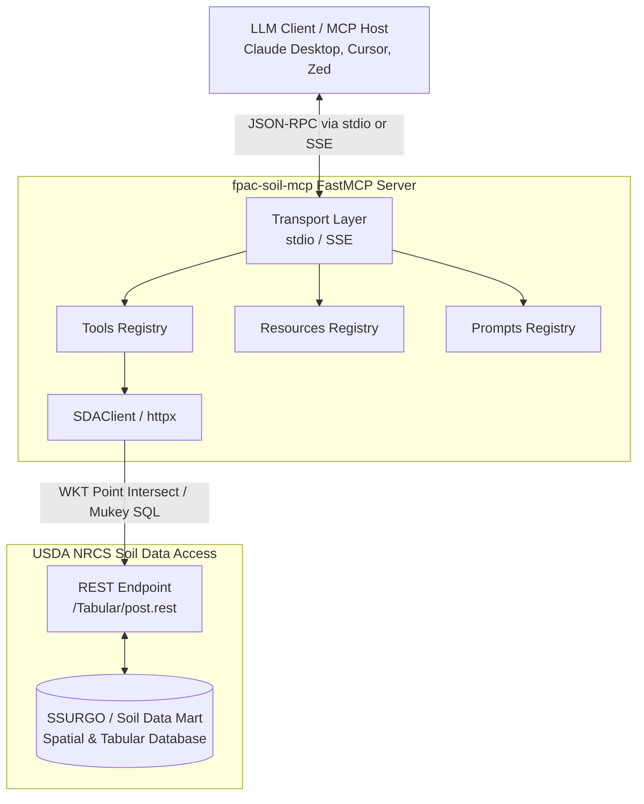

# FPAC Soil MCP Server

[](https://github.com/AndrewBrown-USDA/fpac-soil-mcp/actions/workflows/ci.yml)
[](https://www.python.org/downloads/)
[](https://github.com/jlowin/fastmcp)
[](https://opensource.org/licenses/MIT)

A Model Context Protocol (MCP) server built with [FastMCP](https://github.com/jlowin/fastmcp) that gives LLM clients direct access to USDA Natural Resources Conservation Service (NRCS) **Soil Data Access (SDA)** tabular queries and preliminary **Farmland Protection Policy Act (FPPA)** screening.

---

## Table of Contents

- [Overview](#overview)
- [Architecture & Data Flow](#architecture--data-flow)
- [Features](#features)
- [FPPA Regulatory Scope & Limitations](#fppa-regulatory-scope--limitations)
- [Data Sources & Relationship to py-soildb](#data-sources--relationship-to-py-soildb)
- [Installation & Setup](#installation--setup)
- [Execution Modes](#execution-modes)
- [MCP Client Setup](#mcp-client-setup)
- [Tool Reference](#tool-reference)
- [Resources & Prompts](#resources--prompts)
- [Configuration Reference](#configuration-reference)
- [Development Commands](#development-commands)
- [License](#license)

---

## Overview

Federal projects, environmental reviews (NEPA), agricultural evaluations, and site selection often require checking for **Prime Farmland**, **Unique Farmland**, or **Farmland of Statewide/Local Importance** under USDA NRCS SSURGO datasets and 7 CFR Part 657.

`fpac-soil-mcp` connects LLMs directly to the USDA NRCS Soil Data Access REST API to:
- Find soil map unit keys (`mukey`), symbols (`musym`), names (`muname`), and farmland classification ratings (`farmlndcl`) by geographic coordinates or `mukey`.
- Screen project polygons for farmland categories and Census 2020 urban area exemptions.
- Retrieve soil interpretation ratings (such as NCCPI v3 crop productivity indices).
- Provide MCP Prompts and Resources that explain statutory FPPA boundaries and prevent fabricated Land Evaluation (LE) or Site Assessment (SA) scores.

---

## Architecture & Data Flow



---

## Features

- **Spatial Soil Queries**: Intersects WGS84 coordinates and GeoJSON polygons directly with live USDA Soil Data Mart spatial layers.
- **Mukey Lookups**: Retrieves tabular soil attributes by Map Unit Key.
- **FPPA Screening**: Identifies prime, unique, and statewide important farmland, calculates acreages, and checks Census 2020 urban area boundaries (7 CFR § 658.2(a)).
- **Soil Interpretations**: Fetches component-weighted interpretation ratings like NCCPI v3.
- **Embedded Regulatory Notices**: Attaches 7 CFR Parts 657 & 658 notices to query responses to keep screening distinct from official agency determinations.
- **FastMCP Transports**: Supports stdio for local clients and SSE for network services.
- **Retry Handling**: Retries transient USDA SDA gateway and connection timeouts with exponential backoff.

---

## FPPA Regulatory Scope & Limitations

### 7 CFR Part 657 vs. 7 CFR Part 658

| Regulation | Scope & Authority | Handled by `fpac-soil-mcp`? |
| :--- | :--- | :--- |
| **7 CFR Part 657** | **Farmland Classification.** Defines criteria for Prime Farmland, Unique Farmland, and Farmland of Statewide/Local Importance. | **YES** — Direct live lookup of official SSURGO `farmlndcl` ratings. |
| **7 CFR Part 658** | **Farmland Protection Policy Act Rules.** Governs federal reviews, Land Evaluation and Site Assessment (LESA) scoring (up to 260 points total), and official USDA Form AD-1006 / NRCS-CPA-106 processing. | **NO (Informational Scope Only)** — Preliminary screening only. Official determinations require submission to local USDA NRCS offices. |

### Regulatory Notice

> **IMPORTANT LIMITATION**:
> Query results from this server provide **preliminary soil inventory and farmland classification screening data only** under 7 CFR Part 657. 
> 
> A query **DOES NOT** constitute:
> 1. An official Farmland Protection Policy Act (FPPA) determination under 7 CFR Part 658.
> 2. A completed USDA Form AD-1006 (Farmland Conversion Impact Rating) or Form NRCS-CPA-106.
> 3. An official Land Evaluation (LE) or Site Assessment (SA) score.
> 
> When subject to FPPA rules, project sponsors must submit project boundaries to their local USDA NRCS office for formal review.

---

## Data Sources & Relationship to py-soildb

- **Data Sources**: Tabular and spatial data come from the USDA NRCS **Soil Data Access (SDA)** REST service (`https://sdmdataaccess.nrcs.usda.gov/Tabular/post.rest`) and Census TIGERweb REST APIs.
- **Relationship to `py-soildb`**: While `py-soildb` is an actively maintained package for soil database workflows and serves as a proven reference implementation, `fpac-soil-mcp` implements its own direct SDA query logic. This keeps the server self-contained and lets it manage endpoints and formats (such as GeoJSON clipping and Census urban layers) outside `py-soildb`'s scope without extra dependencies.

---

## Installation & Setup

### Requirements

- **Python**: `>=3.11`
- **Package Manager**: [uv](https://docs.astral.sh/uv/) (recommended) or `pip`

### Using `uv` (Recommended)

```powershell
git clone https://github.com/AndrewBrown-USDA/fpac-soil-mcp.git
Set-Location fpac-soil-mcp
uv sync
```

### Using Standard `pip`

```powershell
python -m venv .venv
.\.venv\Scripts\Activate.ps1
pip install -e .
```

---

## Execution Modes

### Standard I/O (Default, `stdio`)

For local desktop clients such as Claude Desktop, Cursor, and Zed:

```powershell
uv run fpac-soil-mcp
```

### Server-Sent Events (`sse`)

For network services:

```powershell
$env:MCP_TRANSPORT="sse"
$env:MCP_HOST="127.0.0.1"
$env:MCP_PORT="8000"
uv run fpac-soil-mcp
```

### Docker Container

```powershell
docker build -t fpac-soil-mcp .
docker run -i --rm -e MCP_TRANSPORT=stdio fpac-soil-mcp
```

---

## MCP Client Setup

### Claude Desktop

Add to `%APPDATA%\Claude\claude_desktop_config.json` (Windows) or `~/Library/Application Support/Claude/claude_desktop_config.json` (macOS):

```json
{
  "mcpServers": {
    "fpac-soil": {
      "command": "uv",
      "args": [
        "--directory",
        "D:\\workspace\\fpac-soil-mcp",
        "run",
        "fpac-soil-mcp"
      ],
      "env": {
        "MCP_TRANSPORT": "stdio"
      }
    }
  }
}
```

### Cursor

In Cursor's **Features > MCP Servers** settings:

- **Name**: `fpac-soil`
- **Type**: `command`
- **Command**: `uv --directory D:\workspace\fpac-soil-mcp run fpac-soil-mcp`

### Zed

Add to `~/.config/zed/settings.json`:

```json
{
  "context_servers": {
    "fpac-soil": {
      "command": "uv",
      "args": [
        "--directory",
        "D:\\workspace\\fpac-soil-mcp",
        "run",
        "fpac-soil-mcp"
      ]
    }
  }
}
```

---

## Tool Reference

| Tool Name | Parameters | Description |
| :--- | :--- | :--- |
| `get_farmland_classification_by_point` | `latitude` (float, required), `longitude` (float, required) | Queries SDA for soil map unit attributes and farmland classification at a point. |
| `get_farmland_classification_by_mukey` | `mukey` (string, required) | Fetches soil map unit details and farmland classification by Map Unit Key. |
| `analyze_farmland_by_polygon` | `geojson` (dict \| string, required), `include_nccpi` (bool, default `true`) | Performs preliminary FPPA screening on a polygon: calculates acreage, checks 2020 Census urban area exemptions, intersects SSURGO map units with spatial clipping, summarizes farmland categories, and fetches NCCPI v3 ratings. |
| `get_soil_polygons_by_geometry` | `geojson` (dict \| string, required), `clip` (bool, default `true`) | Returns intersecting SSURGO map unit polygon geometries and attributes as a GeoJSON `FeatureCollection`. |
| `check_urban_area_exemption` | `geojson` (dict \| string, required) | Screens point or polygon geometries against Census Bureau 2020 Urban Area boundaries (7 CFR § 658.2(a)). |
| `get_soil_interpretations` | `mukeys` (list[string], required), `rule_name` (string, default NCCPI v3), `aggregation_method` (string, default `'Weighted Average'`) | Fetches component-weighted soil interpretations from USDA SDA for specified map units. |
| `analyze_corridor_fppa` | `centerline` (dict \| string, required), `buffer_distance` (float, required), `buffer_units` (string, default `'feet'`), `indirect_geometry` (dict \| string, optional), `alternatives` (list[dict], optional), `include_nccpi` (bool, default `true`), `site_assessment_inputs` (dict, optional) | Performs multi-county linear corridor FPPA screening (Form NRCS-CPA-106): buffers centerline, erases direct corridor overlap from indirect staging, partitions across Census county boundaries, queries SSURGO/NCCPI, retrieves NASS county agricultural baselines, calculates composite Land Evaluation (LE), and evaluates statutory 7 CFR § 658.5(c) Site Assessment rules and alternatives. |
| `explain_fppa_screening_scope` | None | Explains why SDA preliminary screening (7 CFR 657) differs from formal FPPA LESA reviews and Form AD-1006 (7 CFR 658). |
| `list_farmland_classes` | None | Returns standard USDA NRCS SSURGO Farmland Classification categories, statutory definitions, and 7 CFR citations. |

---

## Resources & Prompts

### Resources

- `fppa://regulatory-notice`: Statutory notice, limitations, and citations.
- `fppa://screening-guidance`: Guidance contrasting 7 CFR 657 inventory queries with 7 CFR 658 AD-1006 reviews.
- `fppa://farmland-classes`: Reference list of SSURGO farmland classification categories.

### Prompts

- `fppa_screening_assistant`: Guided prompt ensuring LLMs maintain regulatory boundaries, avoid score hallucinations, and direct users to local USDA NRCS offices when formal determinations are required.

---

## Configuration Reference

Configure settings via environment variables or a `.env` file:

| Variable | Type | Default | Description |
| :--- | :--- | :--- | :--- |
| `SDA_TABULAR_URL` | string | `https://sdmdataaccess.nrcs.usda.gov/Tabular/post.rest` | USDA NRCS SDA Tabular query endpoint |
| `REQUEST_TIMEOUT_SECONDS` | float | `30.0` | Timeout in seconds for SDA HTTP requests |
| `MAX_RETRIES` | int | `3` | Maximum retry attempts for transient SDA connection errors |
| `NASS_API_KEY` | string | `None` | Optional API key for USDA NASS Quick Stats API |
| `NASS_BASE_URL` | string | `https://quickstats.nass.usda.gov/api/api_GET/` | USDA NASS Quick Stats API GET endpoint |
| `NASS_ENABLED` | boolean | `false` | Enable USDA NASS integration |
| `NASS_CENSUS_YEAR` | int | `2022` | Baseline Census of Agriculture year |
| `TIGERWEB_REST_URL` | string | `https://tigerweb.geo.census.gov/.../0` | Census TIGERweb 2020 Urban Areas MapServer Layer 0 |
| `TIGERWEB_URBAN_LAYER_ID` | int | `0` | Layer index for 2020 Census Urban Areas |
| `TIGERWEB_TIMEOUT_SECONDS` | float | `15.0` | Timeout in seconds for TIGERweb queries |
| `MCP_TRANSPORT` | string | `stdio` | FastMCP transport mode (`stdio` or `sse`) |
| `MCP_HOST` | string | `127.0.0.1` | Host to bind for SSE transport |
| `MCP_PORT` | int | `8000` | Port to bind for SSE transport |

---

## Development Commands

```powershell
# Run unit tests with mocked SDA responses
uv run pytest

# Run live SDA integration tests (requires network access)
uv run pytest -m live_sda

# Check linting
uv run ruff check .

# Check formatting
uv run ruff format --check .
```

---

## License

This project is licensed under the MIT License. See [LICENSE](LICENSE) for details.
