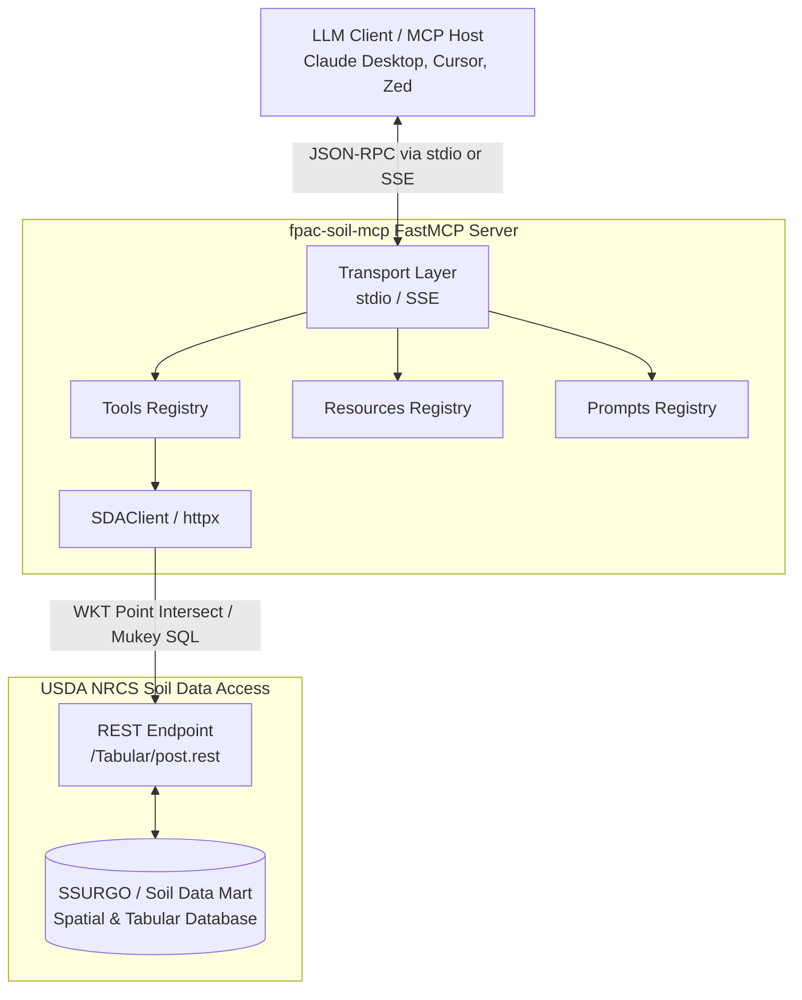

# FPAC Soil MCP Server

[](https://www.python.org/downloads/)
[](https://github.com/jlowin/fastmcp)
[](https://opensource.org/licenses/MIT)

A standard Model Context Protocol (MCP) server built with [FastMCP](https://github.com/jlowin/fastmcp) to provide LLM clients with direct, verified access to USDA Natural Resources Conservation Service (NRCS) **Soil Data Access (SDA)** tabular queries and preliminary **Farmland Protection Policy Act (FPPA)** screening.

---

## Table of Contents

- [Overview](#overview)
- [Architecture & Data Flow](#architecture--data-flow)
- [Key Features](#key-features)
- [FPPA Legal Context & Regulatory Disclaimers](#fppa-legal-context--regulatory-disclaimers)
- [Data Provenance & py-soildb Disclosure](#data-provenance--py-soildb-disclosure)
- [Installation & Setup](#installation--setup)
- [Execution Modes](#execution-modes)
- [MCP Client Configurations](#mcp-client-configurations)
  - [Claude Desktop](#claude-desktop)
  - [Cursor](#cursor)
  - [Zed](#zed)
- [Tool Reference](#tool-reference)
- [Resources & Prompts](#resources--prompts)
- [Configuration Reference](#configuration-reference)
- [Development & QA Commands](#development--qa-commands)
- [License](#license)

---

## Overview

Federal projects, environmental reviews (NEPA), agricultural evaluations, and infrastructure siting often require checking whether a property or parcel contains **Prime Farmland**, **Unique Farmland**, or **Farmland of Statewide/Local Importance** as classified under USDA NRCS SSURGO datasets and 7 CFR Part 657.

`fpac-soil-mcp` connects LLMs directly to the live USDA NRCS Soil Data Access REST query API, allowing agents to:
1. Lookup soil map unit keys (`mukey`), symbols (`musym`), names (`muname`), and official farmland classification designations (`farmlndcl`) via geographic coordinates (WGS84 lat/lon) or explicit `mukey`.
2. Inspect regulatory descriptions of official farmland classification categories.
3. Retrieve structured explanations distinguishing preliminary soil screening from full Land Evaluation and Site Assessment (LESA) determinations.
4. Access standardized MCP Prompts and Resources that reinforce statutory FPPA boundaries and prevent LLM hallucination of Land Evaluation (LE) or Site Assessment (SA) scores.

---

## Architecture & Data Flow



---

## Key Features

- **Live SSURGO Spatial Queries**: Performs spatial point-in-polygon queries against the live USDA Soil Data Mart using WGS84 coordinates.
- **Mukey Direct Lookup**: Fetches comprehensive tabular soil details directly by SSURGO Map Unit Key.
- **Strict FPPA Regulatory Compliance**: Embeds mandatory 7 CFR Parts 657 & 658 disclaimers and warnings directly into tool responses, preventing AI assistants from claiming Form AD-1006 compliance prematurely.
- **MCP Native**: Full support for FastMCP Tools, Resources (`fppa://...`), and Prompts (`fppa_screening_assistant`).
- **Flexible Transports**: Supports both standard input/output (`stdio`) for desktop hosts and Server-Sent Events (`sse`) for networked deployments.
- **Robust Networking**: Automatic retries with exponential backoff on transient SDA gateway and connection timeouts.

---

## FPPA Legal Context & Regulatory Disclaimers

### 7 CFR Part 657 vs. 7 CFR Part 658

| Regulation | Scope & Authority | Handled by `fpac-soil-mcp`? |
| :--- | :--- | :--- |
| **7 CFR Part 657** | **Classification of Prime Farmland, Unique Farmland, and Additional Farmland of Statewide and Local Importance.** Defines technical criteria and soil inventory attributes. | **YES** — Direct live lookup of official SSURGO `farmlndcl` classifications. |
| **7 CFR Part 658** | **Farmland Protection Policy Act (FPPA) Rules & Regulations.** Governs federal agency reviews, Land Evaluation and Site Assessment (LESA) scoring (up to 260 points total: 100 LE + 160 SA), and official USDA Form AD-1006 / NRCS-CPA-106 processing. | **NO (Informational Scope Only)** — Preliminary screening only. Formal determination requires submission to local USDA NRCS state/field offices. |

### Mandatory Regulatory Notice

> **IMPORTANT REGULATORY LIMITATION**:
> Query results from this server provide **preliminary soil inventory and farmland classification screening data only** under 7 CFR Part 657. 
> 
> A soil query **DOES NOT** constitute:
> 1. An official Farmland Protection Policy Act (FPPA) determination under 7 CFR Part 658.
> 2. A completed USDA Form AD-1006 (Farmland Conversion Impact Rating) or Form NRCS-CPA-106.
> 3. An official Land Evaluation (LE) score or Site Assessment (SA) score.
> 
> Federal agencies, grant recipients, and project sponsors must submit proposed project corridors or footprints to the local USDA NRCS state or field office for official evaluation when subject to FPPA rules.

---

## Data Provenance & py-soildb Disclosure

- **Data Origin**: Tabular and spatial data are served directly from the USDA NRCS **Soil Data Access (SDA)** REST web service (`https://sdmdataaccess.nrcs.usda.gov/Tabular/post.rest`).
- **SSURGO Snapshot**: SDA queries live Soil Survey Geographic Database (SSURGO) tables maintained by the National Cooperative Soil Survey (NCSS).
- **py-soildb Relationship**: `fpac-soil-mcp` is an independent, lightweight FastMCP server designed for direct REST integration with SDA. It is not affiliated with or dependent upon legacy Python packages such as `py-soildb`, executing optimized SQL queries directly against USDA endpoints with zero heavy geospatial binary dependencies.

---

## Installation & Setup

### Prerequisites

- **Python**: `>=3.11`
- **Package Manager**: [uv](https://docs.astral.sh/uv/) (recommended) or standard `pip`
- **Optional**: Docker (for containerized deployments)

### Using `uv` (Recommended)

```powershell
# Clone the repository
git clone https://github.com/AndrewBrown-USDA/fpac-soil-mcp.git
Set-Location fpac-soil-mcp

# Create environment and install dependencies
uv sync
```

### Using Standard `pip`

```powershell
python -m venv .venv
.\.venv\Scripts\Activate.ps1
pip install -e .
```

---

## Execution Modes

### 1. Standard I/O Mode (Default, `stdio`)

Recommended for local MCP clients such as Claude Desktop, Cursor, and Zed.

```powershell
uv run fpac-soil-mcp
```

### 2. Server-Sent Events Mode (`sse`)

For network-accessible or remote microservice deployments.

```powershell
$env:MCP_TRANSPORT="sse"
$env:MCP_HOST="127.0.0.1"
$env:MCP_PORT="8000"
uv run fpac-soil-mcp
```

### 3. Docker Container

```powershell
docker build -t fpac-soil-mcp .
docker run -i --rm -e MCP_TRANSPORT=stdio fpac-soil-mcp
```

---

## MCP Client Configurations

### Claude Desktop

Add `fpac-soil-mcp` to your `%APPDATA%\Claude\claude_desktop_config.json` (Windows) or `~/Library/Application Support/Claude/claude_desktop_config.json` (macOS):

```json
{
  "mcpServers": {
    "fpac-soil": {
      "command": "uv",
      "args": [
        "--directory",
        "D:\\workspace\\fpac-soil-mcp",
        "run",
        "fpac-soil-mcp"
      ],
      "env": {
        "MCP_TRANSPORT": "stdio"
      }
    }
  }
}
```

### Cursor

In Cursor's **Features > MCP Servers** settings, add a new server:

- **Name**: `fpac-soil`
- **Type**: `command`
- **Command**: `uv --directory D:\workspace\fpac-soil-mcp run fpac-soil-mcp`

### Zed

Add to your `~/.config/zed/settings.json`:

```json
{
  "context_servers": {
    "fpac-soil": {
      "command": "uv",
      "args": [
        "--directory",
        "D:\\workspace\\fpac-soil-mcp",
        "run",
        "fpac-soil-mcp"
      ]
    }
  }
}
```

---

## Tool Reference

### `get_farmland_classification_by_point`

Query USDA NRCS SDA for soil map unit attributes and farmland classification at a point using WGS84 geographic coordinates.

**Parameters:**
- `latitude` (*float*, required): Latitude in decimal degrees `[-90.0, 90.0]`.
- `longitude` (*float*, required): Longitude in decimal degrees `[-180.0, 180.0]`.

**Response Model (`FarmlandClassificationResponse`):**
```json
{
  "query_type": "point",
  "input_query": {
    "latitude": 41.8781,
    "longitude": -93.0977
  },
  "coverage_status": "covered",
  "map_units": [
    {
      "mukey": "408013",
      "musym": "138B",
      "muname": "Clarion loam, 2 to 6 percent slopes",
      "farmlndcl": "All areas are prime farmland",
      "areasymbol": "IA169"
    }
  ],
  "source": {
    "endpoint": "https://sdmdataaccess.nrcs.usda.gov/Tabular/post.rest",
    "timestamp_utc": "2026-09-16T16:15:00.000000Z"
  },
  "limitations": [
    "Preliminary soil inventory query only under 7 CFR Part 657.",
    "Does not constitute an official FPPA determination or Form AD-1006 completion under 7 CFR Part 658."
  ],
  "regulatory_notice": "..."
}
```

---

### `get_farmland_classification_by_mukey`

Query USDA NRCS SDA for soil map unit details and farmland classification by Map Unit Key (`mukey`).

**Parameters:**
- `mukey` (*string*, required): SSURGO Map Unit Key (numeric string).

---

### `explain_fppa_screening_scope`

Provides an authoritative regulatory breakdown distinguishing preliminary SDA soil screening (7 CFR 657) from formal FPPA Land Evaluation & Site Assessment (LESA) scoring and Form AD-1006 determinations (7 CFR 658).

---

### `list_farmland_classes`

Returns all standardized USDA NRCS SSURGO Farmland Classification categories (`mapunit.farmlndcl`), their statutory definitions, FPPA relevance, and 7 CFR citations.

---

## Resources & Prompts

### Resources

- `fppa://regulatory-notice`: Official statutory notice, limitations, and citations.
- `fppa://screening-guidance`: In-depth guidance contrasting 7 CFR 657 inventory queries with 7 CFR 658 AD-1006 forms.
- `fppa://farmland-classes`: Reference schema of all standard SSURGO farmland class categories.

### Prompts

- `fppa_screening_assistant`: Guided prompt ensuring LLMs maintain strict regulatory discipline, avoid score hallucinations, and properly direct users to local USDA NRCS offices.

---

## Configuration Reference

Settings can be configured via environment variables or a `.env` file:

| Variable | Type | Default | Description |
| :--- | :--- | :--- | :--- |
| `SDA_TABULAR_URL` | string | `https://sdmdataaccess.nrcs.usda.gov/Tabular/post.rest` | USDA NRCS SDA Tabular query endpoint |
| `REQUEST_TIMEOUT_SECONDS` | float | `30.0` | HTTP request timeout in seconds |
| `MAX_RETRIES` | int | `3` | Maximum retry attempts for transient SDA connection errors |
| `MCP_TRANSPORT` | string | `stdio` | FastMCP transport mode (`stdio` or `sse`) |
| `MCP_HOST` | string | `127.0.0.1` | Host to bind for SSE transport |
| `MCP_PORT` | int | `8000` | Port to bind for SSE transport |

---

## Development & QA Commands

```powershell
# Run the test suite (unit tests with mocked SDA responses)
uv run pytest

# Run live SDA integration tests (requires active internet access)
uv run pytest -m live_sda

# Run code style and lint checks
uv run ruff check .

# Run auto-formatting checks
uv run ruff format --check .
```

---

## License

This project is licensed under the MIT License. See [LICENSE](LICENSE) for details.

