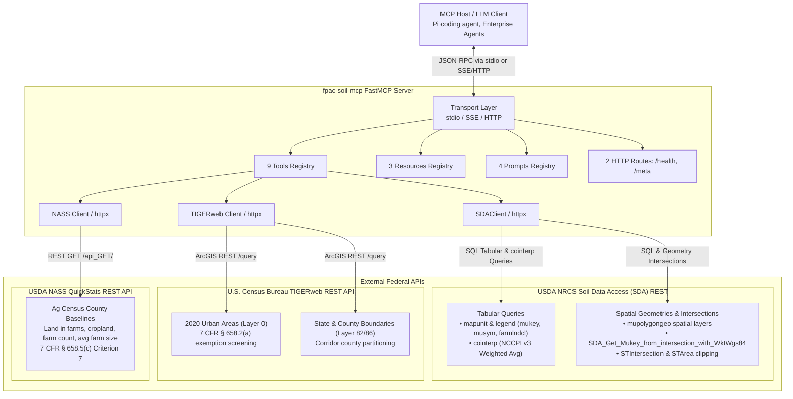

# FPAC Soil MCP Server

[](https://github.com/AndrewBrown-USDA/fpac-soil-mcp/actions/workflows/ci.yml)
[](https://www.python.org/downloads/)
[](https://github.com/jlowin/fastmcp)
[](https://opensource.org/licenses/MIT)

A Model Context Protocol (MCP) server built with [FastMCP](https://github.com/jlowin/fastmcp) that gives LLM clients direct access to USDA Natural Resources Conservation Service (NRCS) **Soil Data Access (SDA)** spatial geometry layers and tabular SSURGO queries, integrated with U.S. Census Bureau and USDA NASS services for preliminary **Farmland Protection Policy Act (FPPA)** screening.

---

## Table of Contents

- [Overview](#overview)
- [Architecture & Data Flow](#architecture--data-flow)
- [Features](#features)
- [FPPA Regulatory Scope & Limitations](#fppa-regulatory-scope--limitations)
- [Data Sources & Relationship to py-soildb](#data-sources--relationship-to-py-soildb)
- [Installation & Setup](#installation--setup)
- [Execution Modes](#execution-modes)
- [Standard MCP Client Configuration](#standard-mcp-client-configuration)
- [Tool Reference](#tool-reference)
- [Resources, Prompts & HTTP Routes](#resources-prompts--http-routes)
- [Configuration Reference](#configuration-reference)
- [Development Commands](#development-commands)
- [License](#license)

---

## Overview

Federal projects, environmental reviews (NEPA), agricultural evaluations, and site selection often require checking for **Prime Farmland**, **Unique Farmland**, or **Farmland of Statewide/Local Importance** under USDA NRCS SSURGO datasets and 7 CFR Part 657.

`fpac-soil-mcp` connects LLMs directly to upstream federal REST APIs to:
- Retrieve **both spatial geometry layers and tabular SSURGO attributes** from USDA NRCS Soil Data Access (SDA):
  - Spatial intersections and geometries (`mupolygongeo`, `SDA_Get_Mukey_from_intersection_with_WktWgs84`, `STIntersection`/`STArea`) with exact clipping.
  - Tabular queries across SSURGO `mapunit`, `legend`, and `cointerp` component-weighted NCCPI v3 crop productivity indices.
- Screen project coordinates and polygons for farmland classification ratings (`farmlndcl`), prime/unique farmland acreages, and Census 2020 urban area exemptions.
- Query U.S. Census Bureau TIGERweb REST APIs for 2020 Urban Areas (Layer 0 for 7 CFR § 658.2(a) exemption screening) and State/County Boundaries (MapServer Layer 82/86 or Layer 1 for multi-county corridor partitioning).
- Query USDA NASS QuickStats REST API for Agricultural Census county baselines (land in farms, cropland, farm count, average farm size for 7 CFR § 658.5(c) Criterion 7).
- Provide MCP Prompts and Resources that explain statutory FPPA boundaries and prevent fabricated Land Evaluation (LE) or Site Assessment (SA) scores.

---

## Architecture & Data Flow



---

## Features

- **Spatial Soil Queries**: Intersects WGS84 coordinates and GeoJSON polygons directly with live USDA Soil Data Mart spatial layers.
- **Mukey Lookups**: Retrieves tabular soil attributes by Map Unit Key.
- **FPPA Screening**: Identifies prime, unique, and statewide important farmland, calculates acreages, and checks Census 2020 urban area boundaries (7 CFR § 658.2(a)).
- **Soil Interpretations**: Fetches component-weighted interpretation ratings like NCCPI v3.
- **Multi-County Corridor Analysis & CPA-106 Rules**: Partitions linear corridor geometries across TIGERweb county boundaries, performs area-weighted composite Land Evaluation (LE) scoring (including for project alternatives), aggregates multi-county Criterion 7 farm size benchmarks from USDA NASS agricultural profiles, and enforces statutory 7 CFR § 658.5(c) / § 658.4(c) rules with strict sum reconciliation audits.
- **Embedded Regulatory Notices**: Attaches 7 CFR Parts 657 & 658 notices to query responses to keep screening distinct from official agency determinations.
- **FastMCP Transports**: Supports stdio for local clients and SSE for network services.
- **Retry Handling**: Retries transient USDA SDA gateway and connection timeouts with exponential backoff.

---

## FPPA Regulatory Scope & Limitations

### 7 CFR Part 657 vs. 7 CFR Part 658

| Regulation | Scope & Authority | Handled by `fpac-soil-mcp`? |
| :--- | :--- | :--- |
| **7 CFR Part 657** | **Farmland Classification.** Defines criteria for Prime Farmland, Unique Farmland, and Farmland of Statewide/Local Importance. | **YES** — Direct live lookup of official SSURGO `farmlndcl` ratings. |
| **7 CFR Part 658** | **Farmland Protection Policy Act Rules.** Governs federal reviews, Land Evaluation and Site Assessment (LESA) scoring (up to 260 points total), and official USDA Form AD-1006 / NRCS-CPA-106 processing. | **NO (Informational Scope Only)** — Preliminary screening only. Official determinations require submission to local USDA NRCS offices. |

### Regulatory Notice

> **IMPORTANT LIMITATION**:
> Query results from this server provide **preliminary soil inventory and farmland classification screening data only** under 7 CFR Part 657. 
> 
> A query **DOES NOT** constitute:
> 1. An official Farmland Protection Policy Act (FPPA) determination under 7 CFR Part 658.
> 2. A completed USDA Form AD-1006 (Farmland Conversion Impact Rating) or Form NRCS-CPA-106.
> 3. An official Land Evaluation (LE) or Site Assessment (SA) score.
> 
> When subject to FPPA rules, project sponsors must submit project boundaries to their local USDA NRCS office for formal review.

---

## Data Sources & Relationship to py-soildb

- **Data Sources**: Both spatial geometry layers (`mupolygongeo`, spatial intersections, clipping) and tabular SSURGO attributes (`mapunit`, `legend`, `cointerp` NCCPI ratings) come from the USDA NRCS **Soil Data Access (SDA)** REST service (`https://sdmdataaccess.nrcs.usda.gov/Tabular/post.rest`). Urban boundaries and county partitioning layers are retrieved from the U.S. Census Bureau **TIGERweb** REST APIs, and agricultural census baselines are queried from the USDA **NASS QuickStats** REST API.
- **Relationship to `py-soildb`**: While `py-soildb` is an actively maintained package for soil database workflows and serves as a proven reference implementation, `fpac-soil-mcp` implements its own direct SDA query logic. This keeps the server self-contained and lets it manage endpoints and formats (such as GeoJSON clipping and Census urban layers) outside `py-soildb`'s scope without extra dependencies.

---

## Installation & Setup

### Requirements

- **Python**: `>=3.11`
- **Package Manager**: [uv](https://docs.astral.sh/uv/) (recommended) or `pip`

### Using `uv` (Recommended)

```powershell
git clone https://github.com/AndrewBrown-USDA/fpac-soil-mcp.git
Set-Location fpac-soil-mcp
uv sync
```

### Using Standard `pip`

```powershell
python -m venv .venv
.\.venv\Scripts\Activate.ps1
pip install -e .
```

---

## Execution Modes

The server is built with FastMCP and supports local command execution as well as enterprise containerized deployment (e.g., in IBM Cloud or Databricks container/job environments):

- **Standard I/O (`stdio`)**: Default mode for local MCP clients and CLI agents.
- **Server-Sent Events (`sse`)** / **HTTP**: Network mode for remote or containerized MCP hosting.
- **Environment Targeting**: Tested locally with the Pi coding agent and configured for enterprise container execution.

### Local Stdio

```powershell
uv run fpac-soil-mcp
```

### Network SSE / HTTP

```powershell
$env:MCP_TRANSPORT="sse"
$env:MCP_HOST="0.0.0.0"
$env:MCP_PORT="8000"
uv run fpac-soil-mcp
```

### Docker Container

The repository includes a production multi-stage `Dockerfile` with dedicated build and slim runtime stages (`ghcr.io/astral-sh/uv:python3.11-bookworm-slim`), non-root `appuser` execution, and a built-in container health check.

```powershell
# Build container image
docker build -t fpac-soil-mcp .

# Run container over stdio
docker run -i --rm -e MCP_TRANSPORT=stdio fpac-soil-mcp

# Run container over SSE / HTTP
docker run -d --rm -p 8000:8000 -e MCP_TRANSPORT=sse -e MCP_HOST=0.0.0.0 -e MCP_PORT=8000 --name fpac-soil-mcp fpac-soil-mcp
```

---

## Standard MCP Client Configuration

Standard boilerplate JSON configuration snippets for any standard MCP host.

### Standard I/O (`stdio`) Boilerplate

```json
{
  "mcpServers": {
    "fpac-soil": {
      "command": "uv",
      "args": [
        "--directory",
        "/path/to/fpac-soil-mcp",
        "run",
        "fpac-soil-mcp"
      ],
      "env": {
        "MCP_TRANSPORT": "stdio"
      }
    }
  }
}
```

*Note for Windows hosts: use Windows-style directory paths (e.g., `"D:\\workspace\\fpac-soil-mcp"`).*

### Network / Remote (`sse` or `http`) Boilerplate

```json
{
  "mcpServers": {
    "fpac-soil": {
      "url": "http://127.0.0.1:8000/sse"
    }
  }
}
```

---

## Tool Reference

The server exposes **9 core MCP tools** for spatial soil query, farmland classification, and corridor assessment:

| Tool Name | Parameters | Description |
| :--- | :--- | :--- |
| `get_farmland_classification_by_point` | `latitude` (float, required), `longitude` (float, required) | Queries SDA for soil map unit attributes and farmland classification at a point. |
| `get_farmland_classification_by_mukey` | `mukey` (string, required) | Fetches soil map unit details and farmland classification by Map Unit Key. |
| `analyze_farmland_by_polygon` | `geojson` (dict \| string, required), `include_nccpi` (bool, default `true`) | Performs preliminary FPPA screening on a polygon: calculates acreage, checks 2020 Census urban area exemptions, intersects SSURGO map units with spatial clipping, summarizes farmland categories, and fetches NCCPI v3 ratings. |
| `get_soil_polygons_by_geometry` | `geojson` (dict \| string, required), `clip` (bool, default `true`) | Returns intersecting SSURGO map unit polygon geometries and attributes as a GeoJSON `FeatureCollection`. |
| `check_urban_area_exemption` | `geojson` (dict \| string, required) | Screens point or polygon geometries against Census Bureau 2020 Urban Area boundaries (7 CFR § 658.2(a)). |
| `get_soil_interpretations` | `mukeys` (list[string], required), `rule_name` (string, default NCCPI v3), `aggregation_method` (string, default `'Weighted Average'`) | Fetches component-weighted soil interpretations from USDA SDA for specified map units. |
| `analyze_corridor_fppa` | `centerline` (dict \| string, required), `buffer_distance` (float, required), `buffer_units` (string, default `'feet'`), `indirect_geometry` (dict \| string, optional), `alternatives` (list[dict], optional), `include_nccpi` (bool, default `true`), `site_assessment_inputs` (dict, optional) | Performs multi-county linear corridor FPPA screening (Form NRCS-CPA-106): buffers centerline, erases direct corridor overlap from indirect staging, partitions across Census county boundaries, queries SSURGO/NCCPI, retrieves NASS county agricultural baselines, calculates composite Land Evaluation (LE), and evaluates statutory 7 CFR § 658.5(c) Site Assessment rules and alternatives. |
| `explain_fppa_screening_scope` | None | Explains why SDA preliminary screening (7 CFR 657) differs from formal FPPA LESA reviews and Form AD-1006 (7 CFR 658). |
| `list_farmland_classes` | None | Returns standard USDA NRCS SSURGO Farmland Classification categories, statutory definitions, and 7 CFR citations. |

---

## Resources, Prompts & HTTP Routes

### Resources (3)

- `fppa://regulatory-notice`: Statutory notice, legal limitations, and formal 7 CFR Parts 657 & 658 citations.
- `fppa://screening-guidance`: Guidance distinguishing preliminary soil inventory queries from full LESA scoring and Form AD-1006 / NRCS-CPA-106 workflows.
- `fppa://farmland-classes`: Reference listing of SSURGO farmland classification categories and statutory criteria.

### Prompts (4)

- `fppa_screening_assistant`: Guided prompt template ensuring LLMs maintain regulatory boundaries, avoid score hallucinations, preserve SDA categories, and direct project sponsors to local USDA NRCS offices for formal determinations. Supports `project_name`, `location`, and `geometry_type` arguments.
- `fppa_corridor_screening_assistant`: Guided prompt template for linear infrastructure corridor screening (highways, pipelines, utility corridors). Guides multi-county partitioning, application of statutory 7 CFR § 658.5(c) rules (Criteria 5 & 6 zeroed, Criteria 8 & 11 increased to 25 pts), and Form NRCS-CPA-106 evaluation. Supports `project_name` and `corridor_length_miles` arguments.
- `fppa_urban_exemption_assistant`: Guided prompt template for evaluating statutory 7 CFR § 658.2(a) urban area exemptions using Census 2020 Urban Areas Layer 0 screening and density documentation. Supports `project_name` and `jurisdiction` arguments.
- `fppa_site_assessment_assistant`: Guided prompt template for Part VI Site Assessment (7 CFR § 658.5) scoring, 160/220 point statutory decision thresholds, Land Evaluation (LE) score handling, and Form AD-1006 vs NRCS-CPA-106 selection. Supports `project_name` and `evaluation_type` arguments.

### Multi-Turn Workflow Example (Flow A: Linear Transmission Corridor & CPA-106 LESA)

```text
User:
"We are preparing NEPA documentation for a 23.2-mile 161kV transmission line project traversing Story and Marshall counties in Iowa. Centerline: LINESTRING(-93.35 42.03, -93.15 42.03, -92.90 42.05). Right-of-way requires a 50-foot buffer on each side (100-ft total width), plus a laydown yard at POLYGON((-93.16 42.02, -93.14 42.02, -93.14 42.04, -93.16 42.04, -93.16 42.02)). Include this Part VI payload with non-corridor site criteria 1–3 inputs (7 CFR § 658.5(c) rules apply): {\"site_assessment_inputs\":{\"project_farm_acres\":350,\"criteria_inputs\":{\"1\":{\"awarded_points\":8,\"justification\":\"Rural zoning; no urban services.\"},\"2\":{\"awarded_points\":7,\"justification\":\"No existing nonfarm development on the tract.\"},\"3\":{\"awarded_points\":6,\"justification\":\"No protected lands identified in the project record.\"}}}}. Can you run a corridor analysis, partition by county, fetch agricultural baselines, and evaluate our Form NRCS-CPA-106 LESA score?"

Assistant (Invoking analyze_corridor_fppa):
1. Buffers centerline by 50 feet in equal-area projection (EPSG:6933).
2. Topologically erases direct ROW overlap from the laydown yard to prevent double-counting.
3. Partitions corridor across Census TIGERweb county boundaries (Story FIPS 19169, Marshall FIPS 19127).
4. Queries SDA for intersecting SSURGO map units and component-weighted NCCPI ratings per segment.
5. Queries NASS QuickStats for county average farm sizes and cropland baselines.
6. Calculates composite Land Evaluation (LE) and executes 7 CFR § 658.5(c) Site Assessment (Criteria 5 & 6 zeroed; Criterion 7 auto-scored; Criteria 8 & 11 evaluated at 25 max pts).
7. Audits and reconciles multi-county acreage sums.

Output:
- Total Impact Area: calculated corridor and non-overlapping staging yard area (illustrative corridor screening run).
- Farmland Protected: 279.68 acres (illustrative result; 95.5% Prime Farmland / Statewide Importance).
- Total LESA Score: 182.2 / 260 points (LE: 84.2, SA: 98.0).
- Statutory Determination (7 CFR § 658.4(c)(2)): Total score >= 160 points; sponsoring agency must evaluate alternative alignments or mitigation to minimize conversion.
- Mandatory Notice: Preliminary inventory estimate. Official Form NRCS-CPA-106 processing requires coordination with the USDA NRCS State Conservationist.
```

### HTTP Routes (2)

When running under network transport modes (`sse` or `http`), the server exposes two operational endpoints:

- `GET /health`: Health-check endpoint returning service status, transport mode, and UTC timestamp.
- `GET /meta`: Metadata endpoint detailing service capabilities, SDA backend endpoint, and statutory citations.

---

## Configuration Reference

Configure settings via environment variables or a `.env` file (see [`.env.example`](.env.example)):

| Variable | Type | Default | Description |
| :--- | :--- | :--- | :--- |
| `SDA_TABULAR_URL` | string | `https://sdmdataaccess.nrcs.usda.gov/Tabular/post.rest` | USDA NRCS SDA Tabular query endpoint |
| `REQUEST_TIMEOUT_SECONDS` | float | `30.0` | Timeout in seconds for SDA HTTP requests |
| `MAX_RETRIES` | int | `3` | Maximum retry attempts for transient SDA connection errors |
| `NASS_API_KEY` | string | `None` | Optional API key for USDA NASS Quick Stats API |
| `NASS_BASE_URL` | string | `https://quickstats.nass.usda.gov/api/api_GET/` | USDA NASS Quick Stats API GET endpoint |
| `NASS_ENABLED` | boolean | `false` | Enable USDA NASS integration |
| `NASS_CENSUS_YEAR` | int | `2022` | Baseline Census of Agriculture year |
| `TIGERWEB_REST_URL` | string | `https://tigerweb.geo.census.gov/arcgis/rest/services/TIGERweb/Urban/MapServer/0` | Census TIGERweb 2020 Urban Areas MapServer Layer 0 |
| `TIGERWEB_URBAN_LAYER_ID` | int | `0` | Layer index for 2020 Census Urban Areas |
| `TIGERWEB_TIMEOUT_SECONDS` | float | `15.0` | Timeout in seconds for TIGERweb queries |
| `MCP_TRANSPORT` | string | `stdio` | FastMCP transport mode (`stdio` or `sse`) |
| `MCP_HOST` | string | `127.0.0.1` | Host to bind for network transport |
| `MCP_PORT` | int | `8000` | Port to bind for network transport |

---

## Development Commands

```powershell
# Run unit and mocked tests (offline default)
uv run pytest -m "not live_network"

# Run all unit tests
uv run pytest

# Run live network integration tests (requires network access)
uv run pytest -m live_network

# Check linting
uv run ruff check .

# Check formatting
uv run ruff format --check .
```

---

## License

This project is licensed under the MIT License. See [LICENSE](LICENSE) for details.
