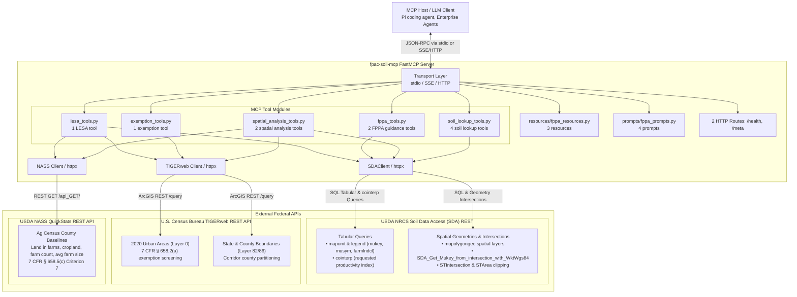

# FPAC Soil MCP Server

[](https://github.com/AndrewBrown-USDA/fpac-soil-mcp/actions/workflows/ci.yml)
[](https://www.python.org/downloads/)
[](https://github.com/jlowin/fastmcp)
[](https://opensource.org/licenses/MIT)

A Model Context Protocol (MCP) server built with [FastMCP](https://github.com/jlowin/fastmcp) that gives LLM clients direct access to USDA Natural Resources Conservation Service (NRCS) **Soil Data Access (SDA)** spatial geometry layers and tabular SSURGO queries, integrated with U.S. Census Bureau and USDA NASS services for preliminary **Farmland Protection Policy Act (FPPA)** screening.

---

## Table of Contents

- [Overview](#overview)
- [Architecture & Data Flow](#architecture--data-flow)
- [Features](#features)
- [FPPA Regulatory Scope & Limitations](#fppa-regulatory-scope--limitations)
- [Data Sources & Relationship to py-soildb](#data-sources--relationship-to-py-soildb)
- [Installation & Setup](#installation--setup)
- [Execution Modes](#execution-modes)
- [Standard MCP Client Configuration](#standard-mcp-client-configuration)
- [Tool Reference](#tool-reference)
- [Resources, Prompts & HTTP Routes](#resources-prompts--http-routes)
- [Configuration Reference](#configuration-reference)
- [Development Commands](#development-commands)
- [Local Deterministic Browser Harness](#local-deterministic-browser-harness)
- [License](#license)

---

## Overview

Federal projects, environmental reviews (NEPA), agricultural evaluations, and site selection often require checking for **Prime Farmland**, **Unique Farmland**, or **Farmland of Statewide/Local Importance** under USDA NRCS SSURGO datasets and 7 CFR Part 657.

`fpac-soil-mcp` connects LLMs directly to upstream federal REST APIs to:
- Retrieve **both spatial geometry layers and tabular SSURGO attributes** from USDA NRCS Soil Data Access (SDA):
  - Spatial intersections and geometries (`mupolygongeo`, `SDA_Get_Mukey_from_intersection_with_WktWgs84`, `STIntersection`/`STArea`) with exact clipping.
  - Tabular queries across SSURGO `mapunit`, `legend`, and `cointerp` component-weighted crop productivity interpretations.
- Screen project coordinates and polygons for farmland classification ratings (`farmlndcl`), prime/unique farmland acreages, and Census 2020 urban area exemptions.
- Query U.S. Census Bureau TIGERweb REST APIs for 2020 Urban Areas (Layer 0 for 7 CFR § 658.2(a) exemption screening) and State/County Boundaries (MapServer Layer 82/86 or Layer 1 for multi-county corridor partitioning).
- Query USDA NASS QuickStats REST API for Agricultural Census county baselines (land in farms, cropland, farm count, average farm size for 7 CFR § 658.5(c) Criterion 7).
- Provide MCP Prompts and Resources that explain statutory FPPA boundaries and prevent fabricated Land Evaluation (LE) or Site Assessment (SA) scores.

---

## Architecture & Data Flow



---

## Features

- **Spatial Soil Queries**: Intersects WGS84 coordinates and GeoJSON polygons directly with live USDA Soil Data Mart spatial layers.
- **Mukey Lookups**: Retrieves tabular soil attributes by Map Unit Key.
- **FPPA Screening**: Identifies prime, unique, and statewide important farmland, calculates acreages, and checks Census 2020 urban area boundaries (7 CFR § 658.2(a)).
- **Soil Interpretations**: Fetches component-weighted interpretation ratings for the requested productivity index.
- **Generic productivity contract**: Polygon, LESA, and corridor results expose `productivity_rating`, `productivity_rating_class`, and `productivity_rating_source` for the validated `NCCPI`, `CSR2`, `CPI`, and `STORIE` selectors. Selector aliases include `nccpi_v3`/the national index name, the Iowa CSR2 name, `crop productivity index`, and the California Revised Storie rule name. STORIE uses the SDV Dominant Condition method (the rating held by the largest combined component percentage in the map unit), not a component-weighted average. CPI follows the SDV "nulls as zero" setting: components without a CPI value count as 0 when the map unit has other rated components, and map units with no CPI data stay unrated. NCCPI and STORIE use a 0–1 scale with three-decimal response precision; CSR2 uses a 5–100 scale and CPI uses a 1–100 scale, both with integer response precision. Provenance identifies the SDA source (`SDA:NCCPI_V3`, `SDA:MAPUNIT_IACORNSR`, `SDA:COMPONENT_CROPPRODINDEX`, or `SDA:COINTERP_STORIE_CA`). Index-aware unrated sentinels are excluded before aggregation; valid CSR2/CPI `99.0` remains rated. `max_county_rating_override` optionally supplies a validated normalization benchmark; otherwise the selected index's per-area-symbol county benchmark is used. The former `nccpi_rating` and `nccpi_class` aliases are intentionally removed from the public response schema.
- **Multi-County Corridor Analysis & CPA-106 Rules**: Partitions linear corridor geometries across TIGERweb county boundaries, performs area-weighted composite Land Evaluation (LE) scoring (including for project alternatives), aggregates multi-county Criterion 7 farm size benchmarks from USDA NASS agricultural profiles, and enforces statutory 7 CFR § 658.5(c) / § 658.4(c) rules with strict sum reconciliation audits.
- **Embedded Regulatory Notices**: Attaches 7 CFR Parts 657 & 658 notices to query responses to keep screening distinct from official agency determinations.
- **FastMCP Transports**: Supports stdio for local clients and SSE for network services.
- **Retry Handling**: Retries transient USDA SDA gateway and connection timeouts with exponential backoff.

---

## FPPA Regulatory Scope & Limitations

### 7 CFR Part 657 vs. 7 CFR Part 658

| Regulation | Scope & Authority | Handled by `fpac-soil-mcp`? |
| :--- | :--- | :--- |
| **7 CFR Part 657** | **Farmland Classification.** Defines criteria for Prime Farmland, Unique Farmland, and Farmland of Statewide/Local Importance. | **YES** — Direct live lookup of official SSURGO `farmlndcl` ratings. |
| **7 CFR Part 658** | **Farmland Protection Policy Act Rules.** Governs federal reviews, Land Evaluation and Site Assessment (LESA) scoring (up to 260 points total), and official USDA Form AD-1006 / NRCS-CPA-106 processing. | **NO (Informational Scope Only)** — Preliminary screening only. Official determinations require submission to local USDA NRCS offices. |

### Regulatory Notice

> **IMPORTANT LIMITATION**:
> Query results from this server provide **preliminary soil inventory and farmland classification screening data only** under 7 CFR Part 657. 
> 
> A query **DOES NOT** constitute:
> 1. An official Farmland Protection Policy Act (FPPA) determination under 7 CFR Part 658.
> 2. A completed USDA Form AD-1006 (Farmland Conversion Impact Rating) or Form NRCS-CPA-106.
> 3. An official Land Evaluation (LE) or Site Assessment (SA) score.
> 
> When subject to FPPA rules, project sponsors must submit project boundaries to their local USDA NRCS office for formal review.

---

## Data Sources & Relationship to py-soildb

- **Data Sources**: Both spatial geometry layers (`mupolygongeo`, spatial intersections, clipping) and tabular SSURGO attributes (`mapunit`, `legend`, `cointerp` productivity interpretations) come from the USDA NRCS **Soil Data Access (SDA)** REST service (`https://sdmdataaccess.nrcs.usda.gov/Tabular/post.rest`). Urban boundaries and county partitioning layers are retrieved from the U.S. Census Bureau **TIGERweb** REST APIs, and agricultural census baselines are queried from the USDA **NASS QuickStats** REST API.
- **Relationship to `py-soildb`**: While `py-soildb` is an actively maintained package for soil database workflows and serves as a proven reference implementation, `fpac-soil-mcp` implements its own direct SDA query logic. This keeps the server self-contained and lets it manage endpoints and formats (such as GeoJSON clipping and Census urban layers) outside `py-soildb`'s scope without extra dependencies.

---

## Installation & Setup

### Requirements

- **Python**: `>=3.11`
- **Package Manager**: [uv](https://docs.astral.sh/uv/) (recommended) or `pip`

### Using `uv` (Recommended)

```powershell
git clone https://github.com/AndrewBrown-USDA/fpac-soil-mcp.git
Set-Location fpac-soil-mcp
uv sync
```

### Using Standard `pip`

```powershell
python -m venv .venv
.\.venv\Scripts\Activate.ps1
pip install -e .
```

---

## Execution Modes

The server is built with FastMCP and supports local command execution as well as enterprise containerized deployment (e.g., in IBM Cloud or Databricks container/job environments):

- **Standard I/O (`stdio`)**: Default mode for local MCP clients and CLI agents.
- **Server-Sent Events (`sse`)** / **HTTP**: Network mode for remote or containerized MCP hosting.
- **Environment Targeting**: Tested locally with the Pi coding agent and configured for enterprise container execution.

### Local Stdio

```powershell
uv run fpac-soil-mcp
```

### Network SSE / HTTP

```powershell
$env:MCP_TRANSPORT="sse"
$env:MCP_HOST="0.0.0.0"
$env:MCP_PORT="8000"
uv run fpac-soil-mcp
```

### Docker Container

The repository includes a production multi-stage `Dockerfile` with dedicated build and slim runtime stages (`ghcr.io/astral-sh/uv:python3.11-bookworm-slim`), non-root `appuser` execution, and a built-in container health check.

```powershell
# Build container image
docker build -t fpac-soil-mcp .

# Run container over stdio
docker run -i --rm -e MCP_TRANSPORT=stdio fpac-soil-mcp

# Run container over SSE / HTTP
docker run -d --rm -p 8000:8000 -e MCP_TRANSPORT=sse -e MCP_HOST=0.0.0.0 -e MCP_PORT=8000 --name fpac-soil-mcp fpac-soil-mcp
```

---

## Standard MCP Client Configuration

Standard boilerplate JSON configuration snippets for any standard MCP host.

### Standard I/O (`stdio`) Boilerplate

```json
{
  "mcpServers": {
    "fpac-soil": {
      "command": "uv",
      "args": [
        "--directory",
        "/path/to/fpac-soil-mcp",
        "run",
        "fpac-soil-mcp"
      ],
      "env": {
        "MCP_TRANSPORT": "stdio"
      }
    }
  }
}
```

*Note for Windows hosts: use Windows-style directory paths (e.g., `"D:\\workspace\\fpac-soil-mcp"`).*

### Network / Remote (`sse` or `http`) Boilerplate

```json
{
  "mcpServers": {
    "fpac-soil": {
      "url": "http://127.0.0.1:8000/sse"
    }
  }
}
```

---

## Tool Reference

The server exposes **10 core MCP tools** for spatial soil query, farmland classification, and corridor assessment:

| Tool Name | Parameters | Description |
| :--- | :--- | :--- |
| `get_farmland_classification_by_point` | `latitude` (float, required), `longitude` (float, required) | Queries SDA for soil map unit attributes and farmland classification at a point. |
| `get_farmland_classification_by_mukey` | `mukey` (string, required) | Fetches soil map unit details and farmland classification by Map Unit Key. |
| `analyze_farmland_by_polygon` | `geojson` (dict \| string, required), `include_nccpi` (bool, default `true`), `productivity_index` (string, default `'nccpi'`), `max_county_rating_override` (float, optional), `include_map` (bool, default `false`) | Performs preliminary FPPA screening on a polygon, summarizes farmland categories, and fetches one of the validated `NCCPI`, `CSR2`, `CPI`, or `STORIE` productivity indexes with candidate Land Evaluation scoring. Results use generic productivity fields and selector-specific SDA provenance; `nccpi_rating` and `nccpi_class` are not public aliases. The response also carries `schema_version`, `data_mode`, `authority` and a `map` block (ADR 0017) whose `aoi`, `farmland_classes` and `urban_context` layers are descriptors only unless `include_map` is true; agents should leave it false. |
| `calculate_preliminary_lesa` | `project_name` (string, required), `geometry` (dict \| string, required), `project_type` (string, default `'site'`), `productivity_index` (string, default `'nccpi'`), `max_county_rating_override` (float, optional), `site_assessment_inputs` (dict, optional) | Performs unified Land Evaluation and Site Assessment (LESA) evaluation for site or corridor projects using a validated `NCCPI`, `CSR2`, `CPI`, or `STORIE` index, normalized against that index's county benchmark or a supported override, with optional corridor assessment inputs. |
| `get_soil_polygons_by_geometry` | `geojson` (dict \| string, required), `clip` (bool, default `true`) | Returns intersecting SSURGO map unit polygon geometries and attributes as a GeoJSON `FeatureCollection`. |
| `check_urban_area_exemption` | `geojson` (dict \| string, required) | Screens point or polygon geometries against Census Bureau 2020 Urban Area boundaries (7 CFR § 658.2(a)). |
| `get_soil_interpretations` | `mukeys` (list[string], required), `rule_name` (string, default NCCPI v3), `aggregation_method` (string, default `'Weighted Average'`) | Fetches component-weighted soil interpretations from USDA SDA for specified map units; the validated public productivity selectors are `NCCPI`, `CSR2`, `CPI`, and `STORIE`, while generic lower-level SDV routing remains internal. |
| `analyze_corridor_fppa` | `centerline` (dict \| string, required), `buffer_distance` (float, required), `buffer_units` (string, default `'feet'`), `indirect_geometry` (dict \| string, optional), `alternatives` (list[dict], optional), `productivity_index` (string, default `'nccpi'`), `max_county_rating_override` (float, optional), `site_assessment_inputs` (dict, optional), `include_map` (bool, default `false`) | Requires a line geometry whose centerline represents the corridor; polygon/MultiPolygon corridor inputs are not representable. Performs multi-county screening by buffering the `centerline` in `buffer_units` (`feet`, `meters`, or `miles`), removing direct overlap from optional `indirect_geometry`, partitioning by county, and evaluating the selected validated `NCCPI`, `CSR2`, `CPI`, or `STORIE` index. The validated override is used when supplied; otherwise the selected index's per-area-symbol county benchmark is used. Optional `alternatives` may provide per-alternative centerlines/buffers; `site_assessment_inputs` supplies corridor-specific assessment inputs. Results use generic productivity fields and exact selector-specific SDA provenance. The response also carries `schema_version`, `data_mode`, `authority` and a `map` block (ADR 0017) with `corridor_direct`, optional `corridor_indirect` and `corridor_alternative_<id>`, `farmland_classes`, `county_segments` and `urban_context` layers; geometry is included only when `include_map` is true, which agents should leave false. |
| `explain_fppa_screening_scope` | None | Explains why SDA preliminary screening (7 CFR 657) differs from formal FPPA LESA reviews and Form AD-1006 (7 CFR 658). |
| `list_farmland_classes` | None | Returns standard USDA NRCS SSURGO Farmland Classification categories, statutory definitions, and 7 CFR citations. |

---

## Resources, Prompts & HTTP Routes

### Resources (3)

- `fppa://regulatory-notice`: Statutory notice, legal limitations, and formal 7 CFR Parts 657 & 658 citations.
- `fppa://screening-guidance`: Guidance distinguishing preliminary soil inventory queries from full LESA scoring and Form AD-1006 / NRCS-CPA-106 workflows.
- `fppa://farmland-classes`: Reference listing of SSURGO farmland classification categories and statutory criteria.

### Prompts (4)

- `fppa_screening_assistant`: Guided prompt template ensuring LLMs maintain regulatory boundaries, avoid score hallucinations, preserve SDA categories, and direct project sponsors to local USDA NRCS offices for formal determinations. Supports `project_name`, `location`, and `geometry_type` arguments.
- `fppa_corridor_screening_assistant`: Guided prompt template for linear infrastructure corridor screening (highways, pipelines, utility corridors). Guides multi-county partitioning, application of statutory 7 CFR § 658.5(c) rules (Criteria 5 & 6 zeroed, Criteria 8 & 11 increased to 25 pts), and Form NRCS-CPA-106 evaluation. Supports `project_name` and `corridor_length_miles` arguments.
- `fppa_urban_exemption_assistant`: Guided prompt template for evaluating statutory 7 CFR § 658.2(a) urban area exemptions using Census 2020 Urban Areas Layer 0 screening and density documentation. Supports `project_name` and `jurisdiction` arguments.
- `fppa_site_assessment_assistant`: Guided prompt template for Part VI Site Assessment (7 CFR § 658.5) scoring, 160/220 point statutory decision thresholds, Land Evaluation (LE) score handling, and Form AD-1006 vs NRCS-CPA-106 selection. Supports `project_name` and `evaluation_type` arguments.

Prompt evaluation cases must render or invoke the named MCP prompt before the
assistant answers. Direct FastMCP tests and Pi downstream tests serve different
purposes: direct tests verify prompt registration and rendered content, while
Pi tests verify gateway-mediated discovery, structured invocation evidence, and
downstream behavior. Exact regulatory citations are intentional evaluation
requirements; RES-01 preserves `7 CFR Part 657`, `7 CFR Part 658`, and
`preliminary`. Gateway diagnostics distinguish bounded structured evidence from
assistant prose, so names appearing only in prose do not count as prompt
rendering, tool-list advertisement, or tool execution.

### Multi-Turn Workflow Example (Flow A: Linear Transmission Corridor & CPA-106 LESA)

```text
User:
"We are preparing NEPA documentation for a 23.2-mile 161kV transmission line project traversing Story and Marshall counties in Iowa. Centerline: LINESTRING(-93.35 42.03, -93.15 42.03, -92.90 42.05). Right-of-way requires a 50-foot buffer on each side (100-ft total width), plus a laydown yard at POLYGON((-93.16 42.02, -93.14 42.02, -93.14 42.04, -93.16 42.04, -93.16 42.02)). Include this Part VI payload with non-corridor site criteria 1–3 inputs (7 CFR § 658.5(c) rules apply): {\"site_assessment_inputs\":{\"project_farm_acres\":350,\"criteria_inputs\":{\"1\":{\"awarded_points\":8,\"justification\":\"Rural zoning; no urban services.\"},\"2\":{\"awarded_points\":7,\"justification\":\"No existing nonfarm development on the tract.\"},\"3\":{\"awarded_points\":6,\"justification\":\"No protected lands identified in the project record.\"}}}}. Can you run a corridor analysis, partition by county, fetch agricultural baselines, and evaluate our Form NRCS-CPA-106 LESA score?"

Assistant (Invoking analyze_corridor_fppa):
1. Buffers centerline by 50 feet in equal-area projection (EPSG:6933).
2. Topologically erases direct ROW overlap from the laydown yard to prevent double-counting.
3. Partitions corridor across Census TIGERweb county boundaries (Story FIPS 19169, Marshall FIPS 19127).
4. Queries SDA for intersecting SSURGO map units and component-weighted ratings for the requested productivity index per segment.
5. Queries NASS QuickStats for county average farm sizes and cropland baselines.
6. Calculates composite Land Evaluation (LE) and executes 7 CFR § 658.5(c) Site Assessment (Criteria 5 & 6 zeroed; Criterion 7 auto-scored; Criteria 8 & 11 evaluated at 25 max pts).
7. Audits and reconciles multi-county acreage sums.

Output:
- Total Impact Area: calculated corridor and non-overlapping staging yard area (illustrative corridor screening run).
- Farmland Protected: 279.68 acres (illustrative result; 95.5% Prime Farmland / Statewide Importance).
- Total LESA Score: 182.2 / 260 points (LE: 84.2, SA: 98.0).
- Statutory Determination (7 CFR § 658.4(c)(2)): Total score >= 160 points; sponsoring agency must evaluate alternative alignments or mitigation to minimize conversion.
- Mandatory Notice: Preliminary inventory estimate. Official Form NRCS-CPA-106 processing requires coordination with the USDA NRCS State Conservationist.
```

### HTTP Routes (2)

When running under network transport modes (`sse` or `http`), the server exposes two operational endpoints:

- `GET /health`: Health-check endpoint returning service status, transport mode, and UTC timestamp.
- `GET /meta`: Metadata endpoint detailing service capabilities, SDA backend endpoint, and statutory citations.

---

## Configuration Reference

Configure settings via environment variables or a `.env` file (see [`.env.example`](.env.example)):

| Variable | Type | Default | Description |
| :--- | :--- | :--- | :--- |
| `SDA_TABULAR_URL` | string | `https://sdmdataaccess.nrcs.usda.gov/Tabular/post.rest` | USDA NRCS SDA Tabular query endpoint |
| `REQUEST_TIMEOUT_SECONDS` | float | `30.0` | Timeout in seconds for SDA HTTP requests |
| `MAX_RETRIES` | int | `3` | Maximum retry attempts for transient SDA connection errors |
| `NASS_API_KEY` | string | `None` | Optional API key for USDA NASS Quick Stats API |
| `NASS_BASE_URL` | string | `https://quickstats.nass.usda.gov/api/api_GET/` | USDA NASS Quick Stats API GET endpoint |
| `NASS_ENABLED` | boolean | `false` | Enable USDA NASS integration |
| `NASS_CENSUS_YEAR` | int | `2022` | Baseline Census of Agriculture year |
| `TIGERWEB_REST_URL` | string | `https://tigerweb.geo.census.gov/arcgis/rest/services/TIGERweb/Urban/MapServer/0` | Census TIGERweb 2020 Urban Areas MapServer Layer 0 |
| `TIGERWEB_URBAN_LAYER_ID` | int | `0` | Layer index for 2020 Census Urban Areas |
| `TIGERWEB_TIMEOUT_SECONDS` | float | `15.0` | Timeout in seconds for TIGERweb queries |
| `MAP_SIMPLIFY_TOLERANCE_M` | float | `1.0` | Display simplification tolerance in metres (EPSG:6933) for `include_map` layers; `0` disables it. Numbers always use exact geometry |
| `MAP_MAX_GEOJSON_BYTES` | int | `2000000` | Cap on inline map GeoJSON per response; whole layers are dropped from the end and marked `truncated` |
| `MCP_TRANSPORT` | string | `stdio` | FastMCP transport mode (`stdio` or `sse`) |
| `MCP_HOST` | string | `127.0.0.1` | Host to bind for network transport |
| `MCP_PORT` | int | `8000` | Port to bind for network transport |

---

## Development Commands

```powershell
# Run unit and mocked tests (offline default)
uv run pytest -m "not live_network"

# Run all unit tests
uv run pytest

# Run live network integration tests (requires network access)
uv run pytest -m live_network

# Check linting
uv run ruff check .

# Check formatting
uv run ruff format --check .
```

## Local Deterministic Browser Harness

The repository includes a local browser workbench at
[`eval\fpac_soil_mcp_harness`](eval/fpac_soil_mcp_harness/README.md). It connects to the
same public MCP surface as other clients and is intended for interactive inspection and
deterministic contract checks, not production hosting.

```powershell
Set-Location eval\fpac_soil_mcp_harness
npm install
npm start
# open http://127.0.0.1:3030
```

Use `npm run dev` for Node watch mode or `npm run check` for JavaScript syntax checks.
The default mode is local `stdio`, which starts `uv run fpac-soil-mcp` from the repository
root. Set `MCP_MODE=sse` with `MCP_URL=http://127.0.0.1:8000/sse`, or
`MCP_MODE=http` with `MCP_URL=http://127.0.0.1:8000/mcp`, to connect to an existing
network server. See the harness `.env.example` for command, working-directory, timeout,
and optional bearer-token settings.

The harness binds to `127.0.0.1` by default. Command and working-directory overrides are
local-development controls and are restricted when bound to a non-loopback host; do not
expose them on a shared deployment without an explicit security design. Its Eval Cases
tab performs deterministic MCP invocations and response checks; it does not use an LLM
to select tools or claim model-evaluation results. The existing `eval\prompt_test_cases.json`
corpus and Python T0/T1 evaluation paths remain separate.

Databricks App hosting/deployment and model-based agent evaluation are intentionally
outside this local workbench and belong to separate forthcoming work. The harness, like
this server, provides preliminary soil inventory screening only; it does not produce an
official FPPA determination, LESA score, Form AD-1006, or NRCS-CPA-106.

### Evaluation Capture (Opt-In)

The project has three evaluation tiers:

1. **Pi local** (`make test-eval`) -- Pi CLI agent evaluation benchmark suite on a laptop. Live, opt-in, serial.
2. **T0 contract** (`uv run pytest eval/contract/`) -- Offline contract tests over the in-memory FastMCP client. Part of the default offline suite.
3. **T1 Databricks** (`make eval-databricks ARGS="--ground-truth"`) -- In-process agent loop with MLflow tracing and scoring on serverless compute. Requires the `eval-databricks` dependency group (`uv sync --group eval-databricks`). See `eval/databricks/README.md` for details.

Capture is opt-in and non-retaining by default. The normal offline test command
does not start Pi, contact external services, or enable capture. To retain
artifacts, explicitly enable capture and provide a repository-external root:

```powershell
uv run python eval\pi\run_evals.py --capture-artifacts --artifact-root C:\path\to\eval-artifacts
```

`EVAL_CAPTURE_ARTIFACTS=1` and `EVAL_CAPTURE_ROOT` may be used instead of the
command-line flags. When capture is enabled, the root is required and must be
outside this repository and its fixture directories; the runner rejects a root
inside the repository. Use an access-restricted location. Captured output is
local sensitive evaluation data, not a production data-retention mechanism.

Each run is organized as:

```text
<external-root>\<run_id>\<case_id>\attempt-<N>\
  metadata.json
  stdout.txt
  stderr.txt
  events.jsonl
  malformed-lines.txt
  raw-stdout.txt
  raw-stderr.txt
  raw-events.jsonl
  raw-malformed-lines.txt
```

For interrogation, inspect `metadata.json` first, then use the bounded
`stdout.txt`, `stderr.txt`, `events.jsonl`, and `malformed-lines.txt` files for
sanitized review. The `raw-*` files preserve complete captured streams and
events for explicit local debugging; they can contain prompt, tool, provider,
or other sensitive data. Metadata records whether bounded copies were
truncated, while evaluation evidence is parsed independently of those copy
limits. Run and case identifiers are sanitized before paths are constructed.

Retention is caller-controlled: protect the external root, share artifacts
only as needed, and remove them after inspection. Clean only beneath the
validated root; never add raw artifacts to the repository. Checked-in fixtures
must be minimal, deterministic, sanitized, and based on verified shapes;
transport/parser fixtures are not historical Pi failures.

This exception applies only to the local opt-in evaluation runner. It does not
weaken production payload sanitization, Section 1619 protections, coordinate
privacy controls, or the server's preliminary-screening limitations. Artifacts
are diagnostic evidence, not an official FPPA determination or audit record.

The default test path remains offline and excludes `live_network` and
`agent_eval`:

```powershell
uv run pytest -m "not live_network and not agent_eval"
```

Live-network and Pi agent-evaluation commands are opt-in; run them serially with
appropriate service, port, and artifact controls.

For closure, the orchestrator runs the following six gates serially after
worker changes are merged and records their exact results in
`planning\STATE_30.md`:

```powershell
uv run pytest -m "not live_network and not agent_eval" -q
uv run pytest eval\pi\test_agent_eval.py -m "not agent_eval" -q
uv run ruff check .
uv run ruff format --check .
git diff --check
uv run pytest -m agent_eval -q
```

The final Pi agent-evaluation gate may be recorded as an environmental block
when its provider or network prerequisites are unavailable. Workers do not run
or record these global serial closure gates.

---

## License

This project is in the worldwide public domain domestically under 17 U.S.C. § 105 and licensed under the [MIT License](LICENSE.md) internationally and for third-party contributions. See [INTENT.md](INTENT.md) and [LICENSE.md](LICENSE.md) for full licensing details and government notices.
