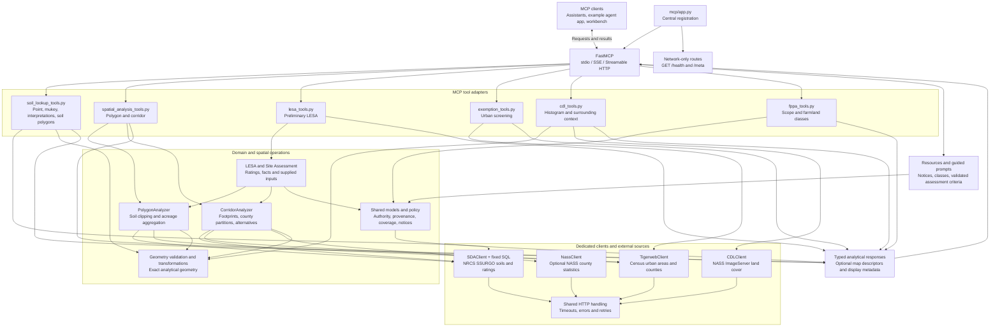
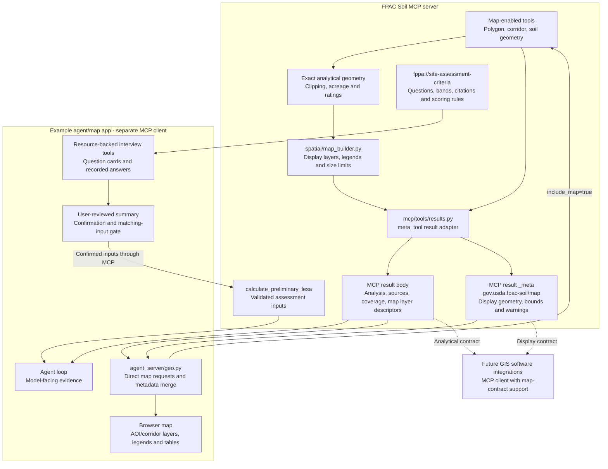

# Architecture Guide

This guide describes the current implementation of the FPAC Soil MCP server: how MCP requests enter the service, how tool calls move through the domain and spatial layers, and how upstream datasets contribute screening evidence. It is an implementation map, not a record of project status or a substitute for the regulatory notices returned by the service.

## Component and Request Flow

Arrows between tools, analyzers, and clients show delegation and data dependencies. Each dedicated client encapsulates its corresponding external service; configuration supplies endpoints and capability settings. Map output and application consumption are expanded below rather than mixed into the source-query graph.

## Map Contract and Example Application

The server owns calculations, domain resources, and output contracts. The example app owns chat, questionnaire interaction, confirmation, and rendering. Its map routes call MCP tools directly; the `geo.py` adapter joins display metadata to body layer descriptors for the browser. The chat path keeps map display metadata separate from model-facing content and summarizes that metadata in tool traces.

With `include_map=true`, `analyze_farmland_by_polygon`, `analyze_corridor_fppa`, and `get_soil_polygons_by_geometry` deliver map display data under `_meta["gov.usda.fpac-soil/map"]`. Body descriptors identify layers, authority, source, vintage, style keys, legends, and delivery status. Metadata contains display CRS, bounds, warnings, and layer-keyed feature collections with simplification/truncation information. Display simplification does not change exact analytical results. The soil-geometry retrieval tool also retains its primary top-level features in the body; the metadata split is not a universal removal of geometry from all responses.

Dashed edges identify a future integration path, not an existing GIS connector. A GIS client can implement the same descriptor/metadata contract without embedding the agent app or recreating screening calculations. See [ADR 0017](decisions/0017-server-map-result-contract.md) for the map contract and the [agent app guide](../apps/agent-fpac-soil-openai-sdk/README.md) for the existing client.

## Responsibilities and Boundaries

- **MCP assembly (`src/fpac_soil_mcp/mcp/`)** creates the FastMCP server and registers tool groups, resources, prompts, and custom HTTP routes. The same server supports `stdio`, SSE, and Streamable HTTP transports; route handlers are available on network transports.
- **Tool adapters (`mcp/tools/`)** expose the public MCP functions and organize them by soil lookup, spatial analysis, CDL, FPPA guidance, exemptions, and LESA. They connect the MCP contract to domain operations rather than acting as independent data stores.
- **Domain workflows (`domain/`)** combine soil, geography, and agricultural context for polygon, corridor, and preliminary LESA workflows. Polygon analysis clips intersecting soil geometry and aggregates acreage and ratings; corridor analysis works with footprints, county partitions, and alternatives.
- **Spatial operations (`spatial/`)** validate and normalize geometry, produce safe WKT for service queries, calculate area and length, and prepare map-layer responses. These operations are shared by multiple workflows.
- **Clients (`clients/`)** isolate external request and response behavior. The shared HTTP helper normalizes request/status errors and retries configured transient failures. The SDA client uses fixed query templates and parses SDA's `JSON+COLUMNNAME` response format; clients do not accept arbitrary user SQL.
- **Contracts and policy (`models/`, `core/`)** hold response schemas, authority and provenance types, configuration, error types, regulatory notices, and privacy protections. Results should communicate partial coverage and unavailable upstream data rather than imply unsupported completeness.
- **Resources and prompts** provide discoverable FPPA notices, screening guidance, farmland classes, assessment criteria, and guided workflow templates. They complement tools and do not replace formal review.
- **HTTP routes** are operational endpoints: `/health` reports service health and `/meta` reports server metadata. They are distinct from MCP tools.

## Data Sources

| Adapter | Source | Role in screening |
| --- | --- | --- |
| `SDAClient` | USDA NRCS Soil Data Access (SDA) | SSURGO map units, farmland classes, soil interpretations, and spatial soil intersections/clipping. |
| `CDLClient` | USDA NASS Cropland Data Layer (CDL) ImageServer | Validated raster vintage and mapped class evidence for an area and configured surrounding zones. |
| `NassClient` | USDA NASS QuickStats | County agricultural statistics used as context in corridor and related assessments; the integration requires its configured capability and API key. |
| `TigerwebClient` | U.S. Census Bureau TIGERweb | 2020 Urban Area screening and county-boundary queries/partitioning. |

These sources describe different things. SSURGO farmland classes are soil-based classifications, soil interpretations are selected productivity or other ratings, CDL is mapped land cover, QuickStats is county-level agricultural context, and TIGERweb supplies boundary geometry. None independently establishes current farming, parcel ownership, or an official FPPA determination.

## Deployment and Evaluation Boundaries

The console entry point is `fpac_soil_mcp.mcp.app:main`. Local MCP clients commonly use `stdio`; network deployments select SSE or Streamable HTTP using configuration. The root Dockerfile packages the server with a non-root runtime user and health check. The Databricks App configuration runs the same server over Streamable HTTP at `/mcp`; the separate application under `apps/agent-fpac-soil-openai-sdk/` is an MCP client, not part of the server's domain or data-access layers.

Automated checks use mocked upstream HTTP responses by default. Offline contract and evaluation suites exercise MCP behavior without requiring live federal services; live-network tests and deployment-specific evaluations are opt-in. The browser harness under `eval/fpac_soil_mcp_harness/` is a local client/workbench for connecting to the server.

The [evaluation guide](evaluation.md) describes case coverage and recorded results. T1 evaluates the checked-out server in process; deployed endpoint access and health are checked separately.

## Source Map

| Area | Location |
| --- | --- |
| Server assembly and transport entry point | `src/fpac_soil_mcp/mcp/app.py` |
| Tool, resource, prompt, and route registration | `src/fpac_soil_mcp/mcp/` |
| Domain operations | `src/fpac_soil_mcp/domain/` |
| Geometry and map response construction | `src/fpac_soil_mcp/spatial/` |
| External service clients | `src/fpac_soil_mcp/clients/` |
| Response models, configuration, policy, and errors | `src/fpac_soil_mcp/models/`, `src/fpac_soil_mcp/core/` |
| Evaluation and fixtures | `eval/` |
