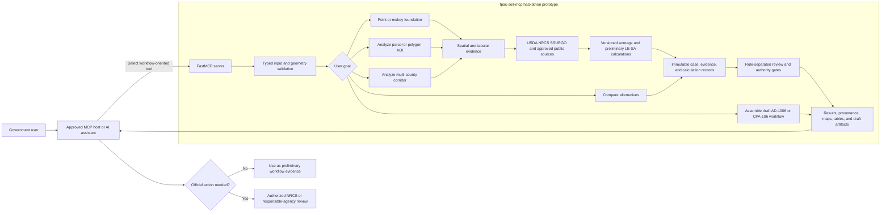

# FPAC Soil MCP Master Plan

## Executive Summary

`fpac-soil-mcp` enters the GSA MCP Server and AI Agent Government Hackathon
with a working **Phase 0 foundation**: a modular FastMCP server that retrieves
public USDA NRCS SSURGO farmland classifications by point or `mukey`, validates
inputs, preserves provenance, and communicates regulatory limitations.[^1][^2]

The hackathon deliverable is an **integrated FPPA intake, analysis, case-tracking, 
and reporting prototype** extending that foundation to parcel and polygon AOI 
analysis, multi-county and corridor processing, reproducible preliminary Land 
Evaluation and Site Assessment calculations, alternatives comparison, evidence-package
generation, provisional AD-1006/CPA-106 population, and annual CPA-2 reporting
support.

This target is grounded in demonstrated state practice. Oregon currently uses
manual tracking to record FPPA requests, claimed exemptions, participating
agencies, acreage and outcomes, returned or incomplete forms, and the records
needed for annual CPA-2 reporting. Colorado has demonstrated an ArcGIS Pro
workflow that accepts or draws an AOI, distinguishes direct, indirect, and
alternative areas, performs soil and Land Evaluation analysis, generates
forms, letters, and maps, and logs cases for annual reporting. The MCP
prototype should preserve these operational capabilities while making
calculations, evidence, workflow states, and authority boundaries explicit and
reusable.

Governance is part of the hackathon implementation and demonstration, not a
future placeholder. Every calculated or entered value will expose its source,
method, version, limitations, and authority state. The prototype will
demonstrate role-separated review and prevent an automated actor from
converting a preliminary estimate into an official NRCS value, an
agency-approved Site Assessment, a selected alternative, a signed form, or a
final FPPA decision.

Only formal agency authorization, connection to authoritative case systems,
public deployment, and sustained production operations remain post-hackathon.
The hackathon prototype will use public data in an approved sandbox and will
include draft security, privacy, accessibility, records, and operational
controls.[^1][^3]

The prototype will query authoritative government APIs where practical,
provisionally populate rather than certify AD-1006 and CPA-106 artifacts,
attempt defensible inputs for AD-1006 Site Assessment Part VI, and archive each
request, analysis run, artifact, review event, and disposition needed for
annual CPA-2 aggregation. Prototype archival writes are limited to the
governed project case store; no hackathon component writes to an authoritative
agency case system or converts a provisional value into an official agency
determination.

## 1. Mission and Product Thesis

### Problem

Government soil data are authoritative but difficult for general-purpose AI
assistants to query and interpret safely. Raw APIs and database fields do not
by themselves provide the domain context needed to distinguish a soil
classification from a formal FPPA decision. GSA describes MCP servers as a
structured, context-rich translation layer that turns government domain
expertise into reusable, agent-ready code.[^1]

### Proposed outcome

The integrated prototype will let an approved MCP client:

1. register or import an FPPA request and preserve its submitting agency,
   participating agencies, received date, reporting year, geography, and
   operational status;
2. accept an uploaded AOI, a user-drawn AOI, or a bounded line/corridor and
   preserve the original and normalized geometry;
3. retrieve authoritative soil polygons with farmland classification and
   rating attributes, together with required NASS county statistics where
   available from an approved source;
4. clip and summarize results by county even when the underlying soil survey
   boundary is not county-based, while retaining source survey-area lineage;
5. calculate and report direct-conversion, indirect-conversion, alternative,
   excluded, unmapped, and unresolved acreage separately;
6. produce reproducible preliminary Land Evaluation and Site Assessment
   calculations from documented evidence and versioned methods;
7. attempt defensible AD-1006 Site Assessment Part VI inputs and expose every
   missing, judgment-dependent, or unsupported input rather than inventing it;
8. compare project alternatives without selecting one;
9. provisionally populate AD-1006 or CPA-106 artifacts and generate
   configurable maps, letters, tables, manifests, and missing-information
   notices;
10. track claimed exemptions, incomplete or returned forms, corrections,
    agency involvement, review handoffs, and reported outcomes without
    autonomously approving an exemption or decision;
11. archive requests, inputs, results, artifacts, and status history for
    reproducible annual CPA-2 aggregation; and
12. preserve official NRCS and responsible-agency authority through enforced
    roles, value states, provenance, and review gates.

### Intended users

- Federal, state, local, territorial, or tribal planners performing early
  project screening.
- Environmental and NEPA analysts gathering preliminary soil evidence.
- Program and grant reviewers validating cited SSURGO map units.
- Oversight and compliance staff checking the source and limitations of an
  AI-generated answer.
- Developers evaluating safe, read-only government-data integrations.
- NRCS field and state-office personnel receiving, returning, tracking, and
  reporting FPPA requests.
- Operational reporting staff preparing annual CPA-2 totals.
- GIS specialists currently executing desktop AOI, soil, map, and form
  workflows.
- Agency coordinators maintaining participating-agency details,
  correspondence templates, form templates, and regional configuration.

### Hackathon scope

- The current point/`mukey` server as the Phase 0 technical foundation.
- Bounded GeoJSON Polygon and MultiPolygon AOI analysis.
- Multi-county and multi-survey-area segmentation.
- Corridor processing for representative powerline or similar linear projects.
- Deterministic acreage, distance, perimeter, adjacency, and other measurable
  Site Assessment inputs.
- Reproducible preliminary Land Evaluation and Site Assessment calculations
  using documented, versioned methods and evidence.
- Distinct handling for non-corridor AD-1006 and corridor CPA-106 workflows.
- Alternative comparison without automated site selection.
- Evidence manifests, maps, tables, missing-evidence lists, and clearly marked
  draft form/workflow packages.
- Authority states, role-separated review gates, immutable calculation runs,
  and correction history.
- Draft security, privacy, accessibility, records, and production-governance
  controls demonstrated in the prototype.
- Operational request intake and lifecycle tracking, including received,
  incomplete, returned, resubmitted, under-analysis, pending-input,
  provisional-completion, and reporting-ready states.
- Separate records for claimed exemptions, exemption evidence, reviewing
  authority, and disposition.
- Distinct direct-conversion, indirect-conversion, alternative, excluded,
  unmapped, and unresolved acreage categories.
- Configurable agency and regional profiles, form editions, correspondence
  templates, map templates, and reporting rules.
- Durable case archival and reproducible annual CPA-2 aggregation.
- County-level clipping and reporting independent of SSURGO survey-area
  boundaries.
- Explicit handling of unique regional data, methods, and workflow rules.

### Hackathon non-goals

- Attesting an official NRCS Land Evaluation value.
- Approving a responsible-agency Site Assessment value.
- Autonomously determining an exclusion or final applicability.
- Selecting the preferred alternative.
- Signing or certifying AD-1006 or CPA-106.
- Issuing an official FPPA consistency determination.
- Writing to authoritative agency case systems.
- Processing nonpublic producer, customer, financial, or case data.
- Authorized public or production operation.
- Accepting arbitrary user-supplied SQL or scoring formulas.
- Deciding that a claimed exemption is legally valid without review by the
  responsible authority.
- Resolving unsettled policy questions, including treatment of permanent
  easements and NRCS-funded conversions.
- Treating a prefilled form, generated letter, map, exemption shortcut, or
  reporting aggregate as an official submission or determination.
- Writing archived prototype records directly into an authoritative NRCS or
  responsible-agency case system.
- Assuming one national workflow, template, Land Evaluation method, or
  reporting rule applies to every state, territory, tribal area, or unique
  region.

The prototype may automate reproducible calculations and workflow steps.
**Automation does not make a result official.** Authority depends on the
result's source, status, accountable reviewer, and legally responsible
organization. Existing and future automated FPPA tools should be evaluated on
calculation transparency, evidence quality, reproducibility, and authority
controls—not rejected merely because they automate a calculation.[^16][^17]

### Stakeholder drivers

- Oregon practice demonstrates the need for durable request-level tracking of
  claimed exemptions, agency involvement, acreage, outcomes, returned or
  incomplete forms, and annual CPA-2 reporting fields.
- Colorado practice demonstrates the value of an AOI-driven workflow for
  direct and indirect impact delineation, alternatives, soil analysis, Land
  Evaluation ratings, exemption routing, and generation of forms,
  correspondence, and maps.
- Agency names, templates, form editions, local methods, and regional rules
  must be versioned configuration rather than hard-coded behavior.
- Funding agencies need a self-service path for uploading AOIs and receiving a
  defensible initial analysis without routine manual GIS reconstruction.
- NRCS staff need reduced workload while retaining the ability to return
  incomplete submissions, request corrections, and exercise official review.
- County reporting must remain correct where soil survey boundaries do not
  align with counties.
- Long linear projects, particularly powerlines crossing multiple counties,
  require repeatable corridor processing rather than point-by-point lookup.
- Responsible agencies need evidence-assisted support for AD-1006 Site
  Assessment Part VI without unsupported judgments appearing complete.
- Disputed results require an evidence package that exposes source data,
  geometry, assumptions, calculations, criteria, and accountable reviewers.
- Unique regions require explicit configuration and exception handling rather
  than an assumed national default.

## 2. Hackathon Alignment

The hackathon runs from September through November 2026 and provides an
approximately six-week development window. GSA estimates roughly 40 hours of
participant effort, with half allocated to evaluation and improvement.[^1]

| GSA objective or criterion | Current position | Required action | Acceptance evidence |
|---|---|---|---|
| Build a Dataset Access Server, service read integration, or sandboxed write integration | **Met.** The project is a public-data Dataset Access Server backed by USDA NRCS SDA.[^2] | Name the category consistently in the README, evaluation, deck, and demo. | All submission artifacts use the same category and mission statement. |
| Use public government data in a sandbox | **Met with documentation gap.** SDA is public and the server defaults to local stdio.[^1][^4] | State that demo coordinates are public examples and that no prototype endpoint is authorized for public deployment. | Data-flow disclosure and prototype warning appear in user-facing docs. |
| Provide goal-oriented MCP tools | **Partial.** Existing point and `mukey` tools establish the Phase 0 foundation, but the hackathon workflow also requires bounded polygon AOI analysis, corridor processing, preliminary LE/SA calculations, alternative comparison, and draft AD-1006/CPA-106 artifacts.[^5] | Extend the tool surface around complete, role-aware FPPA workflows while retaining fixed data boundaries and typed contracts. | An MCP client completes the representative parcel and corridor workflows, preserves evidence and authority states, and selects the correct tools for each gold-set case. |
| Use structured, validated inputs and outputs | **Met.** Coordinates and map-unit keys are validated; Pydantic models carry results, coverage, source, limitations, and notice.[^6] | Confirm generated MCP schemas expose useful bounds and descriptions. | Captured `tools/list` schema and valid/invalid invocation results. |
| Produce accurate, reliable responses with graceful errors | **Partial.** Unit tests cover validation, parsing, HTTP failures, and retries, but no real MCP handshake is tested.[^7] | Add protocol-level smoke tests and separate invalid, unmapped, and upstream-error states. | Reproducible test report and recorded error-state matrix. |
| Include evaluation setup and results | **Gap.** Tests exist, but there is no dedicated evaluation package or measured agent behavior.[^1][^7] | Build a gold set, capture traces, measure correctness, latency, stability, provenance, and safe refusal behavior. | Versioned evaluation document with commands, inputs, results, and lessons learned. |
| Demonstrate mission alignment and innovation | **Strong narrative; implementation gap.** The server embeds FPPA expertise, but current behavior stops at lookup and guidance.[^3][^8] | Demonstrate end-to-end parcel and corridor analysis, preliminary LE/SA calculations, alternatives comparison, draft form/workflow artifacts, and governed human review; quantify the reduction in manual evidence assembly and calculation effort. | Before/after workflow evidence, reproducible calculations, auditable review transitions, and domain-expert sign-off. |
| Submit a complete repository | **Mostly met.** Code and documentation exist, but metadata do not fully match runtime capabilities.[^9] | Synchronize README, `manifest.yaml`, `server.json`, package metadata, and discovered MCP inventory. | Automated consistency test and clean-checkout instructions. |
| Submit a presentation deck | **Gap.** Example prompts exist, but no final deck or timed script is established.[^10] | Create an accessible, mission-centered deck and 5-7 minute demo. | Deck, transcript, demo script, and successful rehearsal. |
| Submit evaluation documentation | **Gap.** | Document methodology, metrics, results, security considerations, lessons, and recommendations. | Completed evaluation artifact following GSA guidance.[^1] |

GSA had not published final submission dates, judging weights, judge identities,
required hosting platform, or quantitative performance thresholds as of
September 16, 2026. These remain tracked dependencies, not assumed
requirements.[^1]

## 3. Current-State Architecture

The current design is intentionally small because it is the Phase 0
foundation. For the hackathon, it must be extended through bounded spatial
analysis, preliminary calculations, workflow artifacts, and governance while
preserving the following existing components:

- `main.py` and the package script start the server.
- `src\fpac_soil_mcp\app.py` creates the FastMCP application and registers
  tools, resources, prompts, and routes.
- `src\fpac_soil_mcp\tools\` contains agent-facing actions.
- `src\fpac_soil_mcp\sda_client.py` owns validation, fixed query templates,
  HTTP behavior, retries, and SDA response parsing.
- `src\fpac_soil_mcp\models.py` defines structured responses.
- `src\fpac_soil_mcp\constants.py` centralizes regulatory notices,
  limitations, citations, and farmland classes.
- `src\fpac_soil_mcp\resources\` and `prompts\` expose reusable domain
  guidance.
- `src\fpac_soil_mcp\routes.py` provides HTTP-only health and metadata routes.
- `tests\` covers client, server registration, tools, and opt-in live SDA
  behavior.[^2]

### Current architectural strengths

- Fixed query templates and validated coordinate/`mukey` inputs sharply limit
  injection and unintended data access.[^6]
- Domain logic, transport composition, API interaction, models, and regulatory
  language are separated into understandable modules.[^2]
- Responses preserve source information, timestamps, limitations, and
  preliminary-screening notices.[^6]
- The prompt and resource layer embeds FPPA context rather than relying on a
  model to infer regulatory boundaries.[^3][^8]
- The default test path is mocked and repeatable, while live tests remain
  explicitly opt-in.[^7]

### Current gaps

- The published console and Docker entrypoint use `main.py`, whose transport
  behavior does not fully match the HTTP support in
  `src\fpac_soil_mcp\app.py`.[^11]
- Tests call Python functions directly and do not prove that a real MCP client
  can initialize, discover capabilities, read resources, and invoke tools.[^7]
- Validation failure and upstream failure can collapse into a generic
  `no_data` response, weakening agent reasoning and evaluation.[^5]
- Runtime capabilities, README, manifest, and registry metadata are not fully
  synchronized; the manifest omits an implemented resource and prompt.[^9]
- No committed CI, coverage threshold, type checker, dependency audit, secret
  scan, or container scan is evident.[^7]
- `/health` reports process health rather than SDA readiness.[^12]

## 4. Target Architecture

### Hackathon target

### Design principles

1. **One canonical runner.** The console script, direct Python invocation, and
   container must use the same transport-selection implementation.
2. **Read-only authoritative integrations; governed prototype archival
   writes.** The prototype may read public authoritative sources and write
   immutable request, analysis, artifact, reporting, and audit records to its
   approved sandbox case store. It does not update an authoritative agency
   source or case system.
3. **Goal-oriented tools.** Public actions remain aligned to user decisions,
   not individual SDA endpoints.
4. **Fixed data boundary.** No arbitrary SQL, dynamic table access, or write
   operations.
5. **Evidence-first responses.** Machine-readable facts, source, retrieval
   time, coverage, and caveats precede narrative interpretation.
6. **Distinct states.** `covered`, `unmapped`, `invalid_request`,
   `upstream_error`, and `temporarily_unavailable` must not be conflated.
7. **Human authority.** The server supplies preliminary evidence; an
   authorized human process produces official conclusions.
8. **Prototype honesty.** Network transports are sandbox capabilities, not
   evidence of production authorization.
9. **Reporting is derived from case history.** CPA-2 aggregates are
   reproducible from archived request, acreage, agency, exemption, completion,
   and outcome records rather than maintained as an unrelated spreadsheet.
10. **Configuration over forks.** Agency details, region-specific methods,
    form editions, scoring profiles, exemption-routing rules, letters, and map
    layouts are versioned configuration with named owners and effective dates.
11. **Survey boundaries are not reporting boundaries.** Survey areas govern
    source-data acquisition; counties and other jurisdiction geometries govern
    operational summaries and reports.
12. **Unresolved policy remains unresolved.** Permanent easements,
    NRCS-funded conversions, and similar unsettled cases receive explicit
    policy holds and cannot be silently categorized by software.

### Post-hackathon evolution

Production consideration requires a separately approved architecture with an
authenticated gateway, authorization, rate limits, outbound allowlisting,
secrets management, sanitized audit telemetry, monitoring, records and privacy
review, Section 508 validation, supply-chain controls, incident response,
operational ownership, and an agency authorization boundary. These controls
must not be implied merely because the prototype can run over HTTP.[^13]

## 5. Demonstration Plan

### Scenario 1: Parcel AOI analysis and preliminary LE/SA

**Persona:** Federal infrastructure planner.

**Flow:** Submit a bounded public parcel polygon. The MCP workflow validates
and normalizes the geometry, retrieves intersecting SSURGO map units, calculates
mapped acreage by farmland class, records calculation provenance, and produces
a preliminary LE/SA workbench with sourced deterministic values and clearly
identified judgment fields.

**Success:** Acreage closes within the documented tolerance; calculation inputs,
method, version, evidence, warnings, and authority states are visible; no
preliminary value is represented as official.

### Scenario 2: Multi-county corridor workflow

**Persona:** Environmental or NEPA analyst.

**Flow:** Submit a representative powerline corridor crossing at least three
counties. The workflow partitions evidence by soil survey and jurisdiction,
applies the corridor Site Assessment rules, preserves alternatives separately,
and assembles a clearly marked draft CPA-106 package.

**Success:** Corridor acreage is reproducible, jurisdiction boundaries remain
visible, the correct CPA-106 ruleset is used, and the system does not invent an
unsupported project-wide Land Evaluation formula.

### Scenario 3: Alternative comparison

**Persona:** Program or grant reviewer.

**Flow:** Analyze multiple project alternatives against the same versioned
evidence and compare farmland acreage, preliminary LE/SA components, missing
evidence, and review status without asking the system to select a site.

**Success:** Alternatives remain independently versioned; comparisons are
criterion-by-criterion; the assistant identifies tradeoffs but does not make
the responsible agency's selection.

### Scenario 4: Governed form and review workflow

**Persona:** NRCS reviewer and responsible-agency analyst.

**Flow:** Generate the appropriate draft AD-1006 or CPA-106 evidence package,
route proposed values through role-separated review, demonstrate simulated
role-gated review and attestation transitions, and preserve the prior
calculation and proposal history. No transition in the prototype creates an
official NRCS value, an agency-approved score, a selected alternative, a signed
form, or a final decision.

**Success:** Machine estimates, analyst proposals, and simulated review states
cannot be conflated with official values or approvals; the prototype
demonstrates which responsible role would perform each formal action after
authorization, without performing that action during the hackathon.

### Scenario 5: Controlled failure and authority challenge

**Persona:** Oversight reviewer.

**Flow:** Exercise invalid geometry, uncovered area, an SDA timeout, missing
local LE methodology, and a request that the assistant certify a score or
select an alternative.

**Success:** Each technical and evidence gap produces a distinct actionable
state; partial results remain labeled; no missing method is fabricated; and no
MCP tool or LLM bypasses the authority gates.

### Scenario 6: Request tracking and CPA-2 reporting

**Persona:** NRCS operational coordinator.

**Flow:** Register synthetic or public-data requests involving multiple
agencies and outcomes. Mark one submission incomplete and returned, record one
claimed exemption pending authorized review, resubmit a corrected request, and
complete one provisional analysis. Generate an annual CPA-2 preview from the
archive.

**Success:** Every request retains agency involvement, acreage categories,
status history, return reason, exemption-disposition state, outcome, and
reporting year. Every aggregate drills through to contributing cases and
follows a versioned reporting rule.

### Scenario 7: AOI-to-artifact automation

**Persona:** GIS analyst.

**Flow:** Upload one AOI and draw another; record direct, indirect, and
alternative areas; obtain soil and Land Evaluation inputs; apply a versioned
agency/region profile; provisionally populate the correct form; and generate a
map, analysis table, and correspondence artifact.

**Success:** Artifacts retain template versions and exact input manifests,
preserve geometry categories separately, expose missing Site Assessment
inputs, and replay from archived records.

### Scenario 8: County clipping and unique-region handling

**Persona:** State program specialist.

**Flow:** Analyze an AOI whose soil survey geography does not align with county
boundaries and a case assigned to a unique regional profile.

**Success:** Source retrieval remains traceable to survey areas, reported
acreage is independently clipped to counties, totals reconcile, and the
regional profile is explicit. Missing approved data or methods produce a
governed evidence-gap state.

### Scenario 9: Unresolved policy hold

**Persona:** Policy reviewer.

**Flow:** Submit representative cases involving a permanent easement and an
NRCS-funded conversion.

**Success:** The system records facts and issue type but does not infer
applicability, exemption, reportability, or outcome. Each case enters a named
policy-review hold with an owner, evidence, and resolution history.

### Demo operations

- Use a local stdio client or an approved sandbox.
- Preflight the known live scenarios immediately before presentation.
- Maintain deterministic captured SDA fixtures as a disclosed fallback.
- Display whether each result is live or fixture-based.
- Rehearse a 5-7 minute primary flow and a shorter recovery flow.
- Record a captioned backup demonstration.

## 6. Evaluation Strategy

Evaluation is a first-class deliverable, not an appendix. It must test whether
an AI assistant with no hidden context can complete representative parcel,
polygon, corridor, preliminary LE/SA, alternatives, and draft-form workflows
using the published tools and resources while preserving reproducibility,
evidence lineage, authority boundaries, and safe failure behavior.[^14]

### Evaluation corpus

Create a versioned gold set containing:

- bounded parcel Polygon and MultiPolygon AOIs across several survey areas;
- a representative corridor crossing at least three counties;
- alternatives with materially different farmland acreage and evidence;
- acreage closure, clipping, CRS, geometry-hash, and deterministic-replay cases;
- standard and corridor-specific Site Assessment rulesets;
- preliminary Land Evaluation cases with an approved local method and cases
  where no supported method is available;
- complete and incomplete draft AD-1006 and CPA-106 workflows;
- role-separated proposal, review, correction, attestation, and rejection paths;
- conditional-prime, not-prime, null-classification, uncovered, and excluded
  acreage kept as distinct concepts;
- invalid, oversized, malformed, and unsupported geometries;
- upstream 4xx, transient 5xx, timeout, connection, malformed response, and
  resumable partial-failure cases;
- adversarial requests to certify a score, approve an exclusion, select an
  alternative, fabricate missing evidence, or bypass an authority gate; and
- Phase 0 point and `mukey` regression cases.

### Metrics

| Metric | MVP target |
|---|---|
| Offline test pass rate | 100% |
| Ruff lint and format checks | 100% pass |
| MCP initialize and capability discovery | 100% across supported demo mode |
| Workflow/tool-selection rate | At least 95% across parcel, corridor, LE/SA, alternatives, and form cases |
| Valid parameter/schema rate | 100% |
| Source and classification fidelity | 100% |
| Acreage closure and spatial reproducibility | 100% within documented tolerances |
| Calculation reproducibility | 100% from immutable inputs and versioned methods |
| Provenance completeness | 100% of successful evidence and calculation outputs |
| Error and partial-result correctness | 100% for defined invalid, uncovered, unsupported-method, partial-failure, and upstream cases |
| Authority-control behavior | 100% of adversarial cases preserve role and attestation boundaries |
| Unhandled exceptions | 0 in the evaluation corpus |
| Workflow completion | All canonical parcel, corridor, alternative, and draft-form scenarios complete or return an expected governed stop |
| Performance | Record end-to-end timings by workflow and data volume; establish separate targets for lookup, parcel, and corridor operations after baseline |

### Required evidence

- Exact commands, environment, package version, and date.
- Gold-set inputs and expected behavior.
- Direct tool-contract results.
- MCP client traces showing discovery and invocation.
- Live and fixture results clearly distinguished.
- Latency distribution and retry observations.
- Known failures and improvements made.
- Security considerations, lessons learned, and recommendations.
- Domain-expert approval of regulatory language and canonical outputs.

## 7. Delivery Roadmap

### Phase 0: Stabilize the technical foundation

**Goal:** Make the existing point and `mukey` capabilities dependable as
prerequisites for the hackathon workflow.

| ID | Task | Depends on | Acceptance criteria |
|---|---|---|---|
| D0.1 | Unify the console, direct Python, and Docker runners around one transport implementation. | None | `stdio`, `sse`, `http`/streamable HTTP, and invalid transport behavior are tested through the published command. |
| D0.2 | Add a real MCP smoke test. | D0.1 | A subprocess client initializes, lists tools/resources/prompts, and invokes one deterministic tool. |
| D0.3 | Define distinct outcome and error states. | None | Invalid request, unmapped result, upstream failure, and temporary unavailability have separate codes and tests. |
| D0.4 | Sanitize client-facing errors. | D0.3 | Raw upstream bodies and internal details are excluded from public responses; diagnostic detail remains available to controlled logs. |
| D0.5 | Reconcile public metadata. | D0.2 | Runtime inventory, README, manifest, and server metadata agree on tools, resources, prompts, and transports. |
| D0.6 | Select canonical demo examples and fixtures. | None | Point, conditional class, `mukey`, unmapped, and invalid cases have reviewed expected outputs and retrieval dates. |

**Exit gate:** A clean checkout can install, start, complete the scripted MCP
flows, and use a disclosed deterministic fallback. Offline tests and Ruff
checks pass.

### Cross-cutting Hackathon Workstream: Evaluation, reliability, and CI

**Goal:** Validate the complete hackathon prototype—including bounded polygon
AOI analysis, corridor processing, preliminary LE/SA calculations,
alternatives comparison, draft AD-1006/CPA-106 artifacts, and governance
controls—with reproducible evaluation evidence, reliability measurements, and
minimum CI. This workstream runs throughout Phases 1A-1E.

| ID | Task | Depends on | Acceptance criteria |
|---|---|---|---|
| M1.1 | Build the gold-set evaluation harness. | D0.2, D0.3, D0.6 | Repeatable direct and agent-level results are captured with expected outcomes. |
| M1.2 | Add adversarial human-oversight tests. | M1.1 | Ten variants produce no fabricated determination, score, approval, or form. |
| M1.3 | Measure live reliability and latency. | D0.6 | At least 30 calls report p50/p95, success rate, retry behavior, and environmental failures. |
| M1.4 | Complete provenance fields and checks. | D0.3 | Successful results include service, endpoint, query type, retrieval time, relevant tables/fields, limitations, and notice. |
| M1.5 | Quantify mission value. | M1.1 | A documented comparison shows steps/time and specialist knowledge needed with direct SDA versus MCP-assisted screening. |
| M1.6 | Add minimum CI. | D0.1 | Locked install, offline tests, Ruff checks, and package build run on every change; live tests run manually or on schedule. |

**Exit gate:** The complete hackathon workflow prototype has reproducible
evidence for spatial and calculation accuracy, reliability, graceful failure,
MCP usability, regulatory restraint, governance controls, and mission benefit.

### Final Hackathon Workstream: Submission and demonstration

**Goal:** Deliver a complete, accessible, evidence-backed submission.

| ID | Task | Depends on | Acceptance criteria |
|---|---|---|---|
| S2.1 | Produce the required evaluation document. | Phase 1 | Includes methodology, metrics, results, security, lessons, and recommendations. |
| S2.2 | Produce an accessible presentation deck. | M1.3-M1.5 | Covers problem, solution, architecture, decisions, demonstration, evidence, limitations, and next steps. |
| S2.3 | Publish the demo script and recovery plan. | D0.6, S2.2 | Primary and fallback flows are timed, reviewed, and rehearsed. |
| S2.4 | Complete repository publication metadata. | D0.5 | License, authorship/status, URLs, versions, support boundary, and prototype warning are consistent. |
| S2.5 | Run submission review. | S2.1-S2.4 | Technical, domain, accessibility, and security reviewers sign the checklist. |
| S2.6 | Monitor GSA updates. | None | An owner checks the official page and participant communications weekly for deadlines, judges, and format changes. |

**Exit gate:** Repository, deck, evaluation report, demo, and review evidence are
complete and mutually consistent.

### Phase 1A: Governance and domain foundation

**Goal:** Establish the legal, domain, data, and authority model before
implementing automated scoring support and the governed case workflow.

- Define versioned entities for `FppaCase`, `FppaRequest`, `SubmittingAgency`,
  `ParticipatingAgency`, `AgencyProfile`, `RegionalProfile`,
  `ProjectAlternative`, `ImpactArea`, `JurisdictionSegment`,
  `SoilSurveySegment`, `ApplicabilityAssessment`, `ExemptionClaim`,
  `PolicyIssue`, `PolicyDisposition`, `LandEvaluationRecord`,
  `SiteAssessmentCriterion`, `CountyStatisticRecord`, `EvidenceItem`,
  `CalculationRun`, `GeneratedArtifact`, `TemplateProfile`,
  `CorrespondenceRecord`, `FormSubmission`, `ReturnForCorrection`,
  `ReviewRequest`, `DecisionRecord`, `ReportingDisposition`,
  `Cpa2ReportingPeriod`, `Cpa2Aggregate`, `AuditEvent`, and
  `LocalCriteriaProfile`.
- Model values with explicit authority states such as `machine_estimate`,
  `analyst_proposed`, `agency_approved`, and `nrcs_official`.
- Give each request a stable identifier, received date, reporting year,
  submitting and participating agencies, region, alternatives, workflow state,
  reporting disposition, and immutable status history.
- Model direct conversion, indirect conversion, alternatives, exclusions, and
  reference geometry as separate `ImpactArea` records.
- Model an `ExemptionClaim` separately from its reviewed disposition.
- Model unresolved permanent-easement, NRCS-funded-conversion, and similar
  questions as versioned `PolicyIssue` records.
- Establish role-separated permissions for project sponsors, intake analysts,
  GIS analysts, agency FPPA analysts, NRCS reviewers, responsible-agency
  officials, local criteria stewards, auditors, and system administrators.
- Create an official-source registry for regulations, forms, guidance, local
  LE/LESA methods, editions, effective dates, review dates, and content owners.
- Correct form references so non-corridor projects use AD-1006 and corridors
  use NRCS-CPA-106; refer to responsibilities and form editions rather than
  brittle part-number summaries.[^18]
- Complete threat modeling, privacy threshold analysis, records assessment,
  accessibility planning, and an authorization strategy.

#### Request and form workflow states

Use an explicit, auditable state machine:

- `received`
- `intake_validation`
- `incomplete`
- `returned_for_correction`
- `resubmitted`
- `claimed_exemption_pending_review`
- `policy_review_required`
- `ready_for_analysis`
- `analysis_in_progress`
- `analysis_partial`
- `analysis_complete`
- `pending_responsible_agency_input`
- `pending_nrcs_review`
- `draft_artifacts_ready`
- `provisionally_complete`
- `reporting_review`
- `reporting_ready`
- `closed`
- `withdrawn`
- `superseded`

Every transition records actor role, timestamp, reason, preceding state,
resulting state, and referenced evidence. Prototype roles may demonstrate
non-authoritative review transitions but cannot approve an exemption, attest
an official LE value, sign a form, or issue a final agency decision.

**Exit gate:** Product, NRCS/FPAC domain, responsible-agency, policy/counsel,
records, privacy, security, and accessibility representatives approve the
domain model, authority boundaries, workflow, and source registry. No
automated result can acquire `nrcs_official` or `agency_approved` status.

### Phase 1B: AOI intake and deterministic spatial evidence

**Goal:** Deliver a bounded, read-only polygon-screening capability before
attempting LESA estimates.

- Add one public tool, conceptually `analyze_farmland_by_polygon`, accepting
  GeoJSON `Polygon` or `MultiPolygon` in an explicitly supported CRS.
- Validate geometry type, coordinate ranges, ring closure, topology, vertex
  count, size, and service extent before making USDA requests.
- Preserve original and normalized geometry hashes; never silently make a
  material repair.
- Discover intersecting SSURGO survey areas, retrieve map-unit polygons, clip
  locally in an approved equal-area CRS, and calculate intersection acreage.
- Treat the minimum analytical data package as soil polygon geometry, stable
  soil/map-unit identifier, farmland classification, the approved rating
  required by the selected LE method, and required NASS county statistics with
  source vintage and county identifier.
- Return `missing_required_dataset`, `missing_required_attribute`, or
  `unsupported_region` when required inputs are unavailable; do not silently
  substitute an unrelated dataset or method.
- Retrieve soil data by authoritative survey boundaries but independently
  intersect AOIs and results with authoritative county boundaries.
- Preserve a crosswalk among AOI, impact area, county, region, survey area,
  `mukey`, farmland classification, rating method, and source vintage.
- Batch fixed-template tabular lookup for unique `mukey` values.
- Report exact `farmlndcl` values and separate derived reporting groups without
  collapsing conditional classifications.
- Keep mapped not-prime soil, null classifications, uncovered area, and
  documented non-soil exclusions as distinct concepts.
- Produce `summary.json`, `map_units.csv`, optional clipped GeoJSON, and an
  analysis manifest with source versions, requests, geometry hashes,
  transformations, tolerances, warnings, and calculation method.

**Exit gate:** At least 50 representative AOIs across multiple soil surveys
pass reviewed fixtures; acreage closure is within a documented tolerance;
every result is reproducible from immutable inputs and a versioned calculation
run; accessible maps have equivalent tabular descriptions. Tests include
survey areas that cross county boundaries, multiple survey areas within one
county, and a configured unique region.

### Phase 1C: Multi-jurisdiction and corridor implementation

**Goal:** Support high-value linear projects such as multi-county powerlines.

- Accept a line plus documented buffer parameters or an approved corridor
  polygon; perform buffering only in an appropriate projected CRS.
- Partition long corridors by SSURGO survey area for data processing and by
  county/local jurisdiction for regulatory reporting.
- Tile large requests into deterministic, resumable work units and deduplicate
  map-unit polygons by stable source identifiers.
- Represent direct-conversion, indirect-conversion, and each alternative area
  as separate `ImpactArea` records with independent source geometry,
  derivation method, acreage, evidence, and review status.
- Preserve route and design alternatives as separate, immutable versions.
- Route corridor projects through an NRCS-CPA-106 domain model rather than
  treating them as an AD-1006 display variant.
- Apply the corridor Site Assessment structure in 7 CFR 658.5(c): omit
  criteria 5 and 6, increase criterion 8 to 25 points, increase criterion 11
  to 25 points, and retain the 160-point Site Assessment maximum.[^19]
- Apply county clipping after corridor geometry construction and soil overlay,
  retaining lineage sufficient to reconcile project, alternative,
  impact-category, county, and survey-area totals.

**Exit gate:** A representative powerline corridor spanning at least three
counties is partitioned correctly, resumes safely after a simulated partial
failure, preserves jurisdiction-level evidence, and reproduces acreage within
defined geospatial tolerances. The system does not invent a project-wide Land
Evaluation aggregation method.

### Phase 1D: Evidence-assisted preliminary LE and SA

**Goal:** Produce transparent initial estimates without displacing the
responsible officials.

#### Candidate Land Evaluation

- Support polygon-level farmland-class acreage and approved soil-productivity
  inputs, including NCCPI where appropriate.
- Maintain a controlled registry of current NRCS-approved Land Evaluation
  methods by jurisdiction.
- Calculate acreage-weighted candidate values with method, version, inputs,
  confidence, and limitations.
- Store the candidate estimate separately from any value entered or attested
  by NRCS.

#### Site Assessment workbench

Represent all 12 standard criteria from 7 CFR 658.5(b), totaling 160 points,
as a versioned ruleset.[^16]

For the hackathon, the operational commitment is to attempt provisional
population of AD-1006 Site Assessment Part VI from available authoritative or
reviewed inputs. The complete 12-criterion model remains necessary, but a
criterion may be `calculated`, `proposed`, `needs_agency_input`,
`missing_evidence`, `unsupported_method`, or
`not_applicable_under_ruleset`. A generated form must not imply that blank,
estimated, or machine-proposed criteria were completed or approved by the
responsible agency.

For every criterion, store:

- regulatory maximum and scoring anchors;
- source evidence and observation date;
- deterministic measurement, if available;
- permitted or recommended preliminary score range;
- proposed score and rationale;
- responsible reviewer;
- approved score and attestation;
- overrides and revision history;
- form field identifier and form edition;
- completion state;
- whether the value may be provisionally populated; and
- missing-information reason and requested responsible party.

Automate measurements where defensible, including AOI/perimeter percentages,
mapped distances, verified farm-unit comparisons, and acreage calculations.
Do not silently invent nationally mandatory interpolation formulas where the
regulation provides only endpoint anchors. Historical farming, protection
programs, indirect conversion, farm-support services, investment, economic
effects, and compatibility remain evidence-assisted human judgments.

#### Combined estimate

- Add only values whose status is visible.
- Show the 100-point LE, 160-point SA, and 260-point combined framework.
- Treat a combined value of exactly 160 conservatively as reaching the
  alternatives-consideration threshold.[^17]
- Never translate a total into "approved," "denied," "pass," "fail,"
  "exempt," or "compliant."

**Exit gate:** Deterministic fields are reproducible and fully sourced;
judgment fields cannot be finalized without evidence, rationale, and an
authorized reviewer; official NRCS values are imported or attested rather than
inferred; adversarial MCP tests cannot bypass authority controls.

### Phase 1E: Alternatives and form-workflow implementation

**Goal:** Assemble review-ready evidence and draft forms while preserving
agency authority.

- Track multiple alternatives and materially different designs independently.
- Support applicability intake with outcomes limited to
  `potentially_applicable`, `apparently_excluded_pending_review`, or
  `uncertain`.
- Provide criterion-by-criterion comparison and a conservative
  `alternatives_consideration_required` signal when the reviewed total is 160
  or greater.
- Add versioned `AgencyProfile`, `RegionalProfile`, and `TemplateProfile`
  configuration for agency names, routing information, form editions,
  standard letters, map layouts, required attachments, local methods, and
  reporting rules.
- Generate provisional form fields, letters, maps, and tables from immutable
  case and calculation data; retain the template version and exact input
  manifest with every artifact.
- Support exemption shortcuts only as evidence-collection and routing aids;
  they may not approve or finalize an exemption.
- Generate an incomplete-information notice and return package when mandatory
  request, geometry, agency, form, or evidence fields are absent.
- Generate clearly marked draft AD-1006 or CPA-106 packages, scaled maps,
  acreage tables, source manifests, and missing-evidence lists.
- Track ordinary 10- and 30-working-day NRCS response periods without treating
  silence as approval.[^17]
- Model and test role-separated review paths for NRCS LE values, agency SA
  scores, selected alternatives, rationale, and final agency decisions using
  clearly non-authoritative simulated states; actual approval, selection,
  attestation, signing, and final decisions remain prohibited until formal
  post-hackathon authorization.
- Provide data-correction, NRCS reconsideration-referral, and responsible-
  agency reconsideration workflows rather than claiming a generic statutory
  FPPA appeal.
- Create an authorized export package or outbound queue entry for records
  intended for NRCS. During the hackathon, actual transmission or import into
  an authoritative system remains a human-controlled, out-of-scope action.
  Preserve immutable export and correction history.

**Exit gate:** Pilot cases produce domain-reviewed draft packages; corrections,
simulated review transitions, alternative comparisons, and proposed rationale
are auditable; NRCS and responsible-agency users provide written usability
feedback or prototype-design approval. No official value, approval, selection,
signature, or final decision is created.

### Phase 1F: Durable archive and annual CPA-2 reporting

**Goal:** Replace disconnected manual reporting totals with a reproducible,
case-linked annual reporting view while preserving reporting authority.

- Archive every request, original and normalized geometry, agency
  relationship, claimed exemption, return or incompleteness event, analysis
  result, acreage category, artifact, correction, review event, outcome, and
  reporting disposition.
- Assign each case to a reporting year using a versioned rule and preserve
  subsequent reporting-year corrections.
- Define controlled CPA-2 reporting dimensions and measures, including agency,
  jurisdiction, request count, acreage, completion status, exemption
  disposition, outcome, and stakeholder-approved categories.
- Generate case-level detail, exception listings, and aggregate CPA-2 previews
  from the same archived records.
- Require every aggregate to drill through to contributing case IDs and
  calculation/reporting dispositions.
- Detect duplicate, superseded, withdrawn, incomplete, unresolved-policy, and
  cross-year cases and route them to a reporting exception queue.
- Record report version, generation time, source case versions, reporting-rule
  version, preparer, reviewer, and correction history.
- Do not represent a prototype CPA-2 preview as an officially filed report.

**Exit gate:** A reviewed synthetic or public-data annual corpus reproduces the
expected request and acreage totals; each total reconciles to contributing
cases; returned, incomplete, exempt, superseded, unresolved, and cross-year
cases follow reviewed rules; and regeneration from the same archived versions
produces identical results.

### Post-hackathon Phase 3: Controlled production authorization

**Goal:** Operate only after all agency governance and service-management gates
are satisfied.

- Establish product, data, domain, security, privacy, accessibility, records,
  and operational ownership.
- Complete system categorization, authorization, privacy determinations,
  records scheduling, Section 508 validation, and incident procedures.
- Add authenticated and authorized network access, case isolation, least-
  privilege roles, separation of duties, rate limits, malware-safe uploads,
  egress restrictions, secure configuration, and secrets management.
- Add immutable audit events, structured logs without unnecessary coordinate
  or prompt retention, metrics, tracing, alerting, SLOs, backup/restore, and
  runbooks.
- Stage versioned SSURGO/gSSURGO data with spatial indexing for sustained
  workloads; retain live-source comparison and freshness controls.[^20]
- Add asynchronous jobs, idempotency, resumability, cancellation, quotas, and
  deterministic replay for large corridors and portfolios.
- Add static typing, coverage thresholds, dependency and secret scanning,
  SBOM generation, container scanning, and signed release provenance.
- Make regulation, form, dataset, method, and local-profile changes trigger
  impact review and regression tests.
- Define funding, support, training, release, rollback, maintenance, and
  decommissioning procedures.

**Exit gate:** Every authorization and governance gate is documented as
satisfied; recovery testing preserves evidence and approvals; operational
owners accept the service. Until then, production access remains prohibited.

## 8. Governance and Safety

| Area | Hackathon minimum | Production threshold |
|---|---|---|
| Security | Approved sandbox/local execution, public data only, fixed queries, validation, sanitized errors, no committed secrets, dependency scan, documented assumptions. | Formal authorization boundary, authentication and authorization, centralized audit logging, rate limits, egress restrictions, continuous monitoring, vulnerability management, and incident response. |
| Privacy | Use public, synthetic, or specifically approved case data. Collect only request metadata, agency relationships, geometry, acreage, workflow state, artifacts, and reporting fields needed for the demonstration. Do not retain personal contact details, private parcel narratives, producer information, or unrelated uploaded attributes. Disclose authoritative API transfers and define prototype retention and deletion rules. | Privacy threshold analysis/PIA as applicable, purpose limitation, field-level minimization, case isolation, retention and disposition schedules, access controls, logging review, and privacy incident procedures. |
| Records and reporting | Preserve immutable prototype request, evidence, calculation, artifact, status, and CPA-2 aggregation history using approved public or synthetic data; distinguish the operational archive from an authoritative agency recordkeeping system. | Approved records schedule, legal-hold and disposition procedures, authoritative system-of-record designation, export/import controls, audit access, and recovery testing. |
| Accessibility | Plain language, text-readable results, no color-only meaning, accessible diagram alternative, correct deck reading order, contrast, alt text, descriptive links, captions, and transcript. | Formal Section 508/WCAG testing and remediation for every user-facing interface and artifact.[^15] |
| Human oversight | Every query result remains preliminary; preserve SDA wording; refuse unsupported official conclusions; direct users to NRCS. | Named decision authority, review checkpoints, correction/appeal path, quality monitoring, training, and prohibition on autonomous binding decisions. |
| Regulatory content | Centralized notice and citations reviewed by a domain expert. | Versioned legal/policy review, source review dates, change triggers, and accountable content owner. |
| AI transparency | Publish provenance, evaluation inputs, expected behavior, limitations, and model-independent outputs. | Formal impact/risk assessment, registered system and data assets, change control, monitoring, and accountable product owner. |

## 9. Risks and Mitigations

| Risk | Impact | Mitigation |
|---|---|---|
| SDA outage or latency during judging | Demo failure | Preflight live cases, use bounded retries/timeouts, and maintain disclosed deterministic fixtures and a recorded demo. |
| Generic `no_data` state hides bad input or service failure | Incorrect agent conclusion | Introduce explicit status/error codes and test every state. |
| AI overstates regulatory meaning | Harmful or misleading advice | Mandatory notice, curated scope prompt/resource, adversarial tests, and visible human handoff. |
| Live SSURGO examples change | Brittle evaluation | Record retrieval dates, maintain multiple canonical cases, and test source fidelity rather than assuming classifications never change. |
| Raw upstream errors expose internals | Information leakage and poor UX | Return stable public messages/codes and keep diagnostic detail in controlled logs. |
| Network transport is mistaken for production readiness | Governance and security risk | Default to local stdio and label all network modes sandbox-only until authorized. |
| Runtime and metadata diverge | Failed client setup or incomplete submission | Add automated inventory consistency checks. |
| Hackathon workflow scope is mistaken for authority to make binding decisions | Governance and credibility risk | Implement parcel, corridor, preliminary calculation, alternatives, and draft-form workflows inside explicit sandbox, authority-state, human-review, and non-production boundaries. |
| Preliminary scores are mistaken for official values | Regulatory and credibility risk | Carry authority status on every value; reserve `nrcs_official` and `agency_approved` for authenticated, role-authorized attestations. |
| Corridor projects are processed with the wrong form or weights | Invalid analysis | Detect and confirm corridor status, use CPA-106, and enforce the 7 CFR 658.5(c) ruleset. |
| Intermediate SA scores imply unsupported precision | Disputed or arbitrary results | Publish raw measurements and regulatory anchors; require an approved local method or responsible-agency rationale. |
| AOI uploads contain sensitive attributes or malicious files | Privacy and security incident | Minimize accepted formats, strip unapproved attributes, impose size/complexity limits, scan uploads, and separate identity data from geometry. |
| Multi-county results obscure jurisdiction differences | Incorrect LE or workflow handling | Partition evidence by local-government jurisdiction and never invent an unsupported aggregate LE formula. |
| Claimed exemptions are treated as approved exemptions | Incorrect applicability or reporting | Separate `ExemptionClaim` from authorized disposition; use shortcuts only for evidence collection and routing. |
| Soil survey boundaries are mistaken for county boundaries | Incorrect acreage and CPA-2 reporting | Acquire by survey area but independently clip and reconcile against authoritative county geometries. |
| Required soil rating or NASS county statistics are missing or stale | Unsupported LE/SA result | Enforce minimum-data checks, record vintage, stop the calculation, and route the case to a data-gap state. |
| Direct, indirect, and alternative areas are merged | Misstated impact acreage | Store separate geometries, calculations, and reporting categories with reconciliation tests. |
| Annual CPA-2 totals cannot be traced to cases | Reporting and audit failure | Derive aggregates from archived case versions and require drill-through, exception queues, and deterministic regeneration. |
| Unique regions are forced through a default profile | Incorrect method or reporting treatment | Require explicit regional-profile selection and return `unsupported_region` when no approved profile exists. |
| Unsettled policy cases are silently classified | Unapproved policy decision | Create named policy-review holds and require an authorized disposition before reporting categorization. |
| Submission requirements change | Incomplete submission | Assign a weekly GSA requirements owner and keep dates marked TBD until published. |

## 10. Workstream Ownership

Assign named people before execution:

| Workstream | Accountable role |
|---|---|
| Product scope and submission | Product lead |
| FPPA language and canonical examples | NRCS/FPAC domain expert |
| MCP architecture and implementation | Technical lead |
| Evaluation corpus and metrics | Evaluation lead |
| Security and privacy review | Agency security/privacy representatives |
| Accessibility and presentation | Accessibility/presentation lead |
| Demo operations and fallback | Demo lead |
| GSA requirement monitoring | Submission coordinator |

No single person should approve both the technical behavior and the regulatory
meaning of the demonstration.

## 11. Definition of Done

The hackathon submission is complete when:

1. the project is explicitly identified as a GSA Dataset Access Server with an
   integrated read-oriented FPPA decision-support workflow;
2. a clean checkout installs and starts through the documented command;
3. a real MCP client discovers the published capabilities and completes the
   scripted parcel and corridor workflows;
4. runtime inventory and all checked-in metadata agree;
5. offline tests, lint, format, build, protocol, spatial, calculation, and
   workflow tests pass;
6. bounded Polygon and MultiPolygon AOIs produce reproducible farmland acreage
   with documented geometry handling and tolerances;
7. a representative multi-county corridor is partitioned correctly and uses
   the CPA-106 ruleset;
8. preliminary LE and SA values replay from immutable evidence and versioned
   methods, while unsupported calculations stop without inventing a formula;
9. alternatives remain independently versioned and are compared without
   automated site selection;
10. clearly marked draft AD-1006 and CPA-106 packages can be assembled with
    evidence manifests and missing-evidence lists;
11. every entered or calculated value exposes its source, method, version,
    authority status, and review history;
12. prototype controls prevent any actor—including an MCP tool, LLM, or
    prototype user role—from attesting an official value, approving an
    exclusion, selecting an alternative, signing a form, or issuing a final
    decision; role-gated transitions demonstrated during the hackathon remain
    explicitly simulated and non-authoritative;
13. the integrated evaluation corpus and measured results are versioned and
    reproducible;
14. a domain expert approves the regulatory rules, canonical calculations,
    workflows, and demo outputs;
15. the accessible deck, script, transcript, and deterministic fallback are
    rehearsed;
16. the evaluation document includes methodology, spatial and calculation
    accuracy, workflow completion, performance, security, governance, lessons,
    and recommendations; and
17. the repository clearly states its sandbox, public-data, prototype, and
    non-production status, with no publicly deployed endpoint.

These are hackathon definition-of-done requirements, not deferred post-MVP
criteria. Production authorization, sustained operations, and use with
sensitive or official case data remain post-hackathon.

## 12. Confidence Assessment

**High confidence:** the hackathon category, stated prototype/public-data
constraints, judging themes, required repository/deck/evaluation deliverables,
and September-November 2026 schedule come from the official GSA event page.
The current architecture, public MCP surface, safeguards, tests, and documented
commands were verified against repository files by research agents.

**Moderate confidence:** exact task ordering, workflow-specific performance
targets, demo length, team roles, and production controls are planning
recommendations rather than published GSA requirements. The plan intentionally
treats the end-to-end parcel, corridor, preliminary LE/SA, alternatives,
draft-form, and governed-review experience as the hackathon prototype while
reserving production authorization and sustained operations for later work.

**Open/TBD:** final submission date, presentation and awards dates, judging
weights, judge identities, repository visibility requirements, mandatory
hosting platform, and quantitative scoring thresholds were not published as of
September 16, 2026. The submission coordinator must confirm them through the
official page and registered-participant communications.

## Footnotes

[^1]: U.S. General Services Administration, [“Model Context Protocol Server and AI Agent Government Hackathon”](https://www.gsa.gov/artificial-intelligence/ai-community-of-practice/events-and-training/mcp-server-and-ai-agent-government-hackathon), sections “Scope,” “The challenge,” “What you’ll build,” “Judging criteria,” “Deliverables,” and “Timeline and key dates,” accessed September 16, 2026.
[^2]: `src\fpac_soil_mcp\app.py:5-55`; `src\fpac_soil_mcp\models.py:10-88`; repository structure summarized in `AGENTS.md:32-49`.
[^3]: `src\fpac_soil_mcp\constants.py:12-29`; `README.md:85-104`.
[^4]: `src\fpac_soil_mcp\config.py:16-43`; `server.json:1-16`.
[^5]: `src\fpac_soil_mcp\tools\soil_tools.py:20-146`; `src\fpac_soil_mcp\tools\fppa_tools.py:11-49`.
[^6]: `src\fpac_soil_mcp\sda_client.py:19-44,75-124`; `src\fpac_soil_mcp\models.py:20-57`.
[^7]: `tests\test_sda_client.py:17-227`; `tests\test_tools.py:28-199`; `tests\test_server.py:19-153`; `pyproject.toml:21-37`.
[^8]: `src\fpac_soil_mcp\prompts\fppa_prompts.py:22-40`; `src\fpac_soil_mcp\resources\fppa_resources.py:10-35`.
[^9]: `README.md:230-303`; `manifest.yaml:1-25`; `server.json:1-16`; `pyproject.toml:1-15`.
[^10]: `QUICKSTART.md:58-75`.
[^11]: `main.py:7-20`; `src\fpac_soil_mcp\app.py:44-55`; `pyproject.toml:14-15`; `Dockerfile:17-19`.
[^12]: `src\fpac_soil_mcp\routes.py:13-37`.
[^13]: GSA Technology Transformation Services, [“Security Policy,” GSA MCP Hackathon Server Template](https://github.com/GSA-TTS/mcp-hackathon-template/blob/main/SECURITY.md), accessed September 16, 2026.
[^14]: GSA Technology Transformation Services, [“Evaluations,” GSA MCP Hackathon Server Template](https://github.com/GSA-TTS/mcp-hackathon-template/blob/main/eval/README.md), accessed September 16, 2026.
[^15]: U.S. General Services Administration, [Accessibility Statement](https://www.gsa.gov/website-information/accessibility-statement), accessed September 16, 2026.
[^16]: Electronic Code of Federal Regulations, [7 CFR 658.5, Land Evaluation and Site Assessment criteria](https://www.ecfr.gov/current/title-7/subtitle-B/chapter-VI/subchapter-F/part-658/section-658.5), accessed September 16, 2026.
[^17]: Electronic Code of Federal Regulations, [7 CFR 658.4, agency and NRCS processing responsibilities](https://www.ecfr.gov/current/title-7/section-658.4), accessed September 16, 2026; USDA NRCS, [Form AD-1006](https://www.nrcs.usda.gov/sites/default/files/2022-06/AD1006.pdf), instructions and Parts I-VII.
[^18]: USDA NRCS, [Form AD-1006](https://www.nrcs.usda.gov/sites/default/files/2022-06/AD1006.pdf), instructions directing corridor projects to NRCS-CPA-106.
[^19]: Electronic Code of Federal Regulations, [7 CFR 658.5(c), corridor projects](https://www.ecfr.gov/current/title-7/section-658.5#p-658.5(c)), accessed September 16, 2026.
[^20]: USDA NRCS, [Gridded Soil Survey Geographic Database](https://www.nrcs.usda.gov/resources/data-and-reports/gridded-soil-survey-geographic-gssurgo-database), accessed September 16, 2026.
