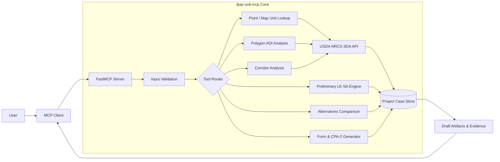
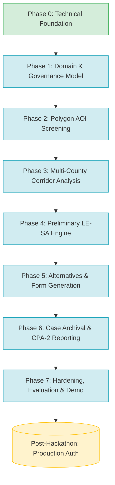

# FPAC Soil MCP Master Plan

## Summary

`fpac-soil-mcp` is a Model Context Protocol (MCP) server for Farmland Protection Policy Act (FPPA) screening. It connects AI assistants to USDA Natural Resources Conservation Service (NRCS) Soil Data Access (SDA) and other public-facing APIs.

The system automates preliminary soil analysis, site assessments, project alternatives comparisons, draft form generation (AD-1006 and CPA-106), and annual CPA-2 reporting records.

The server operates in a sandbox with public data. It generates preliminary screening estimates. It does not issue official NRCS land determinations or sign formal agency documents.

## 1. Problem and Goals

### Problem

General AI tools cannot query or interpret official soil databases safely. Raw database rows lack regulatory context. Users risk mistaking raw soil attributes for binding agency rulings.

### Goals

The system gives MCP clients tools to:

1. Register FPPA requests with submitting agencies, dates, and status.
2. Ingest polygon and linear corridor Areas of Interest (AOIs).
3. Query authoritative SSURGO soil map units and farmland classes.
4. Calculate direct, indirect, alternative, and excluded acreage.
5. Clip and summarize soil data by county and survey area boundaries.
6. Calculate preliminary Land Evaluation (LE) and Site Assessment (SA) scores.
7. Fill draft AD-1006 (parcels) and CPA-106 (corridors) forms.
8. Compare project alternatives without selecting sites.
9. Track request lifecycle, claimed exemptions, and review steps.
10. Generate annual CPA-2 reporting summaries from case history.
11. Keep human authority boundaries explicit on all outputs.

### Users

- Federal and state project planners running initial environmental reviews.
- NEPA and environmental analysts gathering preliminary soil data.
- Grant reviewers checking cited SSURGO map units.
- NRCS field staff tracking and reporting incoming FPPA cases.
- Reporting coordinators preparing annual CPA-2 summaries.

### Non-Goals

The server does not:
- Make binding NRCS Land Evaluation determinations.
- Approve agency Site Assessment scores.
- Grant legal FPPA exemptions.
- Select preferred project alternatives.
- Sign or certify Form AD-1006 or CPA-106.
- Write directly to authoritative agency case databases.
- Run unvalidated, arbitrary user SQL.

## 2. System Architecture

### Key Principles

- **Single Entry Point**: All transports (`stdio`, `sse`, `http`) use one unified runner.
- **Strict Query Boundaries**: Predefined, parameterized SQL templates only. No dynamic SQL passthrough.
- **Explicit Provenance**: Every response includes query timestamps, source tables, and caveats.
- **Clear Status Codes**: Separate `covered`, `unmapped`, `invalid_request`, and `upstream_error` states.
- **Human Authority**: Software generates estimates; only designated officials approve formal determinations.

---

## 3. Phased Delivery Roadmap

The roadmap is structured into sequential phases. Each phase translates directly into an individual `/plan-wave` and `/wave-orchestration` plan.

Technical integration details, source constraints, and implementation breadcrumbs for NASS, Census TIGERweb, and SDA interpretations are maintained in `planning/RESEARCH_PUBLIC_APIS_AND_INTERPRETATIONS.md`.

---

### Phase 0: Technical Foundation Baseline (Complete)

**Goal**: Deliver a stable FastMCP server querying USDA SDA by point coordinates and `mukey`.

**Completed in Orchestration 1**:
- Package setup with `uv`, `fastmcp`, `httpx`, and `pydantic`.
- Point and `mukey` lookup tools (`get_farmland_classification_by_point`, `get_farmland_classification_by_mukey`).
- Scope explanation tool and resource (`explain_fppa_screening_scope`, `fppa://regulatory-notice`).
- Fixed query templates and input validation in `SDAClient`.
- Unit tests with mocked HTTP responses and opt-in live SDA tests.

---

### Phase 1: Domain, Governance & Case State Model

**Goal**: Define the legal, data, and lifecycle state models before adding spatial and calculation features.

**Scope & Deliverables**:
1. **Domain Data Models**: Define Pydantic models for FppaCase, FppaRequest, AgencyProfile, ImpactArea, ExemptionClaim, CalculationRun, and DecisionRecord.
2. **Value Authority States**: Tag every data value with states: machine_estimate, analyst_proposed, agency_approved, or nrcs_official.
3. **Workflow State Machine**: Implement valid state transitions (received, ready_for_analysis, analysis_complete, pending_nrcs_review, provisionally_complete, closed).
4. **Official Source Registry**: Add versioned registry of regulations, official form editions, and regional scoring configurations.
5. **Security & Privacy Baseline**: Strip sensitive personal details from request payloads. Enforce public-only data handling.
6. **Public Data Integration Records**: Define UrbanExemptionRecord, CountyAgProfile, and SoilInterpretationRecord models with source, retrieval time, method version, and configuration provenance.
7. **Integration Configuration**: Define validated configuration for the NASS county agricultural profile, Census TIGERweb urban-area screening, and SDA soil interpretations/NCCPI.

**Exit Criteria**:
- Models validate all workflow transitions.
- Automated code cannot set nrcs_official or agency_approved states.
- Tests verify invalid state transitions are blocked.
- Public-data records reject missing provenance, and integration configuration fails clearly when required settings are absent or invalid.

---

### Phase 2: Polygon AOI Screening & Farmland Analysis

**Goal**: Enable polygon Area of Interest (AOI) intake and spatial soil intersection.

**Scope & Deliverables**:
1. **Geometry Ingestion**: Add tool analyze_farmland_by_polygon accepting GeoJSON Polygon and MultiPolygon.
2. **Spatial Validation**: Check coordinate bounds, vertex count, ring closure, and self-intersections.
3. **Soil Polygon Extraction**: Query intersecting SSURGO map units via SDA spatial endpoints.
4. **Local Acreage Calculation**: Project geometries to local equal-area CRS and calculate acreage per soil unit.
5. **Farmland Breakdown**: Group results by prime, unique, statewide/local importance, not-prime, and unmapped soils.
6. **Artifact Output**: Produce structured summary JSON, CSV map-unit table, and execution manifest.
7. **Urban-Area Pre-Screen**: Overlay AOIs with the configured Census TIGERweb urban-area source and record potentially exempt acreage before soil analysis, without issuing a legal exemption determination.
8. **Soil Interpretation Evidence**: Retrieve component-weighted SDA soil interpretations, including configured NCCPI measures, with source and method provenance.

**Exit Criteria**:
- 50 test AOIs match reviewed test fixtures within 0.1% acreage tolerance.
- Conditional prime classifications are reported accurately without silent conversions.
- Response payloads include full geometry hashes and query metadata.
- Reviewed urban-area fixtures produce the expected preliminary screening flags and preserve non-exempt acreage for soil analysis.
- SDA interpretation and NCCPI results match verified offline benchmark fixtures.

---

### Phase 3: Multi-County Corridor Analysis (CPA-106)

**Goal**: Support linear infrastructure projects (e.g., utility lines, pipelines) spanning multiple counties.

**Scope & Deliverables**:
1. **Corridor Ingestion**: Ingest lines with buffer parameters or pre-buffered corridor polygons.
2. **Spatial Partitioning**: Tile and segment corridors by soil survey areas and county boundaries.
3. **Impact Area Separation**: Track direct-conversion, indirect-conversion, and alternative corridors as distinct geometries.
4. **Corridor Rules Engine**: Apply 7 CFR 658.5(c) rules (omit SA criteria 5 and 6; raise criteria 8 and 11 to 25 points).
5. **Multi-County Reconciliation**: Ensure county-level acreage sums equal total corridor project acreage.
6. **Urban Corridor Segmentation**: Split corridors into preliminary urban-screened and rural analysis segments while preserving the source geometry and screening evidence.
7. **County Agricultural Baselines**: Attach a provenance-bearing NASS county agricultural profile for every county intersected by the corridor.

**Exit Criteria**:
- Multi-county test corridor splits cleanly across survey and county lines.
- Calculations follow CPA-106 rules rather than AD-1006 rules.
- System recovers gracefully from partial upstream network failures.
- Urban and rural segment acreages reconcile to the full corridor acreage within the established tolerance.
- Every intersected county has a configured NASS profile or an explicit unavailable-data status with retrieval provenance.

---

### Phase 4: Preliminary Land Evaluation & Site Assessment Workbench

**Goal**: Calculate reproducible candidate Land Evaluation (LE) and Site Assessment (SA) estimates.

**Scope & Deliverables**:
1. **Candidate Land Evaluation**: Calculate acreage-weighted soil productivity scores (0–100 scale) using approved local rating tables or NCCPI.
2. **Metadata-Driven Rating & Property Query Engine**: Support generalized Soil Data Viewer (`sdvattribute`) query generation to pull arbitrary ratings and agricultural properties beyond standard `cointerp` rules:
   - Dynamic query routing across source tables (`cointerp`, `component`, `chorizon`, `cocropyld`) based on `sdvattribute.attributetablename` and `sdvattribute.attributecolumnname`.
   - Ingestion of state-specific productivity indexes (e.g., Iowa Corn Suitability Rating 2 / CSR2, Minnesota Crop Productivity Index, California Revised Storie Index) and physical/crop metrics (e.g., crop yield, available water capacity).
3. **Site Assessment Measurements**: Automate objective physical measurements (perimeter agricultural adjacency, farm size ratios, infrastructure distances).
4. **Judgment Criteria Handling**: Expose subjective criteria (Part VI items) as input slots with rationale fields. Do not fabricate scores.
5. **Combined Scoring**: Sum LE (100 max) and SA (160 max) to compute preliminary total (260 max).
6. **Threshold Flagging**: Flag projects scoring 160 or higher for mandatory alternatives consideration per 7 CFR 658.4(c)(2).
7. **NCCPI Candidate Method**: When an approved local LE table is unavailable, derive a configured candidate LE score from acreage-weighted SDA NCCPI evidence and label the result as preliminary.
8. **Public-Data SA Measurements**: Use NASS county profiles and TIGERweb spatial evidence for applicable objective SA measurements, while leaving judgment criteria for documented human input.

**Exit Criteria**:
- Deterministic measurements match test cases exactly.
- Missing local methods halt calculations with missing_method errors instead of fabricated values.
- Total scores clearly display preliminary status and breakdown by criterion.
- Configured NCCPI candidate LE calculations match reviewed weighted benchmark fixtures and retain interpretation provenance.
- Metadata-driven SDV property queries dynamically fetch valid state/local agricultural ratings from SDA without requiring static table joins.
- Applicable NASS- and TIGERweb-supported SA measurements match offline fixtures; unavailable data and human-judgment fields remain explicit rather than inferred.

---

### Phase 5: Project Alternatives & Draft Form Generation

**Goal**: Compare project design options and populate draft AD-1006 and CPA-106 forms.

**Scope & Deliverables**:
1. **Alternatives Comparison**: Compare two or more design alternatives side-by-side across soil classes, acreage, and preliminary scores.
2. **Selection Neutrality**: Present comparison tables without ranking or picking a preferred alternative.
3. **Draft AD-1006 Population**: Fill Parts I, II, III, IV, and measurable fields of Part VI for standard parcel projects.
4. **Draft CPA-106 Population**: Fill equivalent sections for corridor projects.
5. **Review Packages**: Generate exportable packages with maps, tables, draft form data, and missing-information lists.
6. **Public-Data Evidence Bundle**: Include the NASS county profile, TIGERweb urban-screening audit record, and SDA interpretation/NCCPI evidence used by each alternative, with configuration and retrieval provenance.

**Exit Criteria**:
- Forms are watermarked as preliminary drafts.
- Incomplete inputs generate missing-information notices.
- Output packages reproduce identically from saved case records.
- Review packages identify the evidence used for every populated public-data field and preserve unavailable-data notices without implying official approval.

---

### Phase 6: Case Archival & CPA-2 Annual Reporting

**Goal**: Maintain an immutable case record and aggregate annual reporting statistics.

**Scope & Deliverables**:
1. **Case Storage**: Store requests, geometry hashes, analysis runs, draft forms, and status updates in local SQLite storage.
2. **Audit Logging**: Record actor role, timestamp, action, and changes for all case events.
3. **Annual Aggregation**: Group completed and tracked cases by reporting fiscal year.
4. **CPA-2 Summary Generation**: Generate annual summary metrics: total requests rreceived, acres evaluated, prime farmland converted, and outcomes.
5. **Drill-Down Verification**: Trace every number on the CPA-2 summary back to individual case IDs.

**Exit Criteria**:
- Synthetic multi-case annual data set generates accurate CPA-2 totals.
- Every metric drills down to individual case records.
- Regeneration produces identical outputs.

---

### Phase 7: Hardening, Evaluation Corpus & Hackathon Submission

**Goal**: Verify reliability, compile the gold-set evaluation package, and assemble final hackathon materials.

**Scope & Deliverables**:
1. **Gold-Set Evaluation Suite**: Run 50+ end-to-end test cases covering point, parcel, corridor, multi-county, and error scenarios.
2. **Adversarial Safety Suite**: Verify the assistant rejects requests to sign forms, issue official rulings, or bypass human review.
3. **Performance Benchmarking**: Measure p50/p95 latency and memory usage across all tool types.
4. **Documentation & Packaging**: Synchronize README.md, manifest.yaml, server.json, and quickstart guides.
5. **Presentation Materials**: Prepare 5-7 minute demo script, slides, and fallback video recording.
6. **Offline Public-Data Corpus**: Add recorded NASS, TIGERweb, and SDA interpretation/NCCPI fixtures covering success, unavailable-data, malformed-response, and partial-upstream-failure scenarios.

**Exit Criteria**:
- 100% pass rate on unit, integration, and offline evaluation tests.
- 0 unhandled exceptions across all gold-set scenarios.
- All public metadata and tool signatures match runtime capabilities.
- Parcel, corridor, LE-SA, and review-package gold-set cases run without live public APIs and reproduce expected provenance-bearing evidence.

---

### Post-Hackathon: Controlled Production Authorization

**Goal**: Transition prototype to production operations under agency authority.

**Requirements**:
- Formal Agency Authority to Operate (ATO) and security compliance.
- User authentication and role-based access control.
- Integration with official agency case management databases.
- Section 508 accessibility compliance audit.
- Centralized logging, monitoring, and incident response runbooks.

---

## 4. Workstream Ownership

| Role | Responsibility |
|---|---|
| **Product Lead** | Scope alignment, hackathon requirements, deliverables. |
| **Domain Expert** | NRCS FPPA rules, form requirements, scoring criteria. |
| **Technical Lead** | MCP architecture, client design, spatial data pipeline. |
| **Evaluation Lead** | Gold-set test cases, benchmark suite, evaluation report. |
| **Security & Privacy Lead** | Data minimization, input validation, sandbox enforcement. |
| **Presentation Lead** | Demo script, slide deck, video recording. |

---

## 5. Definition of Done

The hackathon submission is complete when:

1. Server runs via stdio, sse, and http using standard project scripts.
2. MCP clients can execute point, parcel, corridor, and reporting workflows.
3. Geometry calculations match official soil data within 0.1% tolerance.
4. Draft AD-1006 and CPA-106 packages generate with full provenance.
5. All estimates carry clear non-official preliminary notices.
6. System rejects adversarial attempts to sign forms or bypass review gates.
7. Gold-set evaluation passes with 100% completion.
8. Submission repository includes code, docs, evaluation report, and demo assets.

---

## References

[^1]: GSA MCP Server and AI Agent Government Hackathon guidelines (2026).
[^2]: 7 CFR Part 658 - Farmland Protection Policy Act regulations.
[^3]: USDA NRCS Soil Data Access API documentation.
[^4]: Form AD-1006 (Farmland Conversion Impact Rating) and Form NRCS-CPA-106 (Corridors).
