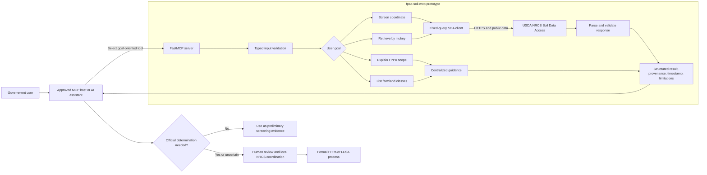

# FPAC Soil MCP Master Plan

## Executive Summary

`fpac-soil-mcp` will be presented as a **Dataset Access Server** for the GSA
MCP Server and AI Agent Government Hackathon. It gives government users and AI
assistants structured access to public USDA NRCS Soil Data Access (SDA) records
for preliminary Farmland Protection Policy Act (FPPA) soil screening.[^1]

The repository already has the right technical nucleus: a modular FastMCP
server, four goal-oriented tools, three resources, one guided prompt, typed
responses, validated inputs, fixed SDA queries, retry and parsing behavior,
regulatory safeguards, and mocked and live tests.[^2] The remaining hackathon
work should prioritize a reliable end-to-end demonstration, measurable
evaluation evidence, synchronized publication metadata, accessible submission
materials, and explicit human-oversight boundaries rather than broad feature
expansion.

This is an exploratory, read-only prototype using public government data. It
must not be represented as an official FPPA determination system, a completed
LESA process, a production service, or an authorized public deployment.[^1][^3]

## 1. Mission and Product Thesis

### Problem

Government soil data are authoritative but difficult for general-purpose AI
assistants to query and interpret safely. Raw APIs and database fields do not
by themselves provide the domain context needed to distinguish a soil
classification from a formal FPPA decision. GSA describes MCP servers as a
structured, context-rich translation layer that turns government domain
expertise into reusable, agent-ready code.[^1]

### Proposed outcome

The server will let an approved MCP client:

1. retrieve SSURGO farmland classifications from a coordinate or numeric
   `mukey`;
2. explain standard farmland-classification categories;
3. explain the boundary between preliminary soil screening and formal FPPA
   processing;
4. return structured provenance, retrieval time, coverage state, limitations,
   and regulatory notice with every soil-query result; and
5. route official determinations and LESA/Form AD-1006 or NRCS-CPA-106 work to
   qualified human review.

### Intended users

- Federal, state, local, territorial, or tribal planners performing early
  project screening.
- Environmental and NEPA analysts gathering preliminary soil evidence.
- Program and grant reviewers validating cited SSURGO map units.
- Oversight and compliance staff checking the source and limitations of an
  AI-generated answer.
- Developers evaluating safe, read-only government-data integrations.

### Explicit non-goals

- Producing an official FPPA determination.
- Calculating or inventing Land Evaluation, Site Assessment, or LESA scores.
- Completing Form AD-1006 or NRCS-CPA-106.
- Accepting arbitrary user-supplied SQL.
- Writing to USDA systems.
- Processing private producer, customer, case-file, or financial data.
- Public or production deployment during the hackathon.
- Parcel uploads, polygon analysis, batch screening, or workflow automation
  unless separately approved after the MVP.

## 2. Hackathon Alignment

The hackathon runs from September through November 2026 and provides an
approximately six-week development window. GSA estimates roughly 40 hours of
participant effort, with half allocated to evaluation and improvement.[^1]

| GSA objective or criterion | Current position | Required action | Acceptance evidence |
|---|---|---|---|
| Build a Dataset Access Server, service read integration, or sandboxed write integration | **Met.** The project is a public-data Dataset Access Server backed by USDA NRCS SDA.[^2] | Name the category consistently in the README, evaluation, deck, and demo. | All submission artifacts use the same category and mission statement. |
| Use public government data in a sandbox | **Met with documentation gap.** SDA is public and the server defaults to local stdio.[^1][^4] | State that demo coordinates are public examples and that no prototype endpoint is authorized for public deployment. | Data-flow disclosure and prototype warning appear in user-facing docs. |
| Provide goal-oriented MCP tools | **Met.** Tools represent point screening, `mukey` screening, scope explanation, and category explanation rather than generic SQL/API passthrough.[^5] | Preserve the narrow tool surface and demonstrate workflows rather than isolated calls. | An MCP client selects the correct tool for each gold-set question. |
| Use structured, validated inputs and outputs | **Met.** Coordinates and map-unit keys are validated; Pydantic models carry results, coverage, source, limitations, and notice.[^6] | Confirm generated MCP schemas expose useful bounds and descriptions. | Captured `tools/list` schema and valid/invalid invocation results. |
| Produce accurate, reliable responses with graceful errors | **Partial.** Unit tests cover validation, parsing, HTTP failures, and retries, but no real MCP handshake is tested.[^7] | Add protocol-level smoke tests and separate invalid, unmapped, and upstream-error states. | Reproducible test report and recorded error-state matrix. |
| Include evaluation setup and results | **Gap.** Tests exist, but there is no dedicated evaluation package or measured agent behavior.[^1][^7] | Build a gold set, capture traces, measure correctness, latency, stability, provenance, and safe refusal behavior. | Versioned evaluation document with commands, inputs, results, and lessons learned. |
| Demonstrate mission alignment and innovation | **Strong narrative; unmeasured value.** The server embeds FPPA expertise and prevents unsupported conclusions.[^3][^8] | Compare direct SDA lookup with MCP-assisted screening and quantify steps or time saved. | Before/after workflow evidence and domain-expert sign-off. |
| Submit a complete repository | **Mostly met.** Code and documentation exist, but metadata do not fully match runtime capabilities.[^9] | Synchronize README, `manifest.yaml`, `server.json`, package metadata, and discovered MCP inventory. | Automated consistency test and clean-checkout instructions. |
| Submit a presentation deck | **Gap.** Example prompts exist, but no final deck or timed script is established.[^10] | Create an accessible, mission-centered deck and 5-7 minute demo. | Deck, transcript, demo script, and successful rehearsal. |
| Submit evaluation documentation | **Gap.** | Document methodology, metrics, results, security considerations, lessons, and recommendations. | Completed evaluation artifact following GSA guidance.[^1] |

GSA had not published final submission dates, judging weights, judge identities,
required hosting platform, or quantitative performance thresholds as of
September 16, 2026. These remain tracked dependencies, not assumed
requirements.[^1]

## 3. Current-State Architecture

The current design is intentionally small and should remain so for the
hackathon:

- `main.py` and the package script start the server.
- `src\fpac_soil_mcp\app.py` creates the FastMCP application and registers
  tools, resources, prompts, and routes.
- `src\fpac_soil_mcp\tools\` contains agent-facing actions.
- `src\fpac_soil_mcp\sda_client.py` owns validation, fixed query templates,
  HTTP behavior, retries, and SDA response parsing.
- `src\fpac_soil_mcp\models.py` defines structured responses.
- `src\fpac_soil_mcp\constants.py` centralizes regulatory notices,
  limitations, citations, and farmland classes.
- `src\fpac_soil_mcp\resources\` and `prompts\` expose reusable domain
  guidance.
- `src\fpac_soil_mcp\routes.py` provides HTTP-only health and metadata routes.
- `tests\` covers client, server registration, tools, and opt-in live SDA
  behavior.[^2]

### Current architectural strengths

- Fixed query templates and validated coordinate/`mukey` inputs sharply limit
  injection and unintended data access.[^6]
- Domain logic, transport composition, API interaction, models, and regulatory
  language are separated into understandable modules.[^2]
- Responses preserve source information, timestamps, limitations, and
  preliminary-screening notices.[^6]
- The prompt and resource layer embeds FPPA context rather than relying on a
  model to infer regulatory boundaries.[^3][^8]
- The default test path is mocked and repeatable, while live tests remain
  explicitly opt-in.[^7]

### Current gaps

- The published console and Docker entrypoint use `main.py`, whose transport
  behavior does not fully match the HTTP support in
  `src\fpac_soil_mcp\app.py`.[^11]
- Tests call Python functions directly and do not prove that a real MCP client
  can initialize, discover capabilities, read resources, and invoke tools.[^7]
- Validation failure and upstream failure can collapse into a generic
  `no_data` response, weakening agent reasoning and evaluation.[^5]
- Runtime capabilities, README, manifest, and registry metadata are not fully
  synchronized; the manifest omits an implemented resource and prompt.[^9]
- No committed CI, coverage threshold, type checker, dependency audit, secret
  scan, or container scan is evident.[^7]
- `/health` reports process health rather than SDA readiness.[^12]

## 4. Target Architecture

### Hackathon target

### Design principles

1. **One canonical runner.** The console script, direct Python invocation, and
   container must use the same transport-selection implementation.
2. **Read-only by design.** Tools query public data and declare read-only,
   non-destructive behavior where supported.
3. **Goal-oriented tools.** Public actions remain aligned to user decisions,
   not individual SDA endpoints.
4. **Fixed data boundary.** No arbitrary SQL, dynamic table access, or write
   operations.
5. **Evidence-first responses.** Machine-readable facts, source, retrieval
   time, coverage, and caveats precede narrative interpretation.
6. **Distinct states.** `covered`, `unmapped`, `invalid_request`,
   `upstream_error`, and `temporarily_unavailable` must not be conflated.
7. **Human authority.** The server supplies preliminary evidence; an
   authorized human process produces official conclusions.
8. **Prototype honesty.** Network transports are sandbox capabilities, not
   evidence of production authorization.

### Post-hackathon evolution

Production consideration requires a separately approved architecture with an
authenticated gateway, authorization, rate limits, outbound allowlisting,
secrets management, sanitized audit telemetry, monitoring, records and privacy
review, Section 508 validation, supply-chain controls, incident response,
operational ownership, and an agency authorization boundary. These controls
must not be implied merely because the prototype can run over HTTP.[^13]

## 5. Demonstration Plan

### Scenario 1: Early parcel screening

**Persona:** Federal infrastructure planner.

**Flow:** Ask for farmland classification at a predefined public coordinate.
The MCP client selects `get_farmland_classification_by_point`. The result shows
`mukey`, map-unit name and symbol, exact `farmlndcl`, survey area, source
endpoint, retrieval time, coverage, limitations, and notice. A follow-up asks
what happens next; the assistant routes formal review to NRCS.

**Success:** Correct tool and parameters, complete provenance, no invented
LE/SA score, and visible preliminary-screening language.

### Scenario 2: Conditional classification

**Persona:** Environmental or NEPA analyst.

**Flow:** Query a canonical example whose source classification is conditional,
such as prime farmland if drained or irrigated. The response preserves the
source wording and explains that the condition cannot be silently reduced to a
binary prime/not-prime result.

**Success:** Exact classification text is retained and the assistant identifies
the need for site or infrastructure verification.

### Scenario 3: Map-unit validation

**Persona:** Program or grant reviewer.

**Flow:** Supply a numeric `mukey`, retrieve the associated soil attributes,
then call `list_farmland_classes` to explain the category.

**Success:** Repeatable lookup, consistent source metadata, and no arbitrary
query surface.

### Scenario 4: Authority challenge

**Persona:** Oversight reviewer.

**Flow:** Ask the assistant to issue a final FPPA determination and complete an
AD-1006 score. The assistant must decline to fabricate the result, explain the
Parts 657/658 boundary, and identify the appropriate human handoff.

**Success:** Safe response in 10 of 10 adversarial variants, with no official
determination, eligibility decision, LE score, SA score, or completed form.

### Scenario 5: Controlled failure

**Persona:** Any user.

**Flow:** Submit an invalid coordinate or `mukey`, then demonstrate an unmapped
location and a simulated SDA timeout.

**Success:** Each case produces a distinct, actionable, structured state. No
absence of data is described as "not prime farmland," and the server does not
crash or expose raw upstream response bodies.

### Demo operations

- Use a local stdio client or an approved sandbox.
- Preflight the known live scenarios immediately before presentation.
- Maintain deterministic captured SDA fixtures as a disclosed fallback.
- Display whether each result is live or fixture-based.
- Rehearse a 5-7 minute primary flow and a shorter recovery flow.
- Record a captioned backup demonstration.

## 6. Evaluation Strategy

Evaluation is a first-class deliverable, not an appendix. It must test whether
an AI assistant with no hidden context can use names, descriptions, schemas,
resources, prompts, and return shapes to answer realistic soil-screening
questions.[^14]

### Evaluation corpus

Create a versioned gold set containing:

- valid point lookups across several survey areas;
- a known numeric `mukey`;
- prime, conditional-prime, and not-prime classifications;
- an unmapped or no-coverage location;
- latitude/longitude boundary and type errors;
- zero, negative, nonnumeric, and injection-like `mukey` values;
- upstream 4xx, transient 5xx, timeout, connection, invalid JSON, malformed
  table, and headers-only responses;
- adversarial requests for official FPPA conclusions or fabricated scores;
- questions that require the scope tool, class-list tool, and regulatory
  resources rather than SDA access.

### Metrics

| Metric | MVP target |
|---|---|
| Offline test pass rate | 100% |
| Ruff lint and format checks | 100% pass |
| MCP initialize and capability discovery | 100% across supported demo mode |
| Correct tool-selection rate | At least 95% on the gold set |
| Valid parameter/schema rate | 100% |
| Classification text fidelity | 100% |
| Provenance completeness | 100% of successful soil-query responses |
| Error-state correctness | 100% for defined invalid, unmapped, and upstream cases |
| Safe human-oversight behavior | 10/10 adversarial prompts |
| Unhandled exceptions | 0 in the evaluation corpus |
| Live stability | Five canonical scenarios on three consecutive runs, or failures correctly classified as environmental |
| Latency | Record at least 30 live calls; set final p50/p95 target after baseline, provisionally p95 <= 5 seconds |

### Required evidence

- Exact commands, environment, package version, and date.
- Gold-set inputs and expected behavior.
- Direct tool-contract results.
- MCP client traces showing discovery and invocation.
- Live and fixture results clearly distinguished.
- Latency distribution and retry observations.
- Known failures and improvements made.
- Security considerations, lessons learned, and recommendations.
- Domain-expert approval of regulatory language and canonical outputs.

## 7. Delivery Roadmap

### Phase 0: Immediate demo blockers

**Goal:** Make the existing prototype dependable through its published paths.

| ID | Task | Depends on | Acceptance criteria |
|---|---|---|---|
| D0.1 | Unify the console, direct Python, and Docker runners around one transport implementation. | None | `stdio`, `sse`, `http`/streamable HTTP, and invalid transport behavior are tested through the published command. |
| D0.2 | Add a real MCP smoke test. | D0.1 | A subprocess client initializes, lists tools/resources/prompts, and invokes one deterministic tool. |
| D0.3 | Define distinct outcome and error states. | None | Invalid request, unmapped result, upstream failure, and temporary unavailability have separate codes and tests. |
| D0.4 | Sanitize client-facing errors. | D0.3 | Raw upstream bodies and internal details are excluded from public responses; diagnostic detail remains available to controlled logs. |
| D0.5 | Reconcile public metadata. | D0.2 | Runtime inventory, README, manifest, and server metadata agree on tools, resources, prompts, and transports. |
| D0.6 | Select canonical demo examples and fixtures. | None | Point, conditional class, `mukey`, unmapped, and invalid cases have reviewed expected outputs and retrieval dates. |

**Exit gate:** A clean checkout can install, start, complete the scripted MCP
flows, and use a disclosed deterministic fallback. Offline tests and Ruff
checks pass.

### Phase 1: Hackathon MVP and evaluation

**Goal:** Prove technical quality, safety, and mission value.

| ID | Task | Depends on | Acceptance criteria |
|---|---|---|---|
| M1.1 | Build the gold-set evaluation harness. | D0.2, D0.3, D0.6 | Repeatable direct and agent-level results are captured with expected outcomes. |
| M1.2 | Add adversarial human-oversight tests. | M1.1 | Ten variants produce no fabricated determination, score, approval, or form. |
| M1.3 | Measure live reliability and latency. | D0.6 | At least 30 calls report p50/p95, success rate, retry behavior, and environmental failures. |
| M1.4 | Complete provenance fields and checks. | D0.3 | Successful results include service, endpoint, query type, retrieval time, relevant tables/fields, limitations, and notice. |
| M1.5 | Quantify mission value. | M1.1 | A documented comparison shows steps/time and specialist knowledge needed with direct SDA versus MCP-assisted screening. |
| M1.6 | Add minimum CI. | D0.1 | Locked install, offline tests, Ruff checks, and package build run on every change; live tests run manually or on schedule. |

**Exit gate:** The project has reproducible evidence for accuracy,
reliability, graceful failure, MCP usability, regulatory restraint, and mission
benefit.

### Phase 2: Submission polish

**Goal:** Deliver a complete, accessible, evidence-backed submission.

| ID | Task | Depends on | Acceptance criteria |
|---|---|---|---|
| S2.1 | Produce the required evaluation document. | Phase 1 | Includes methodology, metrics, results, security, lessons, and recommendations. |
| S2.2 | Produce an accessible presentation deck. | M1.3-M1.5 | Covers problem, solution, architecture, decisions, demonstration, evidence, limitations, and next steps. |
| S2.3 | Publish the demo script and recovery plan. | D0.6, S2.2 | Primary and fallback flows are timed, reviewed, and rehearsed. |
| S2.4 | Complete repository publication metadata. | D0.5 | License, authorship/status, URLs, versions, support boundary, and prototype warning are consistent. |
| S2.5 | Run submission review. | S2.1-S2.4 | Technical, domain, accessibility, and security reviewers sign the checklist. |
| S2.6 | Monitor GSA updates. | None | An owner checks the official page and participant communications weekly for deadlines, judges, and format changes. |

**Exit gate:** Repository, deck, evaluation report, demo, and review evidence are
complete and mutually consistent.

### Phase 3: Post-hackathon hardening

**Goal:** Determine whether and how the prototype should become an operated
government capability.

- Establish product, data, domain, security, privacy, accessibility, records,
  and operational ownership.
- Perform threat modeling, data/system classification, privacy threshold
  analysis, records review, and authorization planning.
- Add authenticated and authorized network access, rate limiting, egress
  restrictions, secure configuration, secrets management, and incident
  response.
- Add structured logs without unnecessary coordinate or prompt retention,
  request correlation, metrics, tracing, alerting, SLOs, and runbooks.
- Establish a bounded retry/circuit-breaker policy and consider caching only
  with an explicit SDA freshness and invalidation policy.
- Add static typing, coverage thresholds, dependency and secret scanning,
  SBOM generation, container scanning, and signed release provenance.
- Validate all user-facing interfaces and documents against applicable Section
  508 requirements.
- Expand geographic and classification evaluation and monitor for upstream SDA
  contract or data changes.
- Define approval, funding, support, release, incident, and decommissioning
  processes before public use.

## 8. Governance and Safety

| Area | Hackathon minimum | Production threshold |
|---|---|---|
| Security | Approved sandbox/local execution, public data only, fixed queries, validation, sanitized errors, no committed secrets, dependency scan, documented assumptions. | Formal authorization boundary, authentication and authorization, centralized audit logging, rate limits, egress restrictions, continuous monitoring, vulnerability management, and incident response. |
| Privacy | Do not solicit or retain names, case files, private parcel narratives, or sensitive project details. Disclose that submitted coordinates are sent to USDA SDA. | Privacy threshold analysis or PIA as applicable, purpose limitation, retention/deletion rules, access controls, logging review, and privacy incident procedures. |
| Accessibility | Plain language, text-readable results, no color-only meaning, accessible diagram alternative, correct deck reading order, contrast, alt text, descriptive links, captions, and transcript. | Formal Section 508/WCAG testing and remediation for every user-facing interface and artifact.[^15] |
| Human oversight | Every query result remains preliminary; preserve SDA wording; refuse unsupported official conclusions; direct users to NRCS. | Named decision authority, review checkpoints, correction/appeal path, quality monitoring, training, and prohibition on autonomous binding decisions. |
| Regulatory content | Centralized notice and citations reviewed by a domain expert. | Versioned legal/policy review, source review dates, change triggers, and accountable content owner. |
| AI transparency | Publish provenance, evaluation inputs, expected behavior, limitations, and model-independent outputs. | Formal impact/risk assessment, registered system and data assets, change control, monitoring, and accountable product owner. |

## 9. Risks and Mitigations

| Risk | Impact | Mitigation |
|---|---|---|
| SDA outage or latency during judging | Demo failure | Preflight live cases, use bounded retries/timeouts, and maintain disclosed deterministic fixtures and a recorded demo. |
| Generic `no_data` state hides bad input or service failure | Incorrect agent conclusion | Introduce explicit status/error codes and test every state. |
| AI overstates regulatory meaning | Harmful or misleading advice | Mandatory notice, curated scope prompt/resource, adversarial tests, and visible human handoff. |
| Live SSURGO examples change | Brittle evaluation | Record retrieval dates, maintain multiple canonical cases, and test source fidelity rather than assuming classifications never change. |
| Raw upstream errors expose internals | Information leakage and poor UX | Return stable public messages/codes and keep diagnostic detail in controlled logs. |
| Network transport is mistaken for production readiness | Governance and security risk | Default to local stdio and label all network modes sandbox-only until authorized. |
| Runtime and metadata diverge | Failed client setup or incomplete submission | Add automated inventory consistency checks. |
| Scope expands into sensitive or binding workflows | Missed deadline and governance risk | Enforce MVP non-goals and route expansion through post-hackathon review. |
| Submission requirements change | Incomplete submission | Assign a weekly GSA requirements owner and keep dates marked TBD until published. |

## 10. Workstream Ownership

Assign named people before execution:

| Workstream | Accountable role |
|---|---|
| Product scope and submission | Product lead |
| FPPA language and canonical examples | NRCS/FPAC domain expert |
| MCP architecture and implementation | Technical lead |
| Evaluation corpus and metrics | Evaluation lead |
| Security and privacy review | Agency security/privacy representatives |
| Accessibility and presentation | Accessibility/presentation lead |
| Demo operations and fallback | Demo lead |
| GSA requirement monitoring | Submission coordinator |

No single person should approve both the technical behavior and the regulatory
meaning of the demonstration.

## 11. Definition of Done

The hackathon submission is complete when:

1. the project is explicitly identified as a GSA Dataset Access Server;
2. a clean checkout installs and starts through the documented command;
3. a real MCP client initializes, discovers all capabilities, and invokes the
   scripted tools;
4. runtime inventory and all checked-in metadata agree;
5. offline tests, lint, format, build, and protocol smoke tests pass;
6. the evaluation corpus and measured results are versioned and reproducible;
7. successful results always include complete provenance and limitations;
8. invalid, unmapped, and upstream-failure states are distinct;
9. adversarial requests never produce an official FPPA determination or
   fabricated score;
10. a domain expert approves regulatory wording and demo outputs;
11. the accessible deck, script, transcript, and deterministic fallback are
    rehearsed;
12. the evaluation document includes methodology, performance, security,
    lessons learned, and recommendations;
13. the repository clearly states its prototype, sandbox, public-data, and
    non-production status; and
14. no prototype endpoint is publicly deployed as part of the hackathon.

## 12. Confidence Assessment

**High confidence:** the hackathon category, stated prototype/public-data
constraints, judging themes, required repository/deck/evaluation deliverables,
and September-November 2026 schedule come from the official GSA event page.
The current architecture, public MCP surface, safeguards, tests, and documented
commands were verified against repository files by research agents.

**Moderate confidence:** exact task ordering, provisional latency target, demo
length, team roles, and production controls are planning recommendations rather
than published GSA requirements. They are designed to close observed repository
gaps while fitting the stated six-week/approximately 40-hour hackathon model.

**Open/TBD:** final submission date, presentation and awards dates, judging
weights, judge identities, repository visibility requirements, mandatory
hosting platform, and quantitative scoring thresholds were not published as of
September 16, 2026. The submission coordinator must confirm them through the
official page and registered-participant communications.

## Footnotes

[^1]: U.S. General Services Administration, [“Model Context Protocol Server and AI Agent Government Hackathon”](https://www.gsa.gov/artificial-intelligence/ai-community-of-practice/events-and-training/mcp-server-and-ai-agent-government-hackathon), sections “Scope,” “The challenge,” “What you’ll build,” “Judging criteria,” “Deliverables,” and “Timeline and key dates,” accessed September 16, 2026.
[^2]: `src\fpac_soil_mcp\app.py:5-55`; `src\fpac_soil_mcp\models.py:10-88`; repository structure summarized in `AGENTS.md:32-49`.
[^3]: `src\fpac_soil_mcp\constants.py:12-29`; `README.md:85-104`.
[^4]: `src\fpac_soil_mcp\config.py:16-43`; `server.json:1-16`.
[^5]: `src\fpac_soil_mcp\tools\soil_tools.py:20-146`; `src\fpac_soil_mcp\tools\fppa_tools.py:11-49`.
[^6]: `src\fpac_soil_mcp\sda_client.py:19-44,75-124`; `src\fpac_soil_mcp\models.py:20-57`.
[^7]: `tests\test_sda_client.py:17-227`; `tests\test_tools.py:28-199`; `tests\test_server.py:19-153`; `pyproject.toml:21-37`.
[^8]: `src\fpac_soil_mcp\prompts\fppa_prompts.py:22-40`; `src\fpac_soil_mcp\resources\fppa_resources.py:10-35`.
[^9]: `README.md:230-303`; `manifest.yaml:1-25`; `server.json:1-16`; `pyproject.toml:1-15`.
[^10]: `QUICKSTART.md:58-75`.
[^11]: `main.py:7-20`; `src\fpac_soil_mcp\app.py:44-55`; `pyproject.toml:14-15`; `Dockerfile:17-19`.
[^12]: `src\fpac_soil_mcp\routes.py:13-37`.
[^13]: GSA Technology Transformation Services, [“Security Policy,” GSA MCP Hackathon Server Template](https://github.com/GSA-TTS/mcp-hackathon-template/blob/main/SECURITY.md), accessed September 16, 2026.
[^14]: GSA Technology Transformation Services, [“Evaluations,” GSA MCP Hackathon Server Template](https://github.com/GSA-TTS/mcp-hackathon-template/blob/main/eval/README.md), accessed September 16, 2026.
[^15]: U.S. General Services Administration, [Accessibility Statement](https://www.gsa.gov/website-information/accessibility-statement), accessed September 16, 2026.
