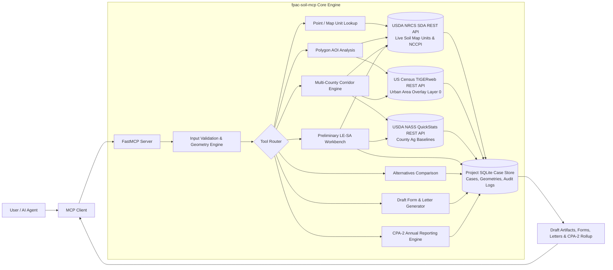
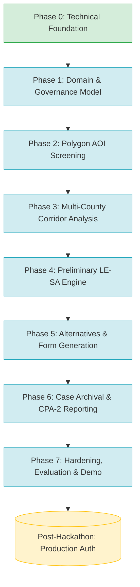

# FPAC Soil MCP Master Plan

## Summary

`fpac-soil-mcp` is a Model Context Protocol (MCP) server for Farmland Protection Policy Act (FPPA) screening. It connects AI assistants to USDA Natural Resources Conservation Service (NRCS) Soil Data Access (SDA) and other public-facing APIs.

The system automates preliminary soil analysis, site assessments, project alternatives comparisons, draft form generation (AD-1006 and CPA-106), and annual CPA-2 reporting records.

The server operates in a sandbox with public data. It generates preliminary screening estimates. It does not issue official NRCS land determinations or sign formal agency documents.

## 1. Problem and Goals

### Problem

General AI tools cannot query or interpret official soil databases safely. Raw database rows lack regulatory context. Users risk mistaking raw soil attributes for binding agency rulings. 

Furthermore, existing desktop GIS automation tools (such as the Colorado NRCS ArcGIS Python Toolbox) require proprietary ArcGIS Pro desktop software, local `arcpy` geoprocessing licenses, manual periodic downloads of USDA NASS Census CSV tables, and local file geodatabase maintenance. Moreover, desktop toolboxes introduce a severe single-county simplification limitation on linear corridors (collapsing multi-county infrastructure alignments to the single largest county by area).

### Goals

The system gives MCP clients tools to:

1. Register FPPA requests with submitting agencies, dates, and status.
2. Ingest polygon and linear corridor Areas of Interest (AOIs) with automated geodesic buffering and unit conversions (`feet`, `meters`, `miles`).
3. Query authoritative SSURGO soil map units and farmland classes via live USDA NRCS Soil Data Access (SDA) REST endpoints.
4. Calculate direct, indirect, alternative, and excluded acreage using equal-area projections (EPSG:6933 and local CRS).
5. Intersect, partition, and reconcile multi-county corridors across county boundaries without arbitrary single-county simplifications.
6. Retrieve live county agricultural census baselines from the USDA NASS QuickStats REST API.
7. Perform automated Decennial Urban Area spatial screening via US Census Bureau TIGERweb REST endpoints.
8. Calculate candidate Land Evaluation (LE) relative ratings normalized by county baselines, supporting state-specific productivity indexes (CSR2, CPI, Storie Index).
9. Calculate preliminary Site Assessment (SA) scores implementing 7 CFR § 658.5(c) corridor scoring rules.
10. Populate watermarked draft Form AD-1006 (parcels) and Form NRCS-CPA-106 (corridors) using standard document template placeholder tags.
11. Generate standard FPPA clearance and exemption determination letters covering statutory exemption categories (including "Minimal Surface Disturbance").
12. Compare project design alternatives (Alternatives B, C, and D) side-by-side with strict analytical neutrality.
13. Track request lifecycle, claimed exemptions, and calculation audits in an ACID-compliant local SQLite case store.
14. Generate annual multi-agency Form NRCS-CPA-2 reporting workbooks aggregating all 19 statutory indicators across the 22 Federal action agencies.
15. Keep human authority boundaries explicit on all outputs.

### Users

- Federal and state project planners running initial environmental reviews.
- NEPA and environmental analysts gathering preliminary soil data.
- Grant reviewers checking cited SSURGO map units.
- NRCS field staff tracking and reporting incoming FPPA cases.
- Reporting coordinators preparing annual CPA-2 summaries.

### Non-Goals

The server does not:
- Make binding NRCS Land Evaluation determinations.
- Approve agency Site Assessment scores.
- Grant legal FPPA exemptions.
- Select preferred project alternatives.
- Sign or certify Form AD-1006 or CPA-106.
- Write directly to authoritative agency case databases.
- Run unvalidated, arbitrary user SQL.

## 2. System Architecture

### Key Principles

- **Cloud-Native & Headless**: Zero dependency on proprietary desktop GIS (`arcpy`), local geodatabases, or manual CSV maintenance.
- **Single Entry Point**: All transports (`stdio`, `sse`, `http`) use one unified runner.
- **Strict Query Boundaries**: Predefined, parameterized SQL templates and REST endpoints only. No dynamic SQL passthrough.
- **True Multi-County Partitioning**: Segment linear corridors by county, fetch county-specific soils and NASS baselines, and enforce strict sum reconciliation.
- **Explicit Provenance**: Every response includes query timestamps, source tables, and caveats.
- **Clear Status Codes**: Separate `covered`, `unmapped`, `invalid_request`, and `upstream_error` states.
- **Human Authority**: Software generates estimates; only designated officials approve formal determinations.

---

## 3. Phased Delivery Roadmap

The roadmap is structured into sequential phases. Each phase translates directly into an individual `/plan-wave` and `/wave-orchestration` plan.

Technical integration details, source constraints, and implementation breadcrumbs for NASS, Census TIGERweb, and SDA interpretations are maintained in `planning/RESEARCH_PUBLIC_APIS_AND_INTERPRETATIONS.md`.

---

### Phase 0: Technical Foundation Baseline (Complete)

**Goal**: Deliver a stable FastMCP server querying USDA SDA by point coordinates and `mukey`.

**Completed in Orchestration 1**:
- Package setup with `uv`, `fastmcp`, `httpx`, and `pydantic`.
- Point and `mukey` lookup tools (`get_farmland_classification_by_point`, `get_farmland_classification_by_mukey`).
- Scope explanation tool and resource (`explain_fppa_screening_scope`, `fppa://regulatory-notice`).
- Fixed query templates and input validation in `SDAClient`.
- Unit tests with mocked HTTP responses and opt-in live SDA tests.

---

### Phase 1: Domain, Governance & Case State Model (Complete)

**Goal**: Define the legal, data, and lifecycle state models before adding spatial and calculation features.

**Scope & Deliverables**:
1. **Domain Data Models**: Define Pydantic models for FppaCase, FppaRequest, AgencyProfile, ImpactArea, ExemptionClaim, CalculationRun, and DecisionRecord.
2. **Value Authority States**: Tag every data value with states: machine_estimate, analyst_proposed, agency_approved, or nrcs_official.
3. **Workflow State Machine**: Implement valid state transitions (received, ready_for_analysis, analysis_complete, pending_nrcs_review, provisionally_complete, closed).
4. **Official Source Registry**: Add versioned registry of regulations, official form editions, and regional scoring configurations.
5. **Security & Privacy Baseline**: Strip sensitive personal details from request payloads. Enforce public-only data handling.
6. **Public Data Integration Records**: Define UrbanExemptionRecord, CountyAgProfile, and SoilInterpretationRecord models with source, retrieval time, method version, and configuration provenance.
7. **Integration Configuration**: Define validated configuration for the NASS county agricultural profile, Census TIGERweb urban-area screening, and SDA soil interpretations/NCCPI.

**Exit Criteria**:
- Models validate all workflow transitions.
- Automated code cannot set nrcs_official or agency_approved states.
- Tests verify invalid state transitions are blocked.
- Public-data records reject missing provenance, and integration configuration fails clearly when required settings are absent or invalid.

---

### Phase 2: Polygon AOI Screening & Farmland Analysis (Complete)

**Goal**: Enable polygon Area of Interest (AOI) intake and spatial soil intersection.

**Scope & Deliverables**:
1. **Geometry Ingestion**: Add tool analyze_farmland_by_polygon accepting GeoJSON Polygon and MultiPolygon.
2. **Spatial Validation**: Check coordinate bounds, vertex count, ring closure, and self-intersections.
3. **Soil Polygon Extraction**: Query intersecting SSURGO map units via SDA spatial endpoints.
4. **Local Acreage Calculation**: Project geometries to local equal-area CRS and calculate acreage per soil unit.
5. **Farmland Breakdown**: Group results by prime, unique, statewide/local importance, not-prime, and unmapped soils.
6. **Artifact Output**: Produce structured summary JSON, CSV map-unit table, and execution manifest.
7. **Urban-Area Pre-Screen**: Overlay AOIs with the configured Census TIGERweb urban-area source and record potentially exempt acreage before soil analysis, without issuing a legal exemption determination.
8. **Soil Interpretation Evidence**: Retrieve component-weighted SDA soil interpretations, including configured NCCPI measures, with source and method provenance.

**Exit Criteria**:
- 50 test AOIs match reviewed test fixtures within 0.1% acreage tolerance.
- Conditional prime classifications are reported accurately without silent conversions.
- Response payloads include full geometry hashes and query metadata.
- Reviewed urban-area fixtures produce the expected preliminary screening flags and preserve non-exempt acreage for soil analysis.
- SDA interpretation and NCCPI results match verified offline benchmark fixtures.

---

### Phase 3: Multi-County Corridor Analysis & Partitioning Engine (CPA-106 Rules) (Complete)

**Goal**: Support linear infrastructure projects (e.g., utility lines, pipelines, transportation rights-of-way) spanning one or multiple counties with geodesic precision and true multi-county segment reconciliation.

**Scope & Deliverables** (referencing `planning/RESEARCH_ARCGIS_TOOLBOX_CROSSWALK.md`):
1. **Plain-Language Corridor Centerline Ingestion & Automated Buffering**:
   - Ingest linear corridor alignments as GeoJSON `LineString`, `MultiLineString`, or WKT centerlines alongside user-specified buffer widths (`buffer_distance` with explicit units: `feet`, `meters`, `miles`).
   - Automate geodesic buffering in equal-area projection space (e.g., NSIDC EASE-Grid 2.0 Global / EPSG:6933 and local equal-area CRS) to generate direct right-of-way conversion polygons.
2. **Impact Area Separation (Direct vs. Indirect vs. Alternatives)**:
   - Track direct corridor conversion (buffered centerline) and indirect impact areas (e.g., construction staging, access roads) as distinct geometries.
   - Automatically erase indirect impact polygons against direct corridor polygons to prevent double-counting of converted farmland.
   - Support up to three named alternative corridor alignments (Corridor Alternatives B, C, and D) matching the Form NRCS-CPA-106 specification.
3. **True Multi-County Segment Partitioning & Sum Reconciliation Engine**:
   - **Overcome Single-County Desktop Limitations**: Unlike desktop GIS tools that collapse multi-county corridors into the single largest county by area, dynamically intersect corridor geometries with Census TIGERweb county boundaries.
   - Partition the corridor into discrete county segments ($S_1, S_2, \dots, S_k$).
   - Process each county segment independently against USDA SDA for soil map unit intersections and USDA NASS QuickStats for county-specific agricultural baselines.
   - Calculate composite acreage-weighted relative Land Evaluation ratings ($RR_{\text{composite}} = \sum (RR_{\text{county\_k}} \times \text{Area}_k / \text{Total Area})$).
   - Enforce rigorous sum reconciliation ensuring segment direct, indirect, prime, and converted acreages sum exactly to total corridor project dimensions within 0.1% tolerance.
4. **Corridor Site Assessment Rules Engine (7 CFR § 658.5(c))**:
   - Implement statutory CPA-106 Site Assessment rules:
     - Criterion 5 (Severance of farm infrastructure) and Criterion 6 (Agricultural support services) are **zeroed out** (0 points).
     - Criterion 8 (Off-farm investments) and Criterion 11 (Alternative corridor routes) are adjusted from 15 to **25 points each** (maintaining the 160-point SA maximum).
5. **Urban Corridor Segmentation**:
   - Overlay corridor segments with Census TIGERweb 2020 Urban Area boundaries to categorize non-urban rural analysis segments vs. potentially exempt urban segments under 7 CFR § 658.2(a) while preserving complete spatial audit trails.
6. **County Agricultural Baselines**:
   - Query live USDA NASS QuickStats REST endpoints for each intersected county to attach land in farms, cropland, and average farm size with retrieval provenance.

**Exit Criteria**:
- Multi-county test corridors split cleanly across county and soil survey boundaries without geographic gaps or overlaps.
- Calculations strictly adhere to 7 CFR § 658.5(c) corridor scoring rules rather than AD-1006 parcel rules.
- Direct, indirect, prime, and converted acreages across multi-county segments reconcile to the full corridor acreage within 0.1% tolerance.
- Every intersected county receives an independent NASS agricultural baseline or explicit unavailable-data status with full provenance.
- System gracefully handles multi-county corridors traversing 5+ counties and multi-state boundaries.

---

### Phase 4: Preliminary Land Evaluation & Site Assessment Workbench

**Goal**: Calculate reproducible candidate Land Evaluation (LE) and Site Assessment (SA) estimates integrating state productivity ratings, relative county baselines, and objective physical measurements.

**Scope & Deliverables** (referencing `planning/RESEARCH_ARCGIS_TOOLBOX_CROSSWALK.md`):
1. **Relative Land Evaluation (LE) Normalization & Scoring (0–100 Scale)**:
   - Calculate normalized relative ratings for each soil map unit $i$ by dividing its productivity rating by the county maximum baseline:
     $$RR_i = \frac{\text{Rating}_i}{\text{Max Rating}_{\text{county}}}$$
   - Calculate the area-weighted relative rating across the AOI:
     $$RR_{\text{AOI}} = \sum_{i=1}^{n} \left( RR_i \times \frac{A_i}{A_{\text{total}}} \right)$$
     $$\text{Candidate LE Score} = \text{round}(RR_{\text{AOI}} \times 100)$$
   - Calculate the county farmland comparison percentile (% of county qualifying farmland with relative rating $\ge RR_{\text{AOI}}$):
     $$\text{Percent Higher} = \left( \frac{A_{\text{qualifying}}}{A_{\text{county\_farmland}}} \right) \times 100$$
   - **Evaluation Rating Null Screening**: Explicitly detect and filter unrated or null values (`[99, 999, None, '']`) from county maximum and weighting calculations, recording explicit data notices rather than skewing averages.
2. **Metadata-Driven Rating & Property Query Engine (Soil Data Viewer Routing)**:
   - Support generalized Soil Data Viewer (`sdvattribute`) dynamic query routing across USDA SDA source tables (`cointerp`, `component`, `chorizon`, `cocropyld`) based on `sdvattribute.attributetablename` and `sdvattribute.attributecolumnname`.
   - Support standard national rating schedules (NCCPI v3 / `National Commodity Crop Productivity Index`) and state-specific productivity indexes:
     - Iowa Corn Suitability Rating 2 (CSR2).
     - Minnesota Crop Productivity Index (CPI).
     - California Revised Storie Index.
     - State-approved local LE schedules with user-supplied or SDA-retrieved county maximum rating overrides (`max_county_rating_override`).
3. **Objective Site Assessment Physical Measurements (0–160 Scale)**:
   - Automate objective physical measurements using Census TIGERweb and spatial algorithms:
     - Criterion 2: Perimeter agricultural adjacency ratio (% of AOI boundary bordering agricultural/rural land).
     - Criterion 7: Farm size comparison ratio against NASS county average farm size.
4. **Explicit Human-Judgment Handling for Subjective Criteria (Part VI)**:
   - Treat subjective criteria (Part VI items) as explicit input slots with mandatory user rationale fields. Never fabricate subjective scores.
   - Enforce regulatory parameter bounds (0–15 or 0–25 points depending on criterion and project type).
5. **Combined Scoring & Mandatory Alternatives Threshold (7 CFR § 658.4(c)(2))**:
   - Sum preliminary LE (0–100) and SA (0–160) scores to compute preliminary Total LESA Score (0–260 max).
   - Statutorily flag projects where $\text{Total LESA Score} \ge 160$ points, triggering mandatory consideration of alternative sites or design modifications.
6. **Live NASS QuickStats Baseline Integration**:
   - Query live NASS QuickStats REST API (`/api_GET/`) by State and County FIPS to retrieve authoritative Census of Agriculture baselines:
     - Total land in farms (acres).
     - Cropland harvested / farmable acres.
     - Average farm size (acres).
     - Total irrigated acres.

**Exit Criteria**:
- Relative LE scoring, county maximum normalization, and comparison percentile calculations match verified benchmark fixtures within 0.01 precision.
- Null and unrated soil map units are cleanly caught, reported in data caveats, and excluded from mathematical skew.
- Dynamic SDV attribute routing retrieves valid state-specific productivity ratings (CSR2, CPI, Storie) from SDA without hardcoded table schema assumptions.
- Objective SA calculations (perimeter adjacency, farm size ratio) reproduce deterministically against test fixtures.
- Projects scoring $\ge 160$ points automatically receive mandatory alternatives flags in response payloads.

---

### Phase 5: Project Alternatives & Draft Form Generation

**Goal**: Compare project design options, populate watermarked draft Form AD-1006 and Form NRCS-CPA-106 documents using canonical placeholder tags, and generate standard FPPA clearance letters.

**Scope & Deliverables** (referencing `planning/RESEARCH_ARCGIS_TOOLBOX_CROSSWALK.md`):
1. **Multi-Alternative Design Slot Mapping**:
   - Compare proposed site/corridor designs alongside up to 3 named alternatives (Site/Corridor Alternatives B, C, and D) across soil types, farmland classes, converted acreages, relative LE values, and preliminary SA scores.
   - Maintain strict analytical selection neutrality without ranking, endorsing, or selecting preferred alternatives.
2. **Standard Document Templating & Tag Substitution Engine**:
   - Ingest and populate standard NRCS document templates matching state office practices (`FormDocument` tag-matching schema):
     - **Administrative & Project Metadata**: `{Project Name}`, `{Agency}`, `{Type of Project}`, `{County}`, `{State}`, `{Date Received}`, `{Date of Evaluation}`, `{Reviewer}`.
     - **County Agricultural Baselines**: `{Acres Irrigated}`, `{Average Farm Size}`, `{County Major Crops}`, `{Farmable Acres}`, `{Farmable Acres Percent}`, `{County Prime Farmland Acres}`, `{County Prime Farmland Percent}`.
     - **Direct & Converted Acreage**: `{Direct Contains Prime Farmland}`, `{Total Prime Farmland}`, `{Total Important Farmland}`, `{Total Converted Farmland Percent}`.
     - **Multi-Alternative Comparative Slots**: `{Alternative B/C/D Prime Farmland}`, `{Alternative B/C/D Important Farmland}`, `{Alternative B/C/D Percent Farmland to be Converted}`, `{Alternative B/C/D Relative Rating Value}`, `{Alternative B/C/D Percent Farmland with Same or Higher Relative Value}`.
     - **Land Evaluation Metrics**: `{Direct Relative Rating Value}`, `{Direct Percent Farmland with Same or Higher Relative Value}`.
3. **Automated FPPA Clearance & Exemption Determination Letters**:
   - Generate official-format draft clearance letters (`Letter_Template.docx` equivalent) when an AOI is determined exempt from FPPA provisions:
     - Inject recipient details: `{Requester Name}`, `{Requester Company}`, `{Requester Street}`, `{Requester City}`, `{Requester State}`, `{Requester Zip}`.
     - Inject standardized regulatory exemption statements (`{Letter Statement}`):
       - **Existing Urban Land / Urbanized Area**: Exemption under 7 CFR § 658.2(a) based on Census TIGERweb urban area screening.
       - **Prior Construction / Committed to Urban Development**: Exemption for lands already committed to non-agricultural uses.
       - **No Farmland Subject to FPPA**: When all intersected soils are classified as "Not prime farmland".
       - **Minimal Surface Disturbance**: Exemption for linear subsurface installations or existing rights-of-way that do not irreversibly convert agricultural soils.
4. **Exportable Evidence Packages & Non-Binding Watermarking**:
   - Emit comprehensive JSON bundles, summary CSV tables, and render watermarked draft `.docx`/`.pdf` documents labeled *"PRELIMINARY SCREENING - NOT AN OFFICIAL NRCS DETERMINATION"*.
   - Include missing-information lists highlighting required human inputs for incomplete Part VI criteria.

**Exit Criteria**:
- Draft AD-1006 (parcels) and CPA-106 (corridors) documents render all template tags cleanly without unreplaced placeholders.
- Side-by-side alternative comparison tables correctly populate Slots B, C, and D from saved calculation runs.
- Clearance letter generator produces legally cited exemption statements for all supported statutory exemption categories.
- Every generated document contains non-official preliminary watermarks and human authority boundary disclaimers.

---

### Phase 6: Case Archival & CPA-2 Annual Reporting

**Goal**: Maintain an immutable local SQLite case record and aggregate annual reporting statistics across all 22 Federal action agencies into Form NRCS-CPA-2 workbooks.

**Scope & Deliverables** (referencing `planning/RESEARCH_ARCGIS_TOOLBOX_CROSSWALK.md`):
1. **ACID-Compliant SQLite Case & Audit Database**:
   - Maintain structured local tables capturing complete case lifecycle records:
     - `cases`: `case_uuid`, `project_name`, `submitting_agency`, `project_type`, `evaluation_type` (`site` vs `corridor`), `status`, `received_date`, `evaluated_date`, `is_exempt`, `exemption_reason`.
     - `geometries`: `geometry_id`, `case_uuid`, `geometry_type` (`direct`, `indirect`, `alt_b`, `alt_c`, `alt_d`), `geometry_wkt`, `geometry_sha256`, `acreage_total`.
     - `cpa2_metrics`: Persistent record of all 19 standard CPA-2 indicators ($A$ through $H$) per project.
     - `audit_events`: Timestamped history of actor roles, workflow state changes, and calculation runs.
2. **19 CPA-2 Statutory Indicator Tracking**:
   - Track every indicator required for the national annual Farmland Protection Policy Act report:
     - $A$: Number of project proposals received.
     - $B$: Total proposed project acres.
     - $C$: Farmland acres evaluated (Prime, Unique, Statewide, Local).
     - $D$: Farmland acres to be converted.
     - $E$: Acreage of prime & unique farmland to be converted.
     - $F$: Acreage of statewide & local important farmland to be converted.
     - $G$: Alternatives considered (acreage reduction or site modification).
     - $H$: Project outcomes and determinations.
3. **22 Standard Federal Action Agency Aggregation**:
   - Support automated classification across the 22 canonical Federal action agencies (e.g., USDA Rural Development, HUD, DOT/FHWA, DOE, DOD/Army Corps of Engineers, FEMA, EPA, DOI/BLM).
4. **Automated Form NRCS-CPA-2 Excel Workbook Generation**:
   - Generate multi-agency fiscal year summary workbooks (`Annual_Report_Template.xlsx` equivalent) aggregating all cases evaluated between October 1 and September 30.
5. **Bidirectional Drill-Down Traceability**:
   - Enable instant verification from any cell in the CPA-2 Excel rollup back to the underlying case UUIDs, spatial geometry hashes, and source SDA/NASS query manifests.

**Exit Criteria**:
- Multi-case synthetic evaluation suite generates exact mathematical totals matching CPA-2 reporting guidelines across all 19 indicators.
- Annual report aggregates accurately across all 22 Federal agencies with zero dropped cases.
- Every metric in the generated Excel report links directly to immutable SQLite case IDs and audit logs.

---

### Phase 7: Hardening, Evaluation Corpus & Hackathon Submission

**Goal**: Verify reliability, compile the gold-set evaluation package, and assemble final hackathon materials.

**Scope & Deliverables**:
1. **Gold-Set Evaluation Suite**: Run 50+ end-to-end test cases covering point, parcel, corridor, multi-county, and error scenarios.
2. **Adversarial Safety Suite**: Verify the assistant rejects requests to sign forms, issue official rulings, or bypass human review.
3. **Performance Benchmarking**: Measure p50/p95 latency and memory usage across all tool types.
4. **Documentation & Packaging**: Synchronize README.md, manifest.yaml, server.json, and quickstart guides.
5. **Presentation Materials**: Prepare 5-7 minute demo script, slides, and fallback video recording.
6. **Offline Public-Data Corpus**: Add recorded NASS, TIGERweb, and SDA interpretation/NCCPI fixtures covering success, unavailable-data, malformed-response, and partial-upstream-failure scenarios.
7. **Test Marker Refactoring**: Refactor pytest test markers to introduce a unified `live_network` marker for all external network tests (USDA SDA, Census TIGERweb, etc.). *(Implemented)*

**Exit Criteria**:
- 100% pass rate on unit, integration, and offline evaluation tests.
- 0 unhandled exceptions across all gold-set scenarios.
- All public metadata and tool signatures match runtime capabilities.
- Parcel, corridor, LE-SA, and review-package gold-set cases run without live public APIs and reproduce expected provenance-bearing evidence.

---

### Post-Hackathon: Controlled Production Authorization

**Goal**: Transition prototype to production operations under agency authority.

**Requirements**:
- Formal Agency Authority to Operate (ATO) and security compliance.
- User authentication and role-based access control.
- Integration with official agency case management databases.
- Section 508 accessibility compliance audit.
- Centralized logging, monitoring, and incident response runbooks.

---

## 4. Workstream Ownership

| Role | Responsibility |
|---|---|
| **Product Lead** | Scope alignment, hackathon requirements, deliverables. |
| **Domain Expert** | NRCS FPPA rules, form requirements, scoring criteria. |
| **Technical Lead** | MCP architecture, client design, spatial data pipeline. |
| **Evaluation Lead** | Gold-set test cases, benchmark suite, evaluation report. |
| **Security & Privacy Lead** | Data minimization, input validation, sandbox enforcement. |
| **Presentation Lead** | Demo script, slide deck, video recording. |

---

## 5. Definition of Done

The hackathon submission is complete when:

1. Server runs via stdio, sse, and http using standard project scripts.
2. MCP clients can execute point, parcel, corridor, and reporting workflows.
3. Geometry calculations match official soil data within 0.1% tolerance.
4. Draft AD-1006 and CPA-106 packages generate with full provenance.
5. All estimates carry clear non-official preliminary notices.
6. System rejects adversarial attempts to sign forms or bypass review gates.
7. Gold-set evaluation passes with 100% completion.
8. Submission repository includes code, docs, evaluation report, and demo assets.

---

## References

[^1]: GSA MCP Server and AI Agent Government Hackathon guidelines (2026).
[^2]: 7 CFR Part 658 - Farmland Protection Policy Act regulations.
[^3]: USDA NRCS Soil Data Access API documentation.
[^4]: Form AD-1006 (Farmland Conversion Impact Rating) and Form NRCS-CPA-106 (Corridors).
