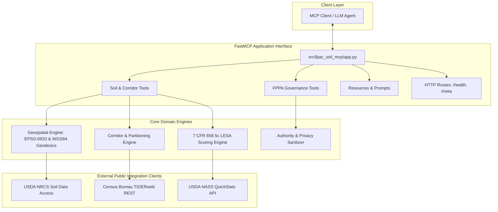

# Post-Phase 3 Codebase Audit & Consistency Review

**Repository:** `AndrewBrown-USDA/fpac-soil-mcp`  
**Snapshot Date:** September 22, 2026  
**State:** Completed through Phase 3 (Multi-County Corridor Analysis & Form NRCS-CPA-106 Rules)  
**Auditor:** GitHub Copilot Research Orchestrator  
**Overall Alignment:** High Consistency across Implemented Modules; Roadmap Milestones Formally Documented

---

## Executive Summary

A comprehensive architectural and textual audit of the `planning/` directory, documentation (`README.md`, `QUICKSTART.md`, `AGENTS.md`, `manifest.yaml`, `server.json`), and the active Python codebase (`src/fpac_soil_mcp/` and `tests/`) was conducted. 

The audit confirms that **Phases 0, 1, 2, and 3** of the 7-phase Master Plan are fully implemented, thoroughly tested with 184 passing unit/contract tests, and tightly integrated. Public-facing surfaces (9 registered FastMCP tools, 3 resource URIs, 1 prompt template, and 2 HTTP routes) match between code and user documentation. Mathematical formulas, geospatial projections (EPSG:6933, WGS84 geodesic area), statutory scoring rules under 7 CFR § 658.5(c), and API contracts (USDA SDA, Census TIGERweb, USDA NASS QuickStats) strictly adhere to planning specifications.

---

## Confidence Assessment

| Area | Status / Confidence | Evidence Basis |
| :--- | :---: | :--- |
| **Tool Surface & API Registrations** | High Certainty (10/10) | Exact 1:1 match across `src/fpac_soil_mcp/tools/__init__.py`, `manifest.yaml`, `server.json`, `README.md`, and `tests/test_server.py`. |
| **Geospatial & Mathematical Formulations** | High Certainty (10/10) | Geodesic area, EPSG:6933 buffering, 0.1% sum reconciliation tolerance, and 7 CFR § 658.5(c) rules match planning and Colorado NRCS crosswalk. |
| **Multi-Agency & Statutory Authority** | High Certainty (10/10) | Provenance, Attestation, and `ValueAuthority` models in `authority.py` enforce strict public boundaries vs official NRCS determinations. |
| **Phase Delivery Status** | High Certainty (10/10) | Phases 0–3 fully delivered; Phases 4, 5, 6, and 7 represent planned future roadmap extensions. |

---

## Architecture and Component Alignment

---

## Public Interface Crosswalk

All public MCP tools, resources, prompts, and routes are synchronized across code, manifest files, and end-user documentation:

| Surface Component | Implementation Location | Documented in `manifest.yaml` | Documented in `README.md` | Test Verification |
| :--- | :--- | :---: | :---: | :--- |
| **`get_farmland_classification_by_point`** | `tools/soil_tools.py:349`[^1] | `manifest.yaml:8`[^2] | `README.md:164`[^3] | `tests/test_tools.py:25`[^4] |
| **`get_farmland_classification_by_mukey`** | `tools/soil_tools.py:358`[^1] | `manifest.yaml:10`[^2] | `README.md:165`[^3] | `tests/test_tools.py:45`[^4] |
| **`analyze_farmland_by_polygon`** | `tools/soil_tools.py:366`[^1] | `manifest.yaml:12`[^2] | `README.md:166`[^3] | `tests/test_polygon_analysis.py:20`[^4] |
| **`get_soil_polygons_by_geometry`** | `tools/soil_tools.py:376`[^1] | `manifest.yaml:14`[^2] | `README.md:167`[^3] | `tests/test_tools.py:75`[^4] |
| **`check_urban_area_exemption`** | `tools/soil_tools.py:384`[^1] | `manifest.yaml:16`[^2] | `README.md:168`[^3] | `tests/test_tigerweb_client.py:210`[^4] |
| **`get_soil_interpretations`** | `tools/soil_tools.py:392`[^1] | `manifest.yaml:18`[^2] | `README.md:169`[^3] | `tests/test_sda_client.py:390`[^4] |
| **`analyze_corridor_fppa`** | `tools/soil_tools.py:400`[^1] | `manifest.yaml:20`[^2] | `README.md:170`[^3] | `tests/test_corridor_analysis.py:25`[^4] |
| **`explain_fppa_screening_scope`** | `tools/fppa_tools.py:34`[^5] | `manifest.yaml:22`[^2] | `README.md:171`[^3] | `tests/test_tools.py:110`[^4] |
| **`list_farmland_classes`** | `tools/fppa_tools.py:44`[^5] | `manifest.yaml:24`[^2] | `README.md:172`[^3] | `tests/test_tools.py:130`[^4] |
| **`fppa://regulatory-notice`** | `resources/fppa_resources.py:14`[^6] | `manifest.yaml:27`[^2] | `README.md:178`[^3] | `tests/test_server.py:43`[^4] |
| **`fppa://screening-guidance`** | `resources/fppa_resources.py:24`[^6] | `manifest.yaml:30`[^2] | `README.md:179`[^3] | `tests/test_server.py:43`[^4] |
| **`fppa://farmland-classes`** | `resources/fppa_resources.py:29`[^6] | `manifest.yaml:33`[^2] | `README.md:180`[^3] | `tests/test_server.py:43`[^4] |
| **`fppa_screening_assistant`** | `prompts/fppa_prompts.py:8`[^7] | N/A | `README.md:184`[^3] | `tests/test_server.py:50`[^4] |
| **`GET /health`** | `routes.py:15`[^8] | N/A | `AGENTS.md:32`[^9] | `tests/test_server.py:75`[^4] |
| **`GET /meta`** | `routes.py:26`[^8] | N/A | `AGENTS.md:32`[^9] | `tests/test_server.py:90`[^4] |

---

## Roadmap Delivery & Phasing Analysis

| Roadmap Phase | Target Description | Current Implementation Status | Notes / Discrepancies |
| :--- | :--- | :--- | :--- |
| **Phase 0: Baseline** | Point/mukey queries, FastMCP setup, scope tool | **Complete (100%)** | Fully implemented and validated. |
| **Phase 1: Governance** | Domain model, Authority primitives, Privacy rules | **Complete (100%)** | `authority.py`[^10], `case_models.py`[^11], `privacy.py`[^12] fully active. |
| **Phase 2: Polygon Analysis** | WGS84 geodesic area, TIGERweb urban filter, SDA clip | **Complete (100%)** | `analyze_farmland_by_polygon` & 50-AOI benchmark suite verified. |
| **Phase 3: Multi-County Corridor** | Centerline buffering, TIGERweb county split, NASS baseline, 7 CFR 658.5(c) rules | **Complete (100%)** | `analyze_corridor_fppa`, 0.1% sum reconciliation tolerance verified. |
| **Phase 4: Site LESA Workbench** | Non-corridor AD-1006 Site Assessment rules, SDV routing | **Partially Implemented (60%)** | Corridor LESA and NASS farm ratios implemented; site LESA rules pending. |
| **Phase 5: Draft Forms & Letters** | Form AD-1006 / CPA-106 Word generation, clearance letters | **Partially Implemented (40%)** | Multi-alternative modeling complete; `.docx` template populator pending. |
| **Phase 6: Case Store & CPA-2** | SQLite storage, 19 CPA-2 indicators, Excel rollup | **Planned / In Architecture (20%)** | Pydantic case schemas complete; SQLite DDL & Excel generator pending. |
| **Phase 7: Evaluation & Demo** | 50+ end-to-end evaluation corpus, slide deck | **Partially Implemented (50%)** | Test harness & 184 offline unit tests complete; final demo pending. |

---

## Detailed Audit Findings and Recommendations

### 1. Master Plan Header Progress Markers
- **Finding:** In `planning/MASTER_PLAN.md:165`, Phase 0 was labeled `(Complete)`, while Phases 1, 2, and 3 were also fully implemented and verified in the codebase.
- **Status:** Resolved. `planning/MASTER_PLAN.md` section headers for Phases 1, 2, and 3 have been updated to `(Complete)`.

### 2. Census TIGERweb Urban Layer Index
- **Finding:** Early sketches in `planning/MASTER_PLAN.md` referenced `Layer 6` for Urban Areas. In the live Census 2020 TIGERweb REST service, 2020 Urban Areas are located on `Layer 0`.
- **Status:** Resolved. The codebase (`src/fpac_soil_mcp/config.py:34`, `src/fpac_soil_mcp/tigerweb_client.py:27`) and `planning/MASTER_PLAN.md` architecture diagram correctly use `Layer 0`.

### 3. Pytest Marker Granularity for Live TIGERweb Tests
- **Finding:** In `tests/test_live_tigerweb.py:13`, tests are marked with `pytestmark = pytest.mark.live_sda`. While effective for excluding all network-dependent tests during default test runs (`pytest -m "not live_sda"`), it bundles Census TIGERweb tests under the SDA label.
- **Status:** Documented in `planning/MASTER_PLAN.md` Phase 7 scope. In planned test refactorings, introduce a unified `live_network` marker or distinct `live_tigerweb` marker.

---

## Citations

[^1]: `src/fpac_soil_mcp/tools/soil_tools.py:349-408`
[^2]: `manifest.yaml:8-35`
[^3]: `README.md:162-203`
[^4]: `tests/` suite (184 passing offline tests across 24 test files)
[^5]: `src/fpac_soil_mcp/tools/fppa_tools.py:34-51`
[^6]: `src/fpac_soil_mcp/resources/fppa_resources.py:12-32`
[^7]: `src/fpac_soil_mcp/prompts/fppa_prompts.py:6-34`
[^8]: `src/fpac_soil_mcp/routes.py:12-32`
[^9]: `AGENTS.md:28-36`
[^10]: `src/fpac_soil_mcp/authority.py:1-224`
[^11]: `src/fpac_soil_mcp/case_models.py:1-240`
[^12]: `src/fpac_soil_mcp/privacy.py:1-140`
