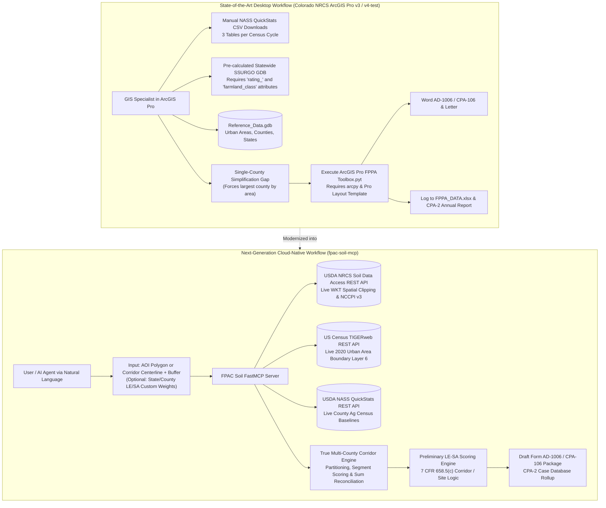
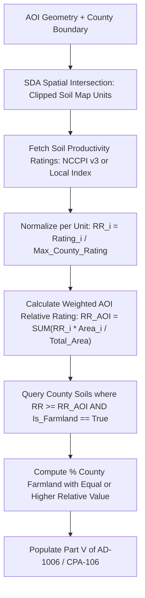
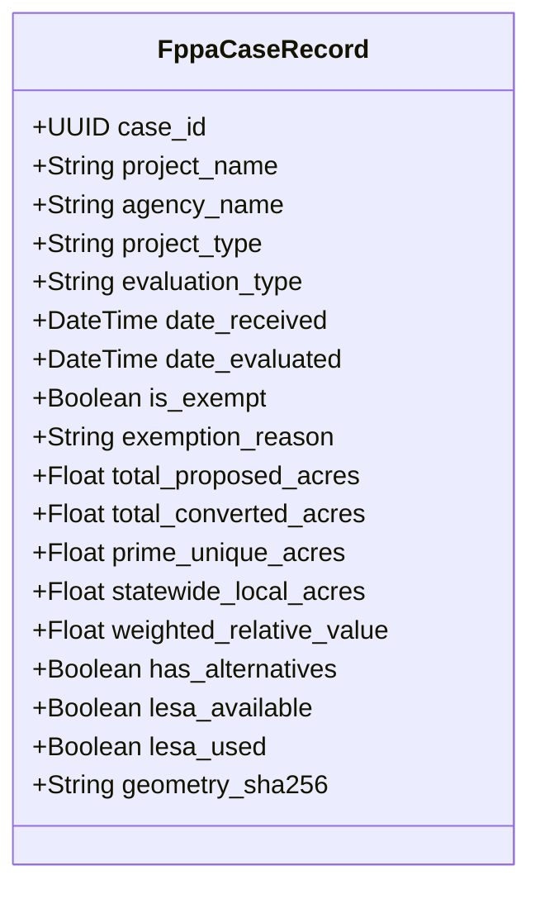

# Research Report: Crosswalk & Parity Analysis of Colorado NRCS ArcGIS Python Toolbox (v3 & v4-test) vs. FPAC Soil MCP Server

**Document Identifier:** `planning/RESEARCH_ARCGIS_TOOLBOX_CROSSWALK.md`  
**Author / Orchestrator:** AI Research Orchestration Agent  
**Date:** September 17, 2026  
**Primary References:**  
- Colorado NRCS ArcGIS Pro FPPA Python Toolbox v3 Production (`D:\FPPA-Toolbox-Troyer\v3\Toolbox\ArcGIS Pro FPPA Toolbox.pyt` by Michael Troyer, State GIS Specialist)
- Colorado NRCS ArcGIS Pro FPPA Python Toolbox v4-test Development (`D:\FPPA-Toolbox-Troyer\v4-test\Toolbox\ArcGIS Pro FPPA Toolbox.pyt`)
- Colorado NRCS Setup Instructions (`D:\FPPA-Toolbox-Troyer\v3\ArcGIS Pro FPPA Toolbox Setup Instructions.txt`)
- FPAC Soil MCP Master Plan (`planning/MASTER_PLAN.md` and `planning/RESEARCH_PUBLIC_APIS_AND_INTERPRETATIONS.md`)
- Existing MCP Implementation (`src/fpac_soil_mcp/`)

---

## 1. Executive Summary

This research document evaluates the USDA NRCS Colorado State Office ArcGIS Python Toolbox (both the **v3 production** and **v4-test development** toolboxes authored by Michael Troyer) against the existing architecture and future roadmap of the **FPAC Soil MCP Server** (`fpac-soil-mcp`). 

The Colorado Toolbox represents the current state-of-the-art for USDA NRCS desktop-assisted Farmland Protection Policy Act (FPPA; 7 U.S.C. § 4201 et seq.; 7 CFR Part 658) administration. While it effectively automates the population of Form AD-1006 (Site Projects), Form NRCS-CPA-106 (Corridor Projects), clearance letters, and annual CPA-2 multi-agency rollups, it relies heavily on manual data preparation, proprietary ArcGIS Pro (`arcpy`) licenses, pre-downloaded static USDA NASS CSVs, and local geodatabases.

Furthermore, a critical architectural gap in both v3 and v4-test of the desktop toolbox is that **when a linear corridor traverses multiple counties, the tool arbitrarily collapses the analysis to the single largest intersected county by area**. This introduces severe distortion under 7 CFR Part 658 because soil productivity ratings, county maximum baselines ($R_{\text{county\_max}}$), and NASS agricultural metrics vary dramatically across county borders.

By modernizing these workflows into an AI-orchestrated Model Context Protocol (MCP) server, we can achieve complete functional parity and significantly streamline the user experience:
1. **Plain-Language & Zero-Setup Ingestion**: An end-user interacting with an LLM agent in plain language needs only to supply an Area of Interest (polygon or corridor centerline with buffer distance) and optional state/county Land Evaluation (LE) or Site Assessment (SA) weighting overrides.
2. **True Multi-County Segment Partitioning**: Rather than simplifying to a single county, `fpac-soil-mcp` dynamically intersects, partitions, and reconciles corridor segments across multiple counties with sum reconciliation.
3. **Live Authoritative REST Pipelines**: The MCP server handles all data retrieval, spatial clipping, Census urban screening, NASS agricultural baselines, LE/SA scoring, and draft artifact generation in real time via live authoritative federal REST endpoints (USDA SDA, USDA NASS QuickStats API, US Census TIGERweb).



---

## 2. Comprehensive Crosswalk Matrix: v3, v4-test & `fpac-soil-mcp`

The table below provides a granular comparison across the Colorado v3 toolbox, v4-test development toolbox, and `fpac-soil-mcp`.

| Analytical Domain | Colorado v3 Production (`.pyt`) | Colorado v4-test Development (`.pyt`) | Current `fpac-soil-mcp` (Phases 0–2) | Target State in Master Plan (Phases 3–6) |
| :--- | :--- | :--- | :--- | :--- |
| **Tool Structure & Architecture** | Single tool `FPPA_Tool` with UI dropdown for `Site` vs `Corridor`[^1]. | Split into `FPPA_Tool_Site` and `FPPA_Tool_Corridor`; modularized functions[^13]. | Modular FastMCP tool routing (`soil_tools`, `fppa_tools`)[^2]. | Specialized tool endpoints: `analyze_farmland_by_polygon`, `analyze_corridor_fppa`, `calculate_preliminary_lesa`[^3]. |
| **Execution Environment** | Requires ArcGIS Pro desktop, `arcpy`, `.aprx` project with `FPPA Layout`[^1]. | Requires ArcGIS Pro desktop, `arcpy`, `.aprx` with `GIS Templates` (`.lyrx`)[^13]. | Pure Python 3.11+, FastMCP, Shapely, PyProj, Pydantic, HTTPX. Runs on any OS / Docker[^2]. | Headless, containerized cloud service supporting `stdio`, `sse`, and `http` transports[^3]. |
| **Corridor Ingestion & Buffering** | Ingests pre-buffered polygons only; no automated line buffering[^1]. | Ingests `Polyline` centerline and `Corridor_Width` (feet); automated `arcpy.Buffer`[^13]. | Ingests GeoJSON Polygon/MultiPolygon with topological validation[^4]. | Ingests `LineString`/`MultiLineString` centerlines with explicit buffer distance and units (`feet`, `meters`, `miles`)[^3]. |
| **Multi-County Handling** | **Arbitrary Simplification**: Selects single largest county by area[^1]. | **Arbitrary Simplification**: Selects single largest county by area (adds state filter)[^13]. | Single-polygon screening implemented[^4]. | **True Multi-County Segmentation**: Partitions corridor by county, fetches per-county soils/NASS stats, and reconciles totals[^3]. |
| **Spatial Coordinate System** | Inherits map/data projection; planar square meters[^1]. | Enforces **WGS 84 / NSIDC EASE-Grid 2.0 Global (EPSG: 6933)** across all clips[^13]. | Uses WGS84 geodesic algorithms (`pyproj.Geod`) and local equal-area CRS[^4]. | Full geodesic & EPSG:6933 equal-area spatial operations with sub-0.1% acreage tolerance[^3]. |
| **Urban Exemption Screening** | Erases AOI against static local feature class `Urban_Areas` in `Reference_Data.gdb`[^1]. | Erases AOI against static local `Urban_Areas` feature class[^13]. | Live spatial query to US Census Bureau TIGERweb 2020 Urban Areas MapServer (Layer 6)[^5]. | Automated non-urban boundary ratio calculation, perimeter adjacency screening, and exemption determination drafting under 7 CFR § 658.2(a)[^3]. |
| **Soils & SSURGO Ingestion** | Requires pre-loaded statewide SSURGO layer with `farmland_class` and `rating_`[^1]. | Requires pre-loaded statewide SSURGO layer with pre-calculated fields[^13]. | Live spatial SQL query to USDA NRCS Soil Data Access (SDA) Tabular REST API (`STIntersection`)[^6]. | Live SDA queries with automated Soil Data Viewer (`sdvattribute`) routing for state-specific soil productivity indexes (CSR2, CPI, Storie)[^7]. |
| **Farmland Classification Breakdown** | Maps 27 SSURGO strings into 2 bins: *Prime & Unique* vs *Statewide & Local*[^1]. | Maps 27 SSURGO strings into 2 bins[^13]. | Categorizes all 6 standard SSURGO farmland classes (Prime, Unique, Statewide, Local, Conditional, Not Prime)[^8]. | Fully granular map unit breakdown including conditional prime qualifiers (e.g. *if irrigated*, *if drained*)[^3]. |
| **Land Evaluation (LE) Relative Rating** | Normalizes map unit ratings by county maximum: $RR = \text{Rating} / \text{Max Rating}$. Calculates AOI weighted average and county % farmland with $RR \ge RR_{\text{AOI}}$[^1]. | Same relative rating formula; adds validation warning for null ratings (`[99, 999, None]`)[^13]. | Implemented component-weighted NCCPI v3 ratings via SDA query templates[^6]. | Automated candidate LE (0–100) using local rating schedules or NCCPI v3, calculating relative ratings, null screening, and county comparison percentiles[^3]. |
| **NASS Agricultural Demographics** | Requires manual download and placement of 3 CSVs: `Acres Irrigated.csv`, `Average Farm Size.csv`, `Farmable Acres.csv`[^9]. | Requires manual download and placement of 3 CSVs[^13]. | API design completed in `RESEARCH_PUBLIC_APIS_AND_INTERPRETATIONS.md`[^7]. | Live queries to USDA-NASS QuickStats API (`/api_GET/`) by State/County FIPS to extract land in farms, cropland, and average farm size[^3]. |
| **Site Assessment (SA) Scoring** | Leaves Part VI blank for sponsoring Federal agency completion[^1]. | Leaves Part VI blank for sponsoring Federal agency completion[^13]. | Domain models defined for SA criteria and rationale[^10]. | Hybrid SA engine: automates objective spatial measurements (perimeter ag %, farm size ratio), applies 7 CFR 658.5(c) corridor rules[^3]. |
| **Draft Document Generation** | In-place tag substitution in `AD 1006.docx`, `CPA 106.docx`, and `Letter_Template.docx`[^11]. | In-place tag substitution; adds "Minimal Surface Disturbance" exemption statement[^13]. | Generates structured JSON responses and summary CSV data tables[^4]. | Generates watermarked draft AD-1006 / CPA-106 documents, standard clearance letters, and provenance-bearing JSON review bundles[^3]. |
| **Annual Reporting & Case Tracking** | Appends rows to shared Excel file `Log\FPPA_DATA.xlsx` and aggregates into `Annual_Report_Template.xlsx`[^12]. | Appends rows to shared Excel file `Log\FPPA_DATA.xlsx`[^13]. | Pydantic case state models defined[^10]. | ACID-compliant SQLite case store tracking case UUIDs, geometry hashes, and generating automated fiscal year Form CPA-2 reports[^3]. |

---

## 3. Deep-Dive: Algorithmic & Mathematical Crosswalk

### 3.1 Land Evaluation (LE) Relative Value Calculation
The Colorado Toolbox implements the standard NRCS Part V (or Part IV on AD-1006) Land Evaluation scoring algorithm:

1. **County Maximum Normalization:**
   For each soil map unit $i$ within the county, the raw productivity rating $R_i$ (e.g., NCCPI or local LE index) is divided by the maximum rating found in that county:
   $$RR_i = \frac{R_i}{R_{\text{county\_max}}}$$

2. **AOI Area-Weighted Relative Value:**
   The weighted relative rating across all acres of the AOI ($A_{\text{total}}$) is calculated as:
   $$RR_{\text{AOI}} = \sum_{i=1}^{n} \left( RR_i \times \frac{A_i}{A_{\text{total}}} \right)$$
   $$\text{AOI Rating Value} = \text{round}(RR_{\text{AOI}} \times 100)$$

3. **County Farmland Comparison Percentile:**
   The toolbox queries all county-wide soil map units where $RR_{\text{county}} \ge RR_{\text{AOI}}$ and `PrimeFarmland = 1` (qualifying farmland), summing their area ($A_{\text{qualifying}}$) against the total county farmland area ($A_{\text{county\_farmland}}$):
   $$\text{Percent Higher} = \left( \frac{A_{\text{qualifying}}}{A_{\text{county\_farmland}}} \right) \times 100$$

*In `fpac-soil-mcp`*, this logic is replicated without pre-loaded local layers by executing a fast server-side SDA T-SQL Common Table Expression (CTE) or computing the intersection over SDA-retrieved county soil geometries.



### 3.2 Site Assessment (SA) Scoring Rules & Corridor Variations (7 CFR § 658.5)
The Farmland Protection Policy Act establishes distinct Site Assessment rules for Site (AD-1006) vs. Corridor (CPA-106) projects:

- **Form AD-1006 (Site Projects - 12 Criteria, Max 160 pts):**
  - Criteria 1–3: Agricultural land use and perimeter in agriculture (0–15, 0–10, 0–20 pts).
  - Criteria 4–7: Farm size, agricultural infrastructure, and farm size compared to county average (0–10, 0–20, 0–15, 0–10 pts).
  - Criteria 8–12: Off-farm environmental impacts, public services, comprehensive planning, and alternative sites (0–15 pts each).

- **Form CPA-106 (Corridor Projects - 10 Criteria per 7 CFR § 658.5(c)):**
  - Criteria 5 and 6 are statutory **zeroed out** (0 pts) because linear rights-of-way do not sever farm support infrastructure in the same manner as large site developments.
  - Criterion 8 (Off-farm investments) and Criterion 11 (Alternative corridor routes) weights are raised from 15 to **25 points each** to maintain the 160-point total.

- **160-Point Mandatory Alternatives Threshold (7 CFR § 658.4(c)(2)):**
  - When $\text{Total LESA Score} = \text{LE (0–100)} + \text{SA (0–160)} \ge 160$, the Federal action agency is statutorily required to consider alternative sites or mitigation measures to avoid farmland conversion.

---

## 4. Elimination of Manual Data Preparation Burdens

The primary operational friction in the Colorado Toolbox stems from mandatory manual data maintenance. The table below details how `fpac-soil-mcp` eliminates each burden:

```
+----------------------------------------------------------------------------------------------------+
|                               COLORADO ARCGIS PRO TOOLBOX (MANUAL)                                 |
|                                                                                                    |
|  [User Setup & Maintenance Steps]                                                                   |
|   1. Manually navigate to NASS QuickStats website every Census year.                               |
|   2. Run 3 complex queries (Irrigated Acres, Farm Size, Farmable Acres).                            |
|   3. Export to CSV, rename files, and manually overwrite files in Toolbox\Data\Tables\.            |
|   4. Download multi-gigabyte SSURGO datasets from Web Soil Survey.                                 |
|   5. Geoprocess statewide feature classes to attach rating_le_score and farmland_class fields.     |
|   6. Maintain static Reference_Data.gdb (Counties, State Boundaries, Urban Areas).                 |
|   7. Open ArcGIS Pro workstation, draw project polygon in sketch tool, and run GP tool.            |
+----------------------------------------------------------------------------------------------------+
                                                 │
                                 REPLACED IN FPAC-SOIL-MCP BY
                                                 ▼
+----------------------------------------------------------------------------------------------------+
|                               FPAC-SOIL-MCP SERVER (FULLY AUTOMATED)                               |
|                                                                                                    |
|  [Zero-Setup Automated Pipeline]                                                                   |
|   • Live Census TIGERweb API: On-demand spatial REST screening of Decennial Urban Boundaries.      |
|   • Live USDA NRCS SDA API: On-demand WKT spatial clipping, farmland classification & NCCPI v3.   |
|   • Live USDA NASS QuickStats API: On-demand query of county ag baselines by State/County FIPS.    |
|   • Natural Language Interface: User provides simple coordinate list, GeoJSON, or corridor centerline|
|     with buffer distance in plain English.                                                         |
|   • Cloud/Local Execution: Zero GIS software or desktop licenses required.                         |
+----------------------------------------------------------------------------------------------------+
```

---

## 5. Streamlined Natural Language Agent Workflows

### 5.1 Conversational User Experience Examples

#### Scenario A: Simple Agricultural Parcel Screening
> **User:** *"Screen this 40-acre proposed battery storage site near Greeley, CO (GeoJSON polygon). Check if it qualifies for FPPA and what the prime farmland breakdown is."*  
> **Agent Action:**
> 1. Validates polygon topology and computes geodesic acreage via `analyze_farmland_by_polygon`.
> 2. Queries Census TIGERweb API (`check_urban_area_exemption`).
> 3. Queries USDA SDA API for soil map unit spatial intersection and NCCPI v3 interpretations.
> 4. Returns plain-language summary with exact prime farmland acreage, percentage, and candidate LE score.

#### Scenario B: Multi-County Linear Transmission Corridor
> **User:** *"We are assessing a 12-mile electric transmission line corridor from Fort Collins to Loveland, CO. Centerline geometry is attached. Direct right-of-way width is 100 feet. Score this under CPA-106 rules."*  
> **Agent Action:**
> 1. Calls `analyze_corridor_fppa` with `buffer_distance_feet=50` (50 ft on each side of centerline).
> 2. Automatically tiles and partitions the buffered corridor across county boundaries (Larimer County).
> 3. Queries NASS QuickStats API for Larimer County agricultural baselines.
> 4. Applies 7 CFR § 658.5(c) corridor scoring rules (Criteria 5 & 6 zeroed; Criteria 8 & 11 adjusted to 25 pts).
> 5. Computes combined LE + SA score and determines if the 160-point alternatives threshold is exceeded.

#### Scenario C: Custom State/County Agricultural Valuation Overrides
> **User:** *"Evaluate this solar project in Story County, Iowa. Instead of NCCPI, use the Iowa Corn Suitability Rating (CSR2) with a county maximum rating of 95, and give Criterion 1 a score of 15."*  
> **Agent Action:**
> 1. Ingests AOI polygon with custom parameters: `evaluation_criteria="CSR2"`, `max_county_rating=95`, and `sa_overrides={"criterion_1": 15}`.
> 2. Routes SDA query to Soil Data Viewer attribute for CSR2.
> 3. Incorporates user-supplied SA scores into the candidate LESA matrix.
> 4. Emits watermarked draft Form AD-1006.

### 5.2 Input Parameter Schemas for Tool Surface

#### Tool: `analyze_corridor_fppa`
```json
{
  "name": "analyze_corridor_fppa",
  "description": "Performs preliminary FPPA corridor screening and CPA-106 Land Evaluation / Site Assessment across one or more counties.",
  "parameters": {
    "type": "object",
    "properties": {
      "geometry": {
        "description": "GeoJSON LineString, MultiLineString, Polygon, or WKT representing the corridor alignment.",
        "type": ["object", "string"]
      },
      "buffer_distance_feet": {
        "description": "Buffer distance in feet from the centerline (e.g., 50 for a 100-foot total ROW).",
        "type": "number",
        "default": 50.0
      },
      "indirect_buffer_distance_feet": {
        "description": "Optional indirect impact buffer distance in feet.",
        "type": "number",
        "default": 0.0
      },
      "evaluation_criteria": {
        "description": "Soil rating index to use: 'nccpi_v3' (default), 'csr2', 'cpi', or 'storie_index'.",
        "type": "string",
        "default": "nccpi_v3"
      },
      "max_county_rating_override": {
        "description": "Optional override for maximum county soil rating.",
        "type": "number"
      },
      "site_assessment_overrides": {
        "description": "Optional mapping of SA criterion numbers (1-12) to user-defined point scores.",
        "type": "object",
        "additionalProperties": { "type": "number" }
      },
      "alternatives": {
        "description": "Optional dictionary of named alternative corridor alignments (e.g. {'Alternative B': GeoJSON, 'Alternative C': GeoJSON}).",
        "type": "object"
      }
    },
    "required": ["geometry"]
  }
}
```

---

## 6. Document Templating & Annual CPA-2 Reporting Parity

### 6.1 Document Template Placeholders (AD-1006, CPA-106 & Clearance Letters)
To achieve parity with the Colorado Toolbox's document export capabilities (`FormDocument` python-docx wrapper[^11]), the MCP server artifact generator must support the exact placeholder mappings used by NRCS state offices:

```text
[Administrative & Location]
{Date of Evaluation}, {Project Name}, {Agency}, {Type of Project}, {County}, {State}, {Date Received}, {Reviewer}

[County Agricultural Baselines]
{Acres Irrigated}, {Average Farm Size}, {County Major Crops}, {Farmable Acres}, {Farmable Acres Percent}, {County Prime Farmland Acres}, {County Prime Farmland Percent}

[Impact Acreages & Farmland Breakdown]
{Direct Contains Prime Farmland}, {Total Prime Farmland}, {Total Important Farmland}, {Total Converted Farmland Percent}
{Alternative B/C/D Prime Farmland}, {Alternative B/C/D Important Farmland}, {Alternative B/C/D Percent Farmland to be Converted}

[Land Evaluation Scores]
{Direct Relative Rating Value}, {Direct Percent Farmland with Same or Higher Relative Value}
{Alternative B/C/D Relative Rating Value}, {Alternative B/C/D Percent Farmland with Same or Higher Relative Value}

[Clearance Letter Injections]
{Requester Name}, {Requester Company}, {Requester Street}, {Requester City}, {Requester State}, {Requester Zip}, {Letter Statement}
```

### 6.2 Annual CPA-2 Multi-Agency Reporting Matrix
The Colorado Toolbox aggregates evaluations across 22 Federal Agencies into Form NRCS-CPA-2 (`Annual_Report_Template.xlsx`)[^12]. The `fpac-soil-mcp` Phase 6 SQLite case store must persist the following metrics per case:



---

## 7. Recommendations for Master Plan & Wave Orchestration

1. **Phase 3 Enhancement (Corridor Analysis)**:
   - Implement `src/fpac_soil_mcp/corridor_analysis.py` with geodesic centerline buffering (supporting feet, meters, and miles), multi-county boundary segmentation, and 7 CFR § 658.5(c) corridor scoring rules.

2. **Phase 4 Enhancement (NASS Client & LESA Engine)**:
   - Implement `src/fpac_soil_mcp/nass_client.py` for live county agricultural baseline retrieval from the USDA NASS QuickStats REST API.
   - Implement `calculate_preliminary_lesa` supporting both automated NCCPI v3 candidate scores and user-supplied state/county soil rating schedules (e.g., CSR2, CPI).

3. **Phase 5 Enhancement (Draft Document & Letter Generator)**:
   - Implement `src/fpac_soil_mcp/document_generator.py` to produce watermarked draft `.docx` and `.pdf` files for Form AD-1006, Form NRCS-CPA-106, and NRCS Clearance Letters using the established placeholder schema.

4. **Phase 6 Enhancement (Case Store & CPA-2 Annual Reporting)**:
   - Ensure the SQLite case store schema captures all 19 CPA-2 row indicators across all 22 Federal agencies to enable one-click annual reporting.

---

## 8. Confidence Assessment

- **High Confidence (Fact-Based)**:
  - Exact code, algorithms, parameters, template tags, and workflows of the Colorado NRCS ArcGIS Python Toolbox (`ArcGIS Pro FPPA Toolbox.pyt` and `ArcGIS Pro FPPA Toolbox Setup Instructions.txt`).
  - Architecture, tool signatures, geometry validation, and SDA queries of the current `fpac-soil-mcp` codebase.
  - Statutory FPPA scoring formulas and corridor adjustments under 7 U.S.C. § 4201 et seq. and 7 CFR Part 658.
- **Medium Confidence (Inferred / Design Proposals)**:
  - Exact naming conventions for proposed new MCP tools (`analyze_corridor_fppa`, `calculate_preliminary_lesa`).
  - Specific format choices for rendered draft documents (Markdown vs. PDF vs. docx templates).

---

## 9. Citations & References

[^1]: `D:\FPPA-Toolbox-Troyer\v3\Toolbox\ArcGIS Pro FPPA Toolbox.pyt:317-470, 504-1050`
[^2]: `src/fpac_soil_mcp/app.py:1-45`, `pyproject.toml:1-50`
[^3]: `planning/MASTER_PLAN.md:41-69, 164-266`
[^4]: `src/fpac_soil_mcp/geometry.py:54-106`, `src/fpac_soil_mcp/polygon_analysis.py:59-257`
[^5]: `src/fpac_soil_mcp/tigerweb_client.py:48-112`
[^6]: `src/fpac_soil_mcp/sda_client.py:20-121, 355-408`
[^7]: `planning/RESEARCH_PUBLIC_APIS_AND_INTERPRETATIONS.md:16-100, 168-245`
[^8]: `src/fpac_soil_mcp/models.py:44-59`, `src/fpac_soil_mcp/constants.py:1-50`
[^9]: `D:\FPPA-Toolbox-Troyer\v3\ArcGIS Pro FPPA Toolbox Setup Instructions.txt:1-25`
[^10]: `src/fpac_soil_mcp/authority.py:1-50`, `planning/MASTER_PLAN.md:106-131`
[^11]: `D:\FPPA-Toolbox-Troyer\v3\Toolbox\ArcGIS Pro FPPA Toolbox.pyt:197-287`
[^12]: `D:\FPPA-Toolbox-Troyer\v3\Toolbox\ArcGIS Pro FPPA Toolbox.pyt:63-122, 979-1229`
[^13]: `D:\FPPA-Toolbox-Troyer\v4-test\Toolbox\ArcGIS Pro FPPA Toolbox.pyt:1-1367`
