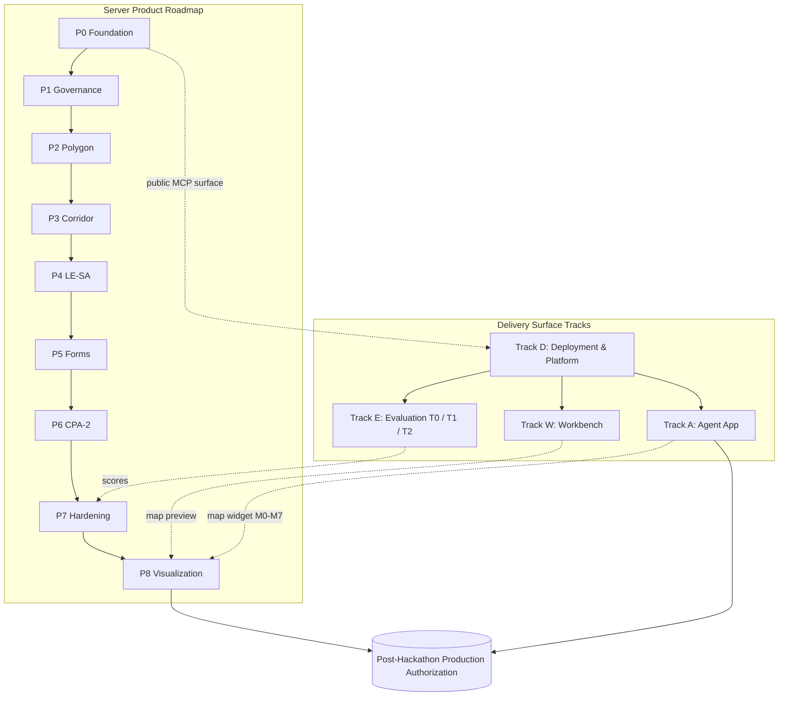

# Research: Updating `MASTER_PLAN.md` for Work Beyond the MCP Server

Date: 2026-10-23, updated 2026-10-24 to include `planning/RESEARCH_MAP_WIDGET_AGENT_APP.md`. Status: research note. `MASTER_PLAN.md` has not been edited.
Clone inspected: `/Workspace/Users/andrew.g.brown@usda.gov/fpac-soil-mcp` (workspace file reads; the clone was on `main` tracking `origin/main` before `origin/main` advanced to `21a1497`).

## Question

How should `planning/MASTER_PLAN.md` change so it covers the work found after the plan was written: the evaluation tiers, the Databricks agent app, and the admin/MCP workbench, alongside the MCP server itself?

## Summary

1. `MASTER_PLAN.md` covers only the MCP server. Its architecture diagram stops at a generic "MCP Client"[^mp-arch]. Its roadmap is one sequential chain, Phase 0 to Phase 8[^mp-road]. It does not mention the Databricks Apps deployment, the agent chat app, the T0/T1/T2 evaluation tiers, or the JavaScript workbench. All four exist in the repository now[^agents-find].
2. Plans 28-36 (9 of the last 10 orchestrations) were about clients, evaluation, or deployment, not new server features[^ep28][^ep29][^ep30][^ep33][^ep34][^ep35][^ep36]. The roadmap has no place for them, so they look like unplanned work.
3. Recommendation: keep Phases 0-8 as the **server product roadmap**. Add a new section, **Delivery Surfaces and Parallel Tracks**, with four tracks: **E** (Evaluation), **A** (Agent App), **W** (Workbench), and **D** (Deployment & Platform). Each track gets a goal, its delivered orchestrations, open backlog, and exit criteria. Tracks fit better than Phases 9-12 because the work ran alongside Phases 4-8, not after them.
4. Some existing sections are also stale or now overlap with other work. Phase 4 status is not marked although the state-index work shipped. Phase 7's "gold-set" item is now split across the eval tiers. Phase 8's Marimo demo client overlaps with the workbench and with the proposed agent-app map widget. The Definition of Done, workstream table, and post-hackathon list need entries for the new surfaces.
5. The map widget note proposes a MapLibre map inside the agent chat app, with drawing, file upload, basemaps, and soil/Census overlays, phased M0-M7[^map-phase]. It is the strongest candidate for the Phase 8 interactive client: it reuses the Phase 8 visualization envelope (its M6 is Phase 8 deliverable 1) and puts the map where USDA staff already use the agent. It belongs in Track A, with Phase 8 cross-references, not in a separate track. Its step zero, vendoring and pinning the chat UI that `start_app.py` currently clones unpinned at every start, is a prerequisite for any agent-app UI work[^map-ui].

## 1. What the plan says today

| Section | Lines | Current content | Gap |
| --- | --- | --- | --- |
| Summary | L3-9 | MCP server for FPPA screening | No mention of the chat agent, evaluation, or workbench |
| Architecture | L58-106 | `User / AI Agent -> MCP Client -> FastMCP Server`; core engine subgraph; key principles | Clients are one box. No Databricks Apps, auth model, or eval paths |
| Roadmap | L110-138 | `P0 -> ... -> P8 -> PROD`, "each phase translates directly into an individual /plan-wave" | Assumes all work is a server phase |
| Phase 4 | L235-278 | LE/SA workbench, SDV routing, CSR2/CPI/Storie | No status marker. Phases 0-3 say "(Complete)" |
| Phase 7 | L352-369 | 50+ gold-set cases, adversarial suite, benchmarks, docs, demo, offline corpus, `live_network` marker | Assumes one eval suite. Now there are Pi, T0, T1, and a deterministic workbench suite |
| Phase 8 | L373-407 | Visualization envelope + Marimo/ipyleaflet `demos/hackathon_demo.py` | Not started. The workbench already has an SVG geometry preview and schema-driven forms[^h-readme], and the map widget note proposes a MapLibre client in the agent app instead[^map-phase] |
| Post-hackathon | L411-420 | ATO, RBAC, case-DB integration, 508, logging | Missing items found during app work (see section 4) |
| Workstream ownership | L424-433 | Six roles | No owners for the agent app, workbench, or platform |
| Definition of Done | L437-448 | 8 server-centric criteria | Nothing on the deployed app, agent, or eval tiers |

Sources: `planning/MASTER_PLAN.md`[^mp-arch][^mp-road].

## 2. Inventory of work outside the server phases

### 2.1 Evaluation (Track E)

| Item | Where | Status | Source |
| --- | --- | --- | --- |
| Pi CLI smoke harness | `eval/pi/run_evals.py`, `eval/pi/test_agent_eval.py` | Kept as a local smoke test behind `agent_eval` | [^agents-find][^res-dbx] |
| Event-capture artifacts, opt-in raw retention | Plans 28, 29; ADR 0010 amendment | Done | [^ep28][^ep29] |
| Pi prompt/citation failure fixes (RES-01, PROMPT-01/02) | Plan 30 | Done | [^ep30] |
| Shared dataset + matching | `eval/common/` (`dataset.py`, `matching.py`); `prompt_test_cases.json` v2 | Done (Plans 33, 34) | [^agents-find][^ep33] |
| T0 in-memory contract tests | `eval/contract/test_contract.py` | Done (Plan 33) | [^res-dbx] |
| T1 MLflow in-process agent eval | `eval/databricks/` (agent, scorers, runner, notebook, `system_prompt_v1/v2.txt`) | Done (Plans 33, 34); 5 ground-truth cases | [^ep33][^ep34] |
| T2 eval against the deployed app (SP M2M or Unity Gateway MCP service) | proposed | Not started | [^res-dbx] |
| Deterministic executable cases | `eval/eval_cases.v1.json` + `lib/evalAssertions.js` | Done (Plan 36) | [^ep36] |
| Phoenix LLM-as-judge | outside the repo | Handled separately, outside Plan 33 | project decision record |

### 2.2 Agent app (Track A)

| Item | Where | Status | Source |
| --- | --- | --- | --- |
| Separate uv project; MCP client only, tools only, SP auth | `apps/agent-fpac-soil-openai-sdk/` | Accepted (ADR 0012) | [^adr12] |
| Config by env var (`AGENT_MODEL`, `FPAC_MCP_URL`, `FPAC_MCP_TIMEOUT_SECONDS` = 180 s); file-based chat prompt | `agent_server/config.py`, `agent_server/prompts/system_prompt.txt` | Done (Plan 35) | [^adr12][^st35] |
| Lint/CI boundary (`extend-exclude = ["apps"]`, `make app-check`, CI job `agent-app`) | root `pyproject.toml`, `Makefile`, CI | Done | [^adr12] |
| Model routed through AI Gateway (`models.ai.gpt-5-6-luna`) | ADR 0012 amendment 2026-10-23 | Done | [^adr12] |
| Live check DISC-01 / POINT-01 / LESA-01 with trace IDs | `planning/STATE_35.md` 35.5.1 | The table is still empty in this clone | [^st35] |
| Chat UI source | `scripts/start_app.py` clones `databricks/app-templates` `e2e-chatbot-app-next` from unpinned `main` at each start; Databricks labels that UI Legacy | Open risk; vendor and pin (map M0) | [^map-ui] |
| Map widget (MapLibre, Terra Draw, Turf; tiered file import; basemap/overlay catalog; AOI registry via `custom_inputs`; layers via `custom_outputs.map_layers`) | `planning/RESEARCH_MAP_WIDGET_AGENT_APP.md` | Research only; M0-M7 proposed; 7 open decisions; third-party claims marked "verify" | [^map-sum][^map-phase][^map-open] |

### 2.3 Workbench (Track W)

The repo calls this the "local MCP protocol workbench" or "UI harness"[^res-ui][^h-readme]. Section 5 asks whether "admin workbench" should be its official name.

| Item | Where | Status | Source |
| --- | --- | --- | --- |
| Express + `@modelcontextprotocol/sdk` client; tabs for Tools, Resources, Prompts, Eval Cases, History, Server | `eval/fpac_soil_mcp_harness/` | Merged via PR #30 / Plan 36 | [^h-readme][^ep36] |
| Runtime fixes (auth header, active token, timeouts, integer input, clipboard); Node tests; smoke test; Node CI; manifest parity | Plan 36 | All 10 tasks done | [^st36] |
| WKT input and `.geojson` upload, converted in the browser (issue #36) | `eval/fpac_soil_mcp_harness/TODO.md` | Planned, not started. The map widget's Tier 1 import plans to reuse the same `wkt.js`, so build it as shared code | [^h-todo][^map-files] |
| Keyboard/ARIA accessibility | review findings | Deferred by Plan 36 | [^ep36][^res-ui] |
| Hosted Databricks App deployment (OAuth M2M, port env, bundled dataset) + Agent tab calling `/invocations` | Option A | Out of scope for Plan 36; "directly following PR" | [^ep36][^res-js] |
| Python vs JS keyword-scoring parity (H6) | `keywords_present` vs `checkKeywords` | Open, unless Plan 36 assertions replaced it (not checked) | [^res-js] |

### 2.4 Deployment and platform (Track D)

| Item | Status | Source |
| --- | --- | --- |
| `mcp-fpac-soil` Databricks App, Streamable HTTP on `/mcp`, `app.yaml`, `/health`, `/meta` | Live | [^agents-find] |
| PyPI pinned as the default index in every uv project (ADR 0013) | Accepted | [^agents-infra] |
| Shared prod clone + hourly auto-pull job | Running | project decision record |
| `stateless_http` for Streamable HTTP ("Missing session ID" risk) | Open | [^res-js] |
| Register the server as a Unity Gateway MCP service | Open | project decision record |

### 2.5 Server fixes that came up through client work

These already belong to existing phases. Record them there, not as tracks.

* Urban-area overlap acreage (`screened_acreage`), issue #29 / PR #39. Goes in Phase 2 item 7 and Phase 3 item 5. ADRs 0004 and 0006 were updated[^todo39].
* State productivity indexes CSR2, CPI, and Storie were delivered by Plans 27, 31, and 32[^ep32]. Phase 4 item 2 and its exit criterion on L276 are therefore met. Phase 4 item 3 (Criterion 2 perimeter adjacency) needs checking before Phase 4 is marked complete.
* SDA's HTML maintenance page raises a raw `JSONDecodeError`. This was found during the T1 runs and belongs to Phase 7 hardening (project decision record).

## 3. Recommended structure

### 3.1 Tracks, not new phases

Use tracks for three reasons:

* Plans 28-36 ran between Phase 4 and Phase 8 work. A Phase 9+ label would suggest they came after Phase 8.
* Every track depends on the server's public MCP surface, not on a particular phase. ADR 0012 already sets that boundary for the agent app[^adr12], and the workbench README sets it for the harness: "only uses its public MCP surface"[^h-readme].
* The line "each phase translates directly into an individual /plan-wave" (L112) still works. Each track backlog item would also become one orchestration.

Proposed roadmap diagram (it replaces L116-138):

### 3.2 Section-by-section edits

| # | Section | Edit |
| --- | --- | --- |
| 1 | Summary (L3-9) | Add one paragraph naming the four delivery surfaces: the deployed MCP app, the chat agent app, the evaluation tiers, and the workbench. Keep the non-official disclaimer. |
| 2 | Section 2 Architecture | Keep the core-engine diagram. Add **2.1 Delivery Topology**: Databricks users -> agent app (SP OAuth, `CAN_USE`) -> `mcp-fpac-soil` `/mcp`; workbench -> stdio / SSE / HTTP; T0 in-memory; T1 in-process + AI Gateway model; T2 -> deployed `/mcp`; Pi -> stdio. |
| 3 | Key Principles (L98-106) | Add: "Clients use the public MCP surface only; the server package has no agent, MLflow, or Databricks SDK dependencies" (ADR 0012). Add: "Every uv project pins PyPI as default index" (ADR 0013). Add: "System prompts do not steer toward specific tools or resources" (D12, Plan 33). |
| 4 | Roadmap (L110-138) | Replace the diagram with 3.1. Add a sentence that tracks run alongside phases and share the same plan-wave convention. |
| 5 | Phase 4 heading | Mark "(Partially Complete)" and list what is done (Plans 17-27, 31, 32) and what is open (Criterion 2, after checking). |
| 6 | Phase 2 / 3 | Add the `screened_acreage` deliverable (PR #39) under the urban pre-screen items. |
| 7 | Phase 7 (L352-369) | Rewrite item 1 as "Gold-set across tiers": T0 contract = merge gate; T1 = scored, not gated; workbench deterministic suite = offline gate; Pi = local smoke. Move the dataset-expansion target (50+) here, and say ground truth needs domain-owner sign-off (Plan 36 D5). Add the SDA maintenance-page handling. |
| 8 | Phase 8 (L373-407) | Add a decision point with three options: (a) the Marimo client as planned, (b) a workbench map tab, or (c) the agent-app map widget[^map-phase]. Option (c) is the recommended default: it is the only one aimed at end users, and its M6 ("server map block") is deliverable 1, the envelope contract, which stays in Phase 8 because it changes the MCP surface. Replace the `demos/hackathon_demo.py` exit criteria with map-widget criteria if (c) is chosen. Keep the strategy doc's symbology and 508 rules either way. |
| 9 | New Section 4: Delivery Surface Tracks | One subsection per track (D, E, A, W) with Goal, Delivered (orchestration + ADR refs), Backlog, and Exit Criteria. Content is in section 4 below. |
| 10 | Workstream Ownership (old Section 4) | Renumber to 5. Add rows for Agent App Lead, Workbench Lead, and Platform/Deployment Lead. Let the Evaluation Lead own T0-T2 and the dataset. |
| 11 | Definition of Done (old Section 5) | Renumber to 6. Add the criteria in 4.5. |
| 12 | Post-Hackathon | Add the items in 4.6. |
| 13 | References | Add ADRs 0010, 0012, 0013 and the research notes listed under Sources. |

## 4. Draft track content (for pasting into the new section)

### 4.1 Track D: Deployment & Platform

* **Goal:** Run the MCP server and its clients as Databricks Apps from the shared prod clone, with reproducible locks and least-privilege grants.
* **Delivered:** `mcp-fpac-soil` app (Streamable HTTP `/mcp`, `/health`, `/meta`); ADR 0013 PyPI pin; prod clone auto-pull.
* **Backlog:** stateless Streamable HTTP decision; Unity Gateway MCP service registration; uv Dependabot entry.
* **Exit:** `/health` green after each `main` deploy; every client SP has a documented `CAN_USE` grant.

### 4.2 Track E: Evaluation

* **Goal:** Measure tool routing, answer correctness, and regulatory compliance at three levels, all reading one shared dataset.
* **Delivered:** Plans 28-30 (Pi capture and fixes); Plans 33-34 (`eval/common`, T0 contract, T1 MLflow runner, scorers, v2 prompt); Plan 36 (`eval_cases.v1.json` deterministic cases).
* **Backlog:** T2 against the deployed app; expand ground truth past 5 cases with domain sign-off; judge model upgrade (deferred, D6 Plan 35); run Pi live before merge; scheduled T1 job (deferred in Plan 33).
* **Exit:** T0 + deterministic suite gate CI; T1 runs record non-null scores in MLflow; T2 matches T1 on the shared cases.

### 4.3 Track A: Agent App

* **Goal:** Give USDA staff a chat interface in Databricks that answers only from MCP tool output and always states the preliminary-screening limitation.
* **Delivered:** Plan 35 (config, prompt, MCP wiring, deploy declarations, CI job); ADR 0012 and its 2026-10-23 amendment (AI Gateway model).
* **Backlog:** record the 35.5.1 live-check trace IDs; point T2 at the agent's `/invocations`; per-user attribution (SP auth does not identify the requesting user[^adr12]); map widget M0-M7 from the map note[^map-phase]:
  * M0 vendor and pin the chat UI (prerequisite for any UI change);
  * M1 spikes: `custom_inputs`/`custom_outputs` round trip, FastAPI routes past the chat proxy, CORS for SDM and TIGERweb;
  * M2 map MVP, M3 results on the map (AOI registry wrapper tools), M4 overlays and proxy, M5 more file formats, M7 hardening;
  * M6 server `map` block is tracked in Phase 8, not here.
* **Exit:** DISC-01, POINT-01, and LESA-01 answered in the chat UI with an fpac tool call in the trace, the limitation stated, and under 180 s. With the map: a user draws or uploads an AOI and the agent screens it with no coordinates in the prompt, and POLY-01/POLY-02 results render with a legend and table view (map M2/M3 exits).
* **Constraints carried from the map note:** server output stays authoritative (browser areas and buffers are labeled estimates, ADR 0003); AOI geometry is not written raw to traces or chat history (Section 1619); frontend lint, typecheck, and tests join `make app-check`, because root CI excludes `apps/` (ADR 0012)[^map-risk].

### 4.4 Track W: Workbench

* **Goal:** A deterministic MCP protocol workbench for developers and admins to inspect discovery, call capabilities, and run fixed regression cases. It is not an authorization boundary and does not do model-based evaluation[^res-ui].
* **Delivered:** PR #30 / Plan 36 (fixes, Node tests, smoke test, CI, parity tests).
* **Backlog:** issue #36 WKT/GeoJSON upload; hosted app (OAuth M2M, `DATABRICKS_APP_PORT`, bundled dataset, relative fetch paths) + Agent tab, Option A[^res-js]; keyboard/ARIA work; scoring parity with `eval/common/matching.py`.
* **Exit:** `npm test` + smoke pass in CI; hosted deployment (if approved) passes a security review of the command-override and auth model.

### 4.5 Definition of Done additions

9. The deployed `mcp-fpac-soil` app passes `/health` and the T0 contract suite against `main`.
10. The agent app passes the three-prompt live check with recorded trace IDs.
11. T1 evaluation produces scored MLflow runs for all ground-truth cases.
12. The workbench deterministic suite and Node CI pass offline.

### 4.6 Post-hackathon additions

* Per-user identity for MCP calls (on-behalf-of-user instead of the app SP).
* Security design for any shared or hosted workbench (command override, token handling, single shared connection H9[^res-js]).
* Section 508 audit covering the agent chat UI, the map widget, and the workbench (the ARIA work deferred in Plan 36).
* AOI persistence across sessions (Lakebase) and its privacy review; the map note defaults to session-only[^map-open].
* Network policy domain allowlist for the map's basemap and overlay hosts, served through the app's proxy[^map-risk].

## 5. Open questions for the user

1. **Naming:** the repo says "workbench" or "UI harness", and the request says "admin workbench". Should the plan call it the admin workbench, and should it move out of `eval/`?
2. **Phase 8:** should the interactive client be the agent-app map widget (recommended), a workbench map tab, or the original Marimo demo? Should the map note's M0-M7 become one orchestration or several (M0 is small and can merge first)? The map note's own seven open decisions (section 11) still need answers before its plan is drafted.
3. **Tracks vs phases:** are tracks D/E/A/W acceptable, or does the team prefer numbered Phases 9-12?
4. **Phase 4 status:** is Criterion 2 (perimeter adjacency) still required before Phase 4 is marked complete?
5. **Frozen history:** `EXECUTION_PLAN_33.md` is frozen (Plan 34 D5). Should `MASTER_PLAN.md` link to plans without restating their details, so it doesn't drift from them again?

## 6. Suggested sequence

1. Answer the questions in section 5.
2. Make one docs-only branch that edits `MASTER_PLAN.md` according to section 3.2, in this order: Summary, Architecture, Roadmap, phase status, Tracks, DoD, Ownership, Post-hackathon, References.
3. Update `AGENTS.md` L71 so it describes `MASTER_PLAN.md` as covering both the server roadmap and the delivery tracks.
4. Optionally run ADR distillation for track decisions that don't have an ADR yet (workbench scope, eval tiers).

## Sources

[^mp-arch]: `planning/MASTER_PLAN.md` L3-9, L58-106.
[^mp-road]: `planning/MASTER_PLAN.md` L110-138, L235-278, L352-448.
[^agents-find]: `AGENTS.md` L63-71 (eval/common, eval/contract, eval/pi, eval/databricks, harness, apps/), L141 (Databricks Apps deployment).
[^agents-infra]: `AGENTS.md` L129 (ADR 0013 PyPI pin).
[^ep28]: `planning/EXECUTION_PLAN_28.md` L1-25.
[^ep29]: `planning/EXECUTION_PLAN_29.md` L1-25.
[^ep30]: `planning/EXECUTION_PLAN_30.md` L1-25.
[^ep32]: `planning/EXECUTION_PLAN_32.md` L1-25.
[^ep33]: `planning/EXECUTION_PLAN_33.md` and `STATE_33.md` (Plan 33 waves 1-6).
[^ep34]: `planning/EXECUTION_PLAN_34.md` and `STATE_34.md`.
[^ep35]: `planning/EXECUTION_PLAN_35.md`.
[^st35]: `planning/STATE_35.md` L16-45 (wave board; empty live-check table).
[^ep36]: `planning/EXECUTION_PLAN_36.md` L1-76 (scope, decisions 1-12, wave table).
[^st36]: `planning/STATE_36.md` L13-26 (all tasks done).
[^adr12]: `docs/decisions/0012-databricks-agent-app-as-separate-mcp-client.md` L49-104.
[^res-dbx]: `planning/RESEARCH_DATABRICKS_EVAL_INTEGRATION.md` L7-21 (T0/T1/T2 tiers).
[^res-ui]: `planning/RESEARCH_FEATURE_EVAL_HARNESS_DATABRICKS.md` L58-66 (workbench scope statement).
[^res-js]: `planning/RESEARCH_JS_HARNESS_AGENT_APP_INTEGRATION.md` L37-49 (H1-H9), L69 (stateless HTTP), L71-109 (Options A/B, suggested order).
[^h-readme]: `eval/fpac_soil_mcp_harness/README.md` L61-85, L112-116.
[^h-todo]: `eval/fpac_soil_mcp_harness/TODO.md` L1-60 (issue #36 plan).
[^todo39]: `planning/TODO_PR39.md` L1-41.
[^map-sum]: `planning/RESEARCH_MAP_WIDGET_AGENT_APP.md` L20-28 (summary, recommended stack, server stays authoritative).
[^map-ui]: `planning/RESEARCH_MAP_WIDGET_AGENT_APP.md` L22, L34-37, L47-55 (unpinned runtime clone of a Legacy UI; option A fork recommended).
[^map-files]: `planning/RESEARCH_MAP_WIDGET_AGENT_APP.md` L45, L140-168 (file tiers; shared `wkt.js`).
[^map-risk]: `planning/RESEARCH_MAP_WIDGET_AGENT_APP.md` L195-205, L222-241 (proxy and egress, 508 and authority guardrails, risks R1-R9).
[^map-phase]: `planning/RESEARCH_MAP_WIDGET_AGENT_APP.md` L243-254 (phasing M0-M7).
[^map-open]: `planning/RESEARCH_MAP_WIDGET_AGENT_APP.md` L256-264 (open decisions).

"Project decision record" means facts recorded in conversation with the user (auto-pull job, Phoenix handled separately, Unity Gateway registration pending, SDA maintenance-page defect). They are not yet written in a repo file.
