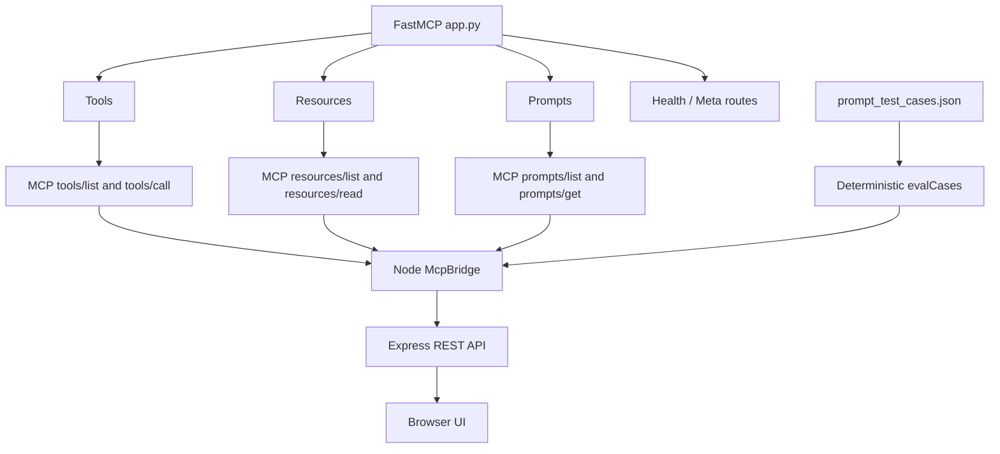

# Research Report: Integrating the `feature/evalHarnessDatabricks01` UI Surface

## Executive Summary

PR #30 adds an open, unmerged browser-based JavaScript harness for exercising the FPAC Soil MCP server. The branch head is `657446104947f7b95633e3fee6a2901d66dc0a9c`; its first commit, `6023abe1817f470845f63b95dff7cc0273283b89`, adds the Express backend and browser UI, while the second adds the required bridge/config/evaluation modules and fixes the repository `.gitignore` interaction.[^1][^2]

The best integration approach is to treat the UI as a client-side developer and contract-testing surface, not as a new MCP capability or a production Databricks application. It should discover tools, resources, prompts, schemas, instructions, and capabilities through the live MCP protocol, while the Python server remains authoritative for registration and regulatory behavior.[^3][^4] The work should be completed in four tracks: clarify scope and naming, document it from the root entry points, add Node/API/CI tests, and harden local-versus-remote operational boundaries.

The current deterministic evaluation tab directly invokes fixed tools/resources/prompts and checks tool errors plus expected keywords. It does not evaluate agent tool selection, argument extraction, reasoning, or semantic correctness.[^5] That limitation must be explicit so agents and contributors do not mistake the UI for the repository's model-based evaluation suites.

## Current Surface and Architecture

`src/fpac_soil_mcp/app.py` is the central Python seam: it creates the FastMCP instance, supplies server instructions, and registers tools, resources, prompts, and routes.[^3] The repository already tests runtime discovery of ten tools, three resources, and four prompts, plus `/health` and `/meta`.[^6]

The new harness uses the official MCP SDK and supports stdio, SSE, and Streamable HTTP. Its bridge calls the live protocol methods `listTools`, `callTool`, `listResources`, `readResource`, `listPrompts`, and `getPrompt`, then exposes them to the browser through Express routes.[^4] This is the correct integration pattern: the UI should not maintain an independent hard-coded capability registry.

## PR #30 Findings

### What is complete

The current head contains all imports referenced by `server.js`. The initial missing-module startup defect applied to commit `6023abe`; commit `6574461` adds `lib/config.js`, `lib/evalCases.js`, and `lib/mcpBridge.js` and removes the conflicting `/lib` ignore entry.[^1][^2]

The UI includes Tools, Resources, Prompts, Eval Cases, History, and Server tabs, with schema-driven forms, raw JSON editing, result rendering, resource/prompt browsing, evaluation controls, and server diagnostics.[^7][^8] The harness README accurately documents local startup, supported transports, and the preliminary-screening disclaimer.[^9]

### Remaining implementation issues

The PR review identifies six findings. The missing modules are fixed at the current head; these remain applicable:

| Priority | Issue | Evidence |
|---|---|---|
| High | `/api/server-routes` uses the configured token rather than the active UI connection token. | `server.js:99-114`; review thread `discussion_r4342571472`.[^10] |
| Medium | Clipboard code can call `.then` on `undefined` when the Clipboard API is unavailable. | `public/app.js:104-108`; review thread `discussion_r4342571402`.[^10] |
| Medium | Integer schema fields accept fractional values. | `public/app.js:380-383`; review thread `discussion_r4342571428`.[^10] |
| Medium | Tool/resource/prompt list entries lack keyboard activation semantics. | `public/app.js:675-680`, `786-801`, `852-859`; review thread `discussion_r4342571449`.[^10] |
| Low | Tabs expose `tab` roles without `aria-selected`, `aria-controls`, or matching `tabpanel` semantics. | `public/index.html:61-69`; review thread `discussion_r4342571505`.[^10] |
| Medium | Evaluation timeout is not forwarded for resource and prompt branches. | `server.js:222-244`; current-head diff evidence.[^11] |

The evaluation implementation also hard-codes many case arguments in JavaScript and derives pass/fail largely from MCP error state and substring keyword matches.[^5][^11] This can show that a known invocation returned expected text, but it does not prove that an agent selected the right tool, extracted correct arguments, produced correct numeric/geometry results, or applied regulatory reasoning correctly.

## Recommended Scope Decision

Adopt this explicit scope:

> **Local MCP protocol workbench and deterministic contract-check UI.** It is for developers and evaluators to inspect live MCP discovery, invoke capabilities, inspect outputs, and run fixed regression cases. It is not a production client, an authorization boundary, or a model-based agent-evaluation system.

This wording resolves the mismatch between the branch name “Databricks” and the current implementation. The branch contains no Databricks-native deployment artifact, SDK, MLflow integration, or app-specific configuration; its defaults run a local Node server on `127.0.0.1:3030` and spawn `uv run fpac-soil-mcp` over stdio.[^9][^12] If Databricks deployment is intended, it should be a separate follow-up with explicit authentication, secrets, ingress, and observability requirements.

Keep the existing Python/Databricks agent evaluation path authoritative for model behavior. That path performs actual agent interactions and requires MCP tool/resource use before the answer.[^13] The browser harness can later gain an agent mode, but that should be a distinct feature with separate scoring and tests.

## Integration Plan

### 1. Preserve one source of truth for agent visibility

Do not duplicate tool/resource/prompt definitions in the UI. Keep `app.py` and the registration packages authoritative.[^3] At runtime, the UI should use MCP discovery results and negotiated server instructions/capabilities from `McpBridge`.[^4]

Extend metadata consistency tests beyond tools. The repository currently checks that `manifest.yaml` and `server.json` agree on ten tools, but it does not equivalently compare resources and prompts to runtime discovery.[^6] Add tests for:

- manifest resources versus `server.list_resources()`;
- manifest prompts and arguments versus `server.list_prompts()`;
- manifest/server metadata parity for resources and prompts;
- non-empty server instructions containing the preliminary-screening disclaimer.

Correct the manifest wording that refers to “all 9 tools” while the repository publishes ten.[^14]

### 2. Make the UI discoverable to contributors and agents

Add a root `README.md` section linking to `eval/fpac_soil_mcp_harness/README.md`, with:

- `cd eval\fpac_soil_mcp_harness`;
- dependency installation and startup;
- default URL and supported transports;
- local-only security assumptions;
- deterministic-evaluation limitation;
- relationship to `eval/databricks` and `eval/run_evals.py`.

Update `QUICKSTART.md` with a short “Interactive harness” entry after the existing evaluation commands. The server's agent-facing instructions should continue to describe the MCP capabilities and regulatory boundaries; agents discover the underlying tools/resources/prompts through MCP, not through the browser UI.[^3][^13]

### 3. Add a real Node test surface

`package.json` currently provides `start`, `dev`, and a syntax-only `check`; it has no test script.[^15] Add a test command and cover:

1. Bridge discovery returns the expected ten tools, three resources, and four prompts using a mocked MCP client.
2. Express routes forward live schemas and results without replacing them.
3. Tool, resource, and prompt error paths are explicit.
4. Evaluation cases distinguish transport failure, MCP tool error, missing keywords, and pass.
5. Resource/prompt timeout behavior is enforced consistently.
6. Active auth-token propagation is correct.
7. Non-loopback command/cwd/environment overrides are rejected.
8. UI schema parsing rejects fractional integers.
9. Clipboard fallback and keyboard/tab accessibility behavior work.

Keep these tests offline. Existing Python tests already demonstrate the repository's preferred mocked and deterministic strategy for registration, resources, prompts, routes, and agent evaluations.[^6][^13]

### 4. Add CI and reproducible dependencies

The current CI and Makefile run Python/uv/Ruff/pytest workflows but do not install Node dependencies or execute the harness checks.[^16] Add a separate Node job that:

1. sets up a pinned Node version compatible with `>=18.18`;
2. installs dependencies from a committed lockfile;
3. runs the syntax check and Node tests;
4. starts the harness against a mocked or fixture MCP server for a smoke test.

Do not make required CI depend on USDA, Census, or NASS availability. Those services remain appropriate for opt-in live tests.

### 5. Harden deployment boundaries

The harness is safe only as a local developer tool by default. It exposes unauthenticated REST endpoints, can spawn configurable stdio commands when overrides are enabled, retains request arguments in in-memory history, accepts large bodies, and permits long-running calls.[^17] Before any shared or Databricks deployment:

- require authentication and origin/CSRF protection;
- disable command/cwd/environment overrides by default;
- use executable and working-directory allowlists;
- protect or disable history and redact geometry/sensitive arguments;
- add request size, rate, concurrency, and cancellation controls;
- require HTTPS and document bearer-token handling;
- ensure `/api/server-routes` uses the active connection's token.

## Suggested Delivery Order

1. **Scope and docs:** rename/describe deterministic checks accurately; link the harness from root README and QUICKSTART.
2. **Correctness fixes:** active-token state, timeout propagation, integer validation, clipboard guard.
3. **Accessibility:** semantic buttons or keyboard handlers; complete tab ARIA relationships.
4. **Contract tests:** mocked bridge/API tests and expanded manifest/runtime parity.
5. **CI:** Node setup, lockfile, syntax/test/smoke job.
6. **Deployment hardening:** only if a shared or Databricks-hosted UI is confirmed in scope.
7. **Optional agent mode:** build separately on the existing Databricks/Pi evaluation architecture rather than overloading deterministic case execution.

## Confidence Assessment

**High confidence:** PR status, branch/head SHAs, changed-file structure, MCP discovery architecture, current UI scope, deterministic evaluation behavior, existing Python registration tests, and the open review findings are directly supported by GitHub repository/PR evidence.[^1][^2][^3][^4][^6][^10][^11]

**Medium confidence:** exact CI integration mechanics and preferred JavaScript test framework are recommendations inferred from the existing Makefile, workflow, package metadata, and test conventions.[^15][^16]

**Assumption:** the desired outcome is integration into the existing repository rather than immediate production deployment. If Databricks hosting is a hard requirement, the security, authentication, deployment, and observability work should be promoted to merge-blocking scope.

## Footnotes

[^1]: [PR #30](https://github.com/AndrewBrown-USDA/fpac-soil-mcp/pull/30), open PR metadata; base `d41ac1caba82b0baa2023c49d226b5d7f6d993a9`, head `657446104947f7b95633e3fee6a2901d66dc0a9c`.
[^2]: [Commit `6023abe1817f470845f63b95dff7cc0273283b89`](https://github.com/AndrewBrown-USDA/fpac-soil-mcp/commit/6023abe1817f470845f63b95dff7cc0273283b89); [commit `657446104947f7b95633e3fee6a2901d66dc0a9c`](https://github.com/AndrewBrown-USDA/fpac-soil-mcp/commit/657446104947f7b95633e3fee6a2901d66dc0a9c).
[^3]: `src/fpac_soil_mcp/app.py:16-37`, indexed at commit `ca799b06661f5ec0ee4baaf1b39d75cba02a658b`.
[^4]: `eval/fpac_soil_mcp_harness/lib/mcpBridge.js:63-183`, current head `657446104947f7b95633e3fee6a2901d66dc0a9c`; file blob SHA `5bf3a7e4c523c8ea2fdc2c8fc585a22dbdfabd4f`.
[^5]: `eval/fpac_soil_mcp_harness/lib/evalCases.js:1-7`, `:137-174`, current head; blob SHA `06eb42fb5b9e10d5ca3df941a96a1cbe8ef74060`.
[^6]: `tests/test_server.py:20-125`, `:126-285`, `:287-344`, indexed at commit `ca799b06661f5ec0ee4baaf1b39d75cba02a658b`.
[^7]: `eval/fpac_soil_mcp_harness/public/index.html:61-213`, current head; blob SHA `1710be3`.
[^8]: `eval/fpac_soil_mcp_harness/public/app.js:1-1188`, current head.
[^9]: `eval/fpac_soil_mcp_harness/README.md:1-105`, current head; blob SHA `f210c8d801e936ce22a9894658c68f40692ce414`.
[^10]: [PR #30 review threads](https://github.com/AndrewBrown-USDA/fpac-soil-mcp/pull/30#pullrequestreview-5606946169), including `discussion_r4342571341`, `discussion_r4342571402`, `discussion_r4342571428`, `discussion_r4342571449`, `discussion_r4342571472`, and `discussion_r4342571505`.
[^11]: `eval/fpac_soil_mcp_harness/server.js:222-244`, current head; corroborated by the current-head branch-diff research.
[^12]: `eval/fpac_soil_mcp_harness/lib/config.js:35-80`, current head; blob SHA `22dc6bd0746df0a022ce5bc1d973f63bccc1f1fa`; `.env.example:1-30`.
[^13]: `eval/run_evals.py:541-557` and `eval/databricks/prompts/system_prompt_v1.txt:1-8`, indexed at commit `ca799b06661f5ec0ee4baaf1b39d75cba02a658b`.
[^14]: `manifest.yaml:40`, indexed at commit `ca799b06661f5ec0ee4baaf1b39d75cba02a658b`; tool-count expectation in `tests/test_server.py:50-65`.
[^15]: `eval/fpac_soil_mcp_harness/package.json:1-21`, current head; package blob SHA `eba50aea9c29fcb1b18e11d05e7808bdad5746cc`.
[^16]: `.github/workflows/ci.yml:1-27`, blob SHA `c43b56135126d962afa18a8bfc09b409e8b6d8b5`; `Makefile:1-65`, blob SHA `e96f5ced554c7e4b0997937befcbc37da2101fdd`.
[^17]: `eval/fpac_soil_mcp_harness/server.js:17-19`, `:26-61`, `:99-127`, `:135-148`, `:232-236`; `lib/config.js:41-64`, current head.
