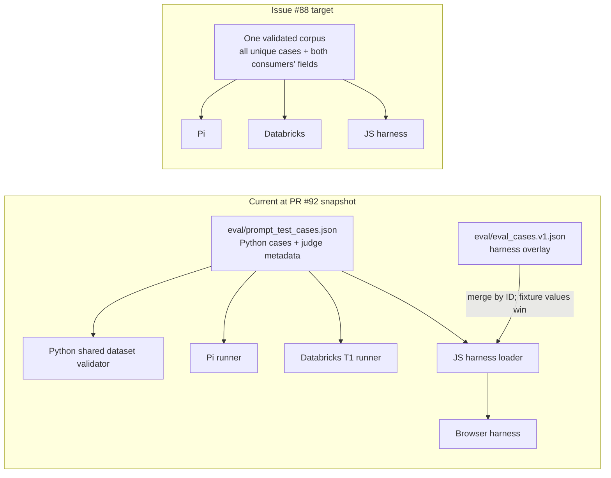

# Issue #88 in the context of `feat/judge-first-scoring`

**Research refreshed:** 2026-11-12. This is a technical deep-dive into [AndrewBrown-USDA/fpac-soil-mcp#88](https://github.com/AndrewBrown-USDA/fpac-soil-mcp/issues/88) and the separate, unmerged judge-first work on [PR #92](https://github.com/AndrewBrown-USDA/fpac-soil-mcp/pull/92).

## Executive summary

Issue #88 proposes removing the split between the Python evaluation corpus and the browser harness overlay by making `eval/eval_cases.v1.json` the shared corpus. The issue has not changed since its last update at 2026-11-12 20:05 UTC; it remains open without comments. PR #92 has advanced to `d1aa249cbe6bd2d1042440b1a5b1a4b408ca85a8`, but is still open and draft, and the two corpus files and overlay behavior remain. [^1][^2][^8]

The branch’s scoring changes are complementary to corpus consolidation, but they make preserving the corpus schema especially important. `expected_facts` now feed the Databricks correctness judge; `required_behaviors` and source disclosure feed its guidelines judge; `expected_keywords` remains required for shared records and continues to serve Pi’s advisory checks and the harness, even though Databricks stopped receiving it. [^3][^4]

The issue’s “duplicated base fields” description is incomplete for the checked-in data. There are 38 Python cases and 19 harness-fixture cases; all 19 fixture IDs overlap, leaving 19 Python-only cases. Several shared records differ in values or fields, and the current harness overlay gives fixture values precedence. A safe consolidation must reconcile those differences and retain both consumers’ requirements—not simply concatenate the files or make Python accept arbitrary unknown keys. [^5][^6]

PR #92’s five reported check runs are green on its current head, but this should not be read as proof that all judge evaluations pass: the latest recorded full judge run includes nonzero failures and nulls. Since the previous report, PR commits have revised several case inputs and expectations, so earlier case-quality findings should be treated as historical leads rather than current confirmed defects until re-evaluated. [^7][^24]

## Issue intent and current status

Issue #88 is titled “Unify Python/pi eval corpus with JS harness corpus.” It proposes using `eval/eval_cases.v1.json` as the single source, moving the 19 Python-only cases into it, deleting `prompt_test_cases.json`, updating Python and harness loaders/tests/docs, and restoring an ID-parity check. The issue remains open; its last update was 2026-11-12 20:05 UTC, and the latest refresh found no comments or linked closing PR. No new issue requirements or acceptance criteria were surfaced. [^8]

The branch and issue are separate work: at PR #92 head `d1aa249…`, Python still defaults to `prompt_test_cases.json`, the harness config points there too, and the JS loader still merges `eval_cases.v1.json` by ID. Both files remain present. The branch’s newer corpus changes update case inputs and expectations but do not complete #88. [^2][^9][^24]

## Latest refresh: issue unchanged, PR advanced

The issue body, status, and acceptance scope are unchanged since the prior report: the issue is still open and has no comments; it has not acquired a linked implementation PR. The PR #92 head advanced from `58ade29…` to `d1aa249cbe6bd2d1042440b1a5b1a4b408ca85a8`. [^1][^8]

The intervening PR commits include a GeoJSON input correction for POLY-02/URBAN-01 (`5fad8d02…`), per-criterion LESA-01 inputs with a corresponding harness invocation update (`b94e9c7d…`), and further expectation revisions. These are case-quality changes in the existing corpus, not the consolidation requested by #88. They make it important to preserve the latest edits in `prompt_test_cases.json` if #88 proceeds. [^24]

At the refreshed PR head, `dataset.py` still defaults to the prompt file and `evalCases.js` still loads the fixture as an overlay. Five PR check runs are reported successful. That establishes CI status only; it does not demonstrate that all model-judged examples pass. The original report’s recorded judge failure/null counts are historical run results, and the refresh did not verify a newer live judge run. [^2][^7][^25]

## Architecture and data flow

The Python shared dataset loader validates the prompt corpus and has an explicit field allow-list. Pi also has its own fixture-path constant, so changing only the shared loader’s default would not redirect Pi. Databricks builds MLflow evaluation records through the shared dataset conversion. The JavaScript loader reads the prompt corpus as primary, merges overlay records by ID, and shallow-merges each fixture record over the matching prompt record; fixture values therefore win on collisions, while prompt-only fields survive. [^10][^11][^12]

## Corpus compatibility findings

### The two files are related, not interchangeable

At the inspected corpus snapshot, the Python file has 38 cases and the harness fixture has 19. The fixture IDs all occur in the Python set; 19 Python IDs are absent from the fixture. The harness merge is consequently enriching shared records rather than simply combining two disjoint catalogs. [^5]

There are meaningful differences among overlapping rows:

| Difference | Evidence |
|---|---|
| Seven shared adversarial rows have different `required_behaviors` values between the two files. | `ADV-FORMS-01`, `ADV-NONPRIME-01`, `ADV-RELOCATE-01`, `ADV-OUTAGE-01`, `ADV-PARTIAL-01`, `ADV-PRIVACY-01`, `ADV-PERFORMANCE-01`. [^13] |
| `CORR-01` has a different category, and its Python row has `expected_facts` absent from the fixture row. | The current overlay behavior chooses the fixture category but retains Python-only fields such as facts. [^14] |
| Fixture rows do not carry all Python-required fields. `expected_tools` is absent, and `expected_keywords` is present in only a subset. | The current overlay preserves primary-file fields; a fixture-only replacement would not. [^15] |
| Harness fields such as `assertions`, `invocation`, `expected_result`, `ownership`, and `protected_regulatory_assertions` are outside the Python validator’s allow-list. | Moving to the fixture without a deliberate schema change fails validation. [^16] |

The issue’s statement that the overlay duplicates all base fields is therefore too broad for the inspected branch data. Likewise, the issue’s mention of `silent_nccpi_fallback` appears stale at that snapshot: the research found that ID in neither corpus. This does not invalidate the proposed parity check; it means the reason given for the existing gap should be rechecked. [^17]

### Current test coverage is not full corpus parity

The Python dataset tests check minimum corpus size and known adversarial IDs, while a Databricks contract test compares only `SA-MA-01` through `SA-MA-04` for selected fields. The harness tests exercise invocation and assertion helpers and inspect the fixture directly, but do not test `loadEvalCases` overlay precedence or assert whole-corpus ID parity. Duplicate IDs are already rejected by Python validation. [^18]

## What judge-first changes mean for #88

The branch shifts natural-language evaluation toward model-assisted judges, while retaining deterministic contract checks. At the inspected later state, the Databricks scorer list contains 10 deterministic scorers and six MLflow judges. The keyword scorer was removed in commit `78d66ba218c4e7dfeebbe710c16995d71b2bc6dc`; that is a Databricks-specific change, not removal of the shared keyword field. [^3][^19]

The field roles to preserve during consolidation are:

| Case data | Consumer / role |
|---|---|
| `expected_facts` | Databricks correctness judge; optional at schema level, but checked-in non-adversarial cases with keywords are covered by a dataset test requiring facts. |
| `guidelines`, `required_behaviors`, `source_disclosure` | Combined into judge guidelines for Databricks; these are not Pi string-match failures. |
| `expected_keywords` | Still required by the shared schema; used by Pi as an advisory and by the browser harness. It is intentionally no longer included in Databricks MLflow records. |
| `expected_tools`, status/prohibited-behavior and budget metadata | Continue to support deterministic checks in applicable runners. |
| Harness fields (`invocation`, `assertions`, `expected_result`, etc.) | Support deterministic browser-harness invocation and assertions, and require explicit treatment in the shared Python schema. |

These roles are evidenced in the shared dataset conversion and the Pi/harness implementations. The practical risk is accidental behavior change: dropping facts weakens the new correctness evaluation; dropping keywords breaks non-Databricks consumers; overwriting behavior lists changes judge inputs; and indiscriminately accepting unknown keys weakens schema validation. [^4][^16][^20]

“Judge-first” should not be read as “judges overrule deterministic checks.” The scorer inventory is reported in deterministic-then-judge order and the results are reported per scorer; the code does not establish a single aggregate score or a precedence rule where a judge overrides a deterministic failure. Deterministic contract tests remain a separate evidence tier. [^19][^21]

## Recommended implementation sequence for #88

1. **Reconcile the records before moving them.** Build one row per unique ID. Preserve the Python runner’s required fields and judge-first metadata, add harness fields, and make explicit decisions for the seven behavior-list disagreements and `CORR-01` category/facts. Do not rely on the current implicit “fixture wins” rule once the overlay is removed. [^5][^13][^14]
2. **Keep validation strict.** Extend the Python schema to accept and validate the harness fields, rather than allowing unrestricted unknown keys. Retain the duplicate-ID invariant and validate the consolidated corpus before consumer-specific filtering. [^10][^16][^18]
3. **Update every reader, not only the shared default.** The relevant paths include Python’s `DEFAULT_PATH`, Pi’s own fixture path, the JS harness config/loader, the Databricks notebook and contract tests, and harness tests that currently read the fixture directly. [^9][^10][^22]
4. **Replace implicit overlay behavior with direct unified loading.** Add JS tests around loading the unified file and invocation/assertion behavior; remove the merge only after ID, field, and behavior parity checks exist. The existing harness suite does not pin the merge semantics that it currently depends on. [^11][^18]
5. **Update references and run targeted checks.** The issue explicitly calls out root/harness/Databricks documentation and corpus-ID checks; retain test coverage for facts, judge-guideline conversion, Pi advisory keywords, and harness-specific invocation/assertions. [^8][^18][^22]

## Validation and confidence

PR #92 is reported open and draft. A research result reports five current-head GitHub Actions checks as successful, while the combined legacy status endpoint showed pending with zero legacy statuses; these are distinct status signals. The same research reports the latest recorded 38-record live Databricks run had `correctness` at 17 pass / 7 fail / 14 null, so “CI green” is not equivalent to “all judged examples pass.” [^7]

**High confidence:** issue #88 remains distinct from PR #92; judge-first case fields have consumers that should survive consolidation; the current two-file merge has precedence behavior and the validator is strict; and the corpus is not merely two disjoint lists. These claims are supported by issue/PR metadata and branch-pinned implementation/test findings. [^2][^10][^11][^16]

**Snapshot caveat:** branch and PR heads changed during research. Detailed line-level merge and corpus-difference findings were inspected at `b880535…`; the refresh reports current PR head `d1aa249c…`. Current loader/source claims use links pinned to that latest head. The refresh did not independently run tests or a live judge evaluation. [^1][^23][^25]

## Footnotes

[^1]: [PR #92, current head/status](https://github.com/AndrewBrown-USDA/fpac-soil-mcp/pull/92); [latest reported head commit `d1aa249cbe6bd2d1042440b1a5b1a4b408ca85a8`](https://github.com/AndrewBrown-USDA/fpac-soil-mcp/commit/d1aa249cbe6bd2d1042440b1a5b1a4b408ca85a8).
[^2]: [`eval/common/dataset.py:16-33` at `d1aa249cbe6bd2d1042440b1a5b1a4b408ca85a8`](https://github.com/AndrewBrown-USDA/fpac-soil-mcp/blob/d1aa249cbe6bd2d1042440b1a5b1a4b408ca85a8/eval/common/dataset.py#L16-L33); [`eval/fpac_soil_mcp_harness/lib/config.js:60-68` at that SHA](https://github.com/AndrewBrown-USDA/fpac-soil-mcp/blob/d1aa249cbe6bd2d1042440b1a5b1a4b408ca85a8/eval/fpac_soil_mcp_harness/lib/config.js#L60-L68); [`eval/fpac_soil_mcp_harness/lib/evalCases.js:161-188` at that SHA](https://github.com/AndrewBrown-USDA/fpac-soil-mcp/blob/d1aa249cbe6bd2d1042440b1a5b1a4b408ca85a8/eval/fpac_soil_mcp_harness/lib/evalCases.js#L161-L188); [current PR corpus files](https://github.com/AndrewBrown-USDA/fpac-soil-mcp/tree/d1aa249cbe6bd2d1042440b1a5b1a4b408ca85a8/eval).
[^3]: [`eval/common/dataset.py:22-29,42-49,65-75,355-377` at `2d011ce0432748b3066214a2f0a70bdba5ff0ec2`](https://github.com/AndrewBrown-USDA/fpac-soil-mcp/blob/2d011ce0432748b3066214a2f0a70bdba5ff0ec2/eval/common/dataset.py#L22-L29); [commit `78d66ba218c4e7dfeebbe710c16995d71b2bc6dc`](https://github.com/AndrewBrown-USDA/fpac-soil-mcp/commit/78d66ba218c4e7dfeebbe710c16995d71b2bc6dc); [`eval/databricks/scorers.py:29-49` at `2d011ce…`](https://github.com/AndrewBrown-USDA/fpac-soil-mcp/blob/2d011ce0432748b3066214a2f0a70bdba5ff0ec2/eval/databricks/scorers.py#L29-L49).
[^4]: [`eval/common/dataset.py:354-394` at `b8805355882f45a3818c4ba63c9cfd837c5e8f9f`](https://github.com/AndrewBrown-USDA/fpac-soil-mcp/blob/b8805355882f45a3818c4ba63c9cfd837c5e8f9f/eval/common/dataset.py#L354-L394); [`eval/pi/run_evals.py:828-849` at that SHA](https://github.com/AndrewBrown-USDA/fpac-soil-mcp/blob/b8805355882f45a3818c4ba63c9cfd837c5e8f9f/eval/pi/run_evals.py#L828-L849); [`eval/fpac_soil_mcp_harness/lib/evalCases.js:203-212` at that SHA](https://github.com/AndrewBrown-USDA/fpac-soil-mcp/blob/b8805355882f45a3818c4ba63c9cfd837c5e8f9f/eval/fpac_soil_mcp_harness/lib/evalCases.js#L203-L212).
[^5]: [`eval/prompt_test_cases.json` and `eval/eval_cases.v1.json` at `b8805355882f45a3818c4ba63c9cfd837c5e8f9f`](https://github.com/AndrewBrown-USDA/fpac-soil-mcp/tree/b8805355882f45a3818c4ba63c9cfd837c5e8f9f/eval); branch comparison enumerated 38 prompt IDs, 19 fixture IDs, 19 shared IDs, and 19 prompt-only IDs.
[^6]: [`eval/fpac_soil_mcp_harness/lib/evalCases.js:168-174` at `b8805355882f45a3818c4ba63c9cfd837c5e8f9f`](https://github.com/AndrewBrown-USDA/fpac-soil-mcp/blob/b8805355882f45a3818c4ba63c9cfd837c5e8f9f/eval/fpac_soil_mcp_harness/lib/evalCases.js#L168-L174).
[^7]: [PR #92](https://github.com/AndrewBrown-USDA/fpac-soil-mcp/pull/92); [`planning/STATE_47.md:146-190` at `58ade29dfb980bd23c3d7f7a65828ae0c03d195b`](https://github.com/AndrewBrown-USDA/fpac-soil-mcp/blob/58ade29dfb980bd23c3d7f7a65828ae0c03d195b/planning/STATE_47.md#L146-L190); [later current-head Actions run 43320684805](https://github.com/AndrewBrown-USDA/fpac-soil-mcp/actions/runs/43320684805).
[^8]: [Issue #88](https://github.com/AndrewBrown-USDA/fpac-soil-mcp/issues/88); issue metadata and body as reported by research, including no comments or linked closing PR at the inspected time.
[^9]: [PR #92 changed files](https://github.com/AndrewBrown-USDA/fpac-soil-mcp/pull/92/files); [`eval/databricks/README.md:122-123` at `58ade29dfb980bd23c3d7f7a65828ae0c03d195b`](https://github.com/AndrewBrown-USDA/fpac-soil-mcp/blob/58ade29dfb980bd23c3d7f7a65828ae0c03d195b/eval/databricks/README.md#L122-L123).
[^10]: [`eval/common/dataset.py:17-61,167-192` at `b8805355882f45a3818c4ba63c9cfd837c5e8f9f`](https://github.com/AndrewBrown-USDA/fpac-soil-mcp/blob/b8805355882f45a3818c4ba63c9cfd837c5e8f9f/eval/common/dataset.py#L17-L61); [`eval/pi/run_evals.py:37-38,219-229` at that SHA](https://github.com/AndrewBrown-USDA/fpac-soil-mcp/blob/b8805355882f45a3818c4ba63c9cfd837c5e8f9f/eval/pi/run_evals.py#L37-L38).
[^11]: [`eval/fpac_soil_mcp_harness/lib/evalCases.js:157-182` at `b8805355882f45a3818c4ba63c9cfd837c5e8f9f`](https://github.com/AndrewBrown-USDA/fpac-soil-mcp/blob/b8805355882f45a3818c4ba63c9cfd837c5e8f9f/eval/fpac_soil_mcp_harness/lib/evalCases.js#L157-L182).
[^12]: [`eval/fpac_soil_mcp_harness/lib/config.js:60-68` at `b8805355882f45a3818c4ba63c9cfd837c5e8f9f`](https://github.com/AndrewBrown-USDA/fpac-soil-mcp/blob/b8805355882f45a3818c4ba63c9cfd837c5e8f9f/eval/fpac_soil_mcp_harness/lib/config.js#L60-L68); [`eval/databricks/run_mlflow_eval.py:147-163` at that SHA](https://github.com/AndrewBrown-USDA/fpac-soil-mcp/blob/b8805355882f45a3818c4ba63c9cfd837c5e8f9f/eval/databricks/run_mlflow_eval.py#L147-L163).
[^13]: [`eval/prompt_test_cases.json` lines 882-981 and `eval/eval_cases.v1.json` lines 241-324` at `b8805355882f45a3818c4ba63c9cfd837c5e8f9f`](https://github.com/AndrewBrown-USDA/fpac-soil-mcp/tree/b8805355882f45a3818c4ba63c9cfd837c5e8f9f/eval).
[^14]: [`eval/prompt_test_cases.json:350-368` and `eval/eval_cases.v1.json:329-337` at `b8805355882f45a3818c4ba63c9cfd837c5e8f9f`](https://github.com/AndrewBrown-USDA/fpac-soil-mcp/tree/b8805355882f45a3818c4ba63c9cfd837c5e8f9f/eval).
[^15]: [`eval/common/dataset.py:22-31` and `eval/eval_cases.v1.json` at `b8805355882f45a3818c4ba63c9cfd837c5e8f9f`](https://github.com/AndrewBrown-USDA/fpac-soil-mcp/tree/b8805355882f45a3818c4ba63c9cfd837c5e8f9f/eval).
[^16]: [`eval/common/dataset.py:61-62,173-192` at `b8805355882f45a3818c4ba63c9cfd837c5e8f9f`](https://github.com/AndrewBrown-USDA/fpac-soil-mcp/blob/b8805355882f45a3818c4ba63c9cfd837c5e8f9f/eval/common/dataset.py#L61-L62); fixture examples: [`eval/eval_cases.v1.json:241-245,329-416`](https://github.com/AndrewBrown-USDA/fpac-soil-mcp/blob/b8805355882f45a3818c4ba63c9cfd837c5e8f9f/eval/eval_cases.v1.json#L329-L416).
[^17]: [`eval/prompt_test_cases.json` and `eval/eval_cases.v1.json` at `b8805355882f45a3818c4ba63c9cfd837c5e8f9f`](https://github.com/AndrewBrown-USDA/fpac-soil-mcp/tree/b8805355882f45a3818c4ba63c9cfd837c5e8f9f/eval); corpus scan reported no `silent_nccpi_fallback` ID.
[^18]: [`eval/common/test_common_dataset.py:70-102,289-303,319-322` at `b8805355882f45a3818c4ba63c9cfd837c5e8f9f`](https://github.com/AndrewBrown-USDA/fpac-soil-mcp/blob/b8805355882f45a3818c4ba63c9cfd837c5e8f9f/eval/common/test_common_dataset.py#L70-L102); [`tests/eval/test_phase4_databricks_contract.py:35-64,135-151`](https://github.com/AndrewBrown-USDA/fpac-soil-mcp/blob/b8805355882f45a3818c4ba63c9cfd837c5e8f9f/tests/eval/test_phase4_databricks_contract.py#L35-L64); [`eval/fpac_soil_mcp_harness/test/harness.test.js:68-75,114-121,170-180`](https://github.com/AndrewBrown-USDA/fpac-soil-mcp/blob/b8805355882f45a3818c4ba63c9cfd837c5e8f9f/eval/fpac_soil_mcp_harness/test/harness.test.js#L68-L75).
[^19]: [`eval/databricks/scorers.py:29-49,302-361` at `2d011ce0432748b3066214a2f0a70bdba5ff0ec2`](https://github.com/AndrewBrown-USDA/fpac-soil-mcp/blob/2d011ce0432748b3066214a2f0a70bdba5ff0ec2/eval/databricks/scorers.py#L29-L49); [keyword-scorer removal commit `78d66ba218c4e7dfeebbe710c16995d71b2bc6dc`](https://github.com/AndrewBrown-USDA/fpac-soil-mcp/commit/78d66ba218c4e7dfeebbe710c16995d71b2bc6dc); [`eval/databricks/README.md:147-174`](https://github.com/AndrewBrown-USDA/fpac-soil-mcp/blob/58ade29dfb980bd23c3d7f7a65828ae0c03d195b/eval/databricks/README.md#L147-L174).
[^20]: [`eval/pi/run_evals.py:828-849` and `eval/fpac_soil_mcp_harness/lib/evalAssertions.js:17-79` at `b8805355882f45a3818c4ba63c9cfd837c5e8f9f`](https://github.com/AndrewBrown-USDA/fpac-soil-mcp/tree/b8805355882f45a3818c4ba63c9cfd837c5e8f9f/eval).
[^21]: [`eval/databricks/scorers.py:353-361` and `eval/databricks/README.md:147-174` at `b8805355882f45a3818c4ba63c9cfd837c5e8f9f`](https://github.com/AndrewBrown-USDA/fpac-soil-mcp/tree/b8805355882f45a3818c4ba63c9cfd837c5e8f9f/eval/databricks); [`tests/eval/test_phase4_databricks_contract.py:117-133`](https://github.com/AndrewBrown-USDA/fpac-soil-mcp/blob/b8805355882f45a3818c4ba63c9cfd837c5e8f9f/tests/eval/test_phase4_databricks_contract.py#L117-L133).
[^22]: [`eval/databricks/run_t1_eval_notebook.py:4-7`, `tests/eval/test_phase4_databricks_contract.py:12-15`, and `AGENTS.md:177-181` at `b8805355882f45a3818c4ba63c9cfd837c5e8f9f`](https://github.com/AndrewBrown-USDA/fpac-soil-mcp/tree/b8805355882f45a3818c4ba63c9cfd837c5e8f9f).
[^23]: [Earlier head commit `b8805355882f45a3818c4ba63c9cfd837c5e8f9f`](https://github.com/AndrewBrown-USDA/fpac-soil-mcp/commit/b8805355882f45a3818c4ba63c9cfd837c5e8f9f); [intermediate head `2d011ce0432748b3066214a2f0a70bdba5ff0ec2`](https://github.com/AndrewBrown-USDA/fpac-soil-mcp/commit/2d011ce0432748b3066214a2f0a70bdba5ff0ec2); [previous head `58ade29dfb980bd23c3d7f7a65828ae0c03d195b`](https://github.com/AndrewBrown-USDA/fpac-soil-mcp/commit/58ade29dfb980bd23c3d7f7a65828ae0c03d195b); [refreshed head `d1aa249cbe6bd2d1042440b1a5b1a4b408ca85a8`](https://github.com/AndrewBrown-USDA/fpac-soil-mcp/commit/d1aa249cbe6bd2d1042440b1a5b1a4b408ca85a8).
[^24]: [PR #92 commit history](https://github.com/AndrewBrown-USDA/fpac-soil-mcp/pull/92/commits); [GeoJSON correction `5fad8d02f6d60ec8d0ada0da22b8f130c7b36b4f`](https://github.com/AndrewBrown-USDA/fpac-soil-mcp/commit/5fad8d02f6d60ec8d0ada0da22b8f130c7b36b4f); [LESA-01 inputs and harness invocation `b94e9c7df320adae08e24fb763e5914ce3c44e33`](https://github.com/AndrewBrown-USDA/fpac-soil-mcp/commit/b94e9c7df320adae08e24fb763e5914ce3c44e33); [later expectation revisions include `afa2930ce02ed4f2e82df0d5829bcd0205be38c8`](https://github.com/AndrewBrown-USDA/fpac-soil-mcp/commit/afa2930ce02ed4f2e82df0d5829bcd0205be38c8).
[^25]: [PR checks](https://github.com/AndrewBrown-USDA/fpac-soil-mcp/pull/92/checks); [Actions run 43320684805](https://github.com/AndrewBrown-USDA/fpac-soil-mcp/actions/runs/43320684805); loader links in [^2].
