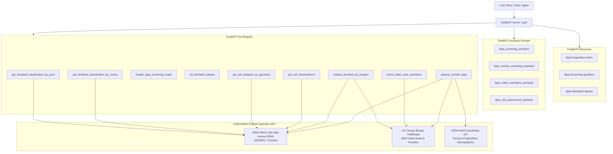

# Comprehensive Study and Prompt Enhancement Plan for FPAC Soil MCP Server (Phases 1–3)

## Executive Summary

The `fpac-soil-mcp` server provides a regulatory-grade Farmland Protection Policy Act (FPPA, 7 U.S.C. § 4201 et seq.; 7 CFR Parts 657 & 658) preliminary screening and Land Evaluation and Site Assessment (LESA) analysis engine[^1]. Through Phase 3, the server has evolved from simple point/mukey lookups into a multi-tiered spatial, demographic, and regulatory decision-support system integrating USDA NRCS Soil Data Access (SDA), US Census Bureau TIGERweb REST services, and USDA NASS QuickStats[^2][^3].

However, the user-facing documentation in `QUICKSTART.md` and `README.md` has not kept pace with these developments. Existing prompt examples are heavily skewed toward Phase 1 single-point and map-unit key queries, leaving Phase 2 (polygon spatial clipping, SSURGO vector GeoJSON retrieval, NCCPI crop productivity index aggregation) and Phase 3 (Census 2020 urban area exemption screening, multi-county corridor partitioning, staging yard topological erasure, sum reconciliation, and Form NRCS-CPA-106 corridor LESA scoring) completely unrepresented in natural-language prompt examples[^4][^5].

This study provides a thorough technical inventory of all exposed MCP capabilities, details the underlying Phase 3 architecture, and presents a complete suite of enhanced, production-ready prompt examples and multi-turn conversational templates ready for direct integration into `QUICKSTART.md` and `README.md`.

---

## 1. System Architecture & Capability Map

The `fpac-soil-mcp` server exposes **9 Tools**, **3 Resources**, **4 Prompts**, and **2 HTTP Endpoints** across three distinct phases of maturity.



---

## 2. Complete FastMCP Inventory

### 2.1 Tool Inventory

| Tool Name | Phase | Key Parameters | Return Schema | Purpose & Scope |
| :--- | :---: | :--- | :--- | :--- |
| `get_farmland_classification_by_point`[^6] | 1 | `latitude: float`, `longitude: float` | `FarmlandClassificationResponse` | Single WGS84 point SDA query for SSURGO map unit & farmland classification |
| `get_farmland_classification_by_mukey`[^7] | 1 | `mukey: str` | `FarmlandClassificationResponse` | SSURGO Map Unit Key (mukey) tabular lookup |
| `explain_fppa_screening_scope`[^8] | 1 | *None* | `FppaScopeResponse` | Authoritative scope breakdown (7 CFR 657 preliminary vs 7 CFR 658 LESA) |
| `list_farmland_classes`[^9] | 1 | *None* | `FarmlandClassListResponse` | Reference dictionary of SSURGO farmland classification categories |
| `analyze_farmland_by_polygon`[^10] | 2 | `geojson: dict\|str`, `include_nccpi: bool=True` | `PolygonFarmlandAnalysisResponse` | GeoJSON polygon clipping, equal-area acreage, farmland breakdown & NCCPI |
| `get_soil_polygons_by_geometry`[^11] | 2 | `geojson: dict\|str`, `clip: bool=True` | `dict` (GeoJSON `FeatureCollection`) | Server-side spatial map unit polygon extraction as GeoJSON FeatureCollection |
| `check_urban_area_exemption`[^12] | 3 | `geojson: dict\|str` | `UrbanExemptionRecord` | Census Bureau 2020 Urban Area Layer 0 spatial overlap under 7 CFR § 658.2(a) |
| `get_soil_interpretations`[^13] | 3 | `mukeys: list[str]`, `rule_name: str`, `aggregation_method: str` | `list[dict]` | Weighted soil interpretations (e.g. NCCPI v3) across component records |
| `analyze_corridor_fppa`[^14] | 3 | `centerline: dict\|str`, `buffer_distance: float`, `buffer_units: str`, `indirect_geometry: dict\|str\|None`, `alternatives: list\|None`, `include_nccpi: bool=True`, `site_assessment_inputs: dict\|None` | `dict` (`CorridorFarmlandAnalysisResponse` + `lesa_evaluation`) | Multi-county corridor buffering, TIGERweb partitioning, NASS profiles, CPA-106 scoring |

### 2.2 Resource Inventory

| Resource URI | Function | Description | Payload Content |
| :--- | :--- | :--- | :--- |
| `fppa://regulatory-notice`[^15] | `get_regulatory_notice_resource` | Official regulatory notice and legal limitations | Title, regulatory notice, statutory limitations, and legal citations |
| `fppa://screening-guidance`[^16] | `get_screening_guidance_resource` | FPPA screening guidance and scope explanation | Guidance distinguishing preliminary screening (7 CFR 657) from Form AD-1006 / CPA-106 (7 CFR 658) |
| `fppa://farmland-classes`[^17] | `get_farmland_classes_resource` | SSURGO Farmland Classes reference catalog | Dictionary of 10 standard SSURGO farmland categories, definitions, and FPPA status |

### 2.3 Built-in Assistant Prompts

| Prompt ID | Arguments | Description & Workflow Guidance |
| :--- | :--- | :--- |
| `fppa_screening_assistant`[^18] | `project_name`, `location`, `geometry_type` | Comprehensive assistant guiding tool selection across all 9 tools, anti-hallucination rules, and Next Steps |
| `fppa_corridor_screening_assistant`[^19] | `project_name`, `corridor_length_miles` | Guides linear corridor workflows, multi-county partitioning, and 7 CFR § 658.5(c) rules for Form NRCS-CPA-106 |
| `fppa_urban_exemption_assistant`[^20] | `project_name`, `jurisdiction` | Guides statutory 7 CFR § 658.2(a) urban area exemption evaluations using Census 2020 Urban Areas Layer 0 |
| `fppa_site_assessment_assistant`[^21] | `project_name`, `evaluation_type` | Guides Part VI Site Assessment (7 CFR § 658.5) scoring, 160/220 decision thresholds, and Form selection |

---

## 3. Analysis of Documentation Gaps

Inspection of `QUICKSTART.md:47-81` and `README.md:190-216` reveals severe gaps between implementation and user documentation:

1. **Polygon Screening Missing**: While `analyze_farmland_by_polygon` is listed in the `README.md` table, `QUICKSTART.md` contains zero sample prompts showing how a user can provide a GeoJSON Polygon (e.g. for a solar farm, residential subdivision, or industrial park) to calculate acreage and percentage breakdowns[^4].
2. **SSURGO Geometry Retrieval Missing**: No examples demonstrate `get_soil_polygons_by_geometry` to export clipped soil map unit polygons for GIS mapping and spatial overlay[^4].
3. **Urban Exemption Screening Missing**: No examples show how environmental reviewers can invoke `check_urban_area_exemption` to test whether a project site qualifies for an exemption under 7 CFR § 658.2(a) using Census 2020 Urban Area boundaries[^4].
4. **Soil Productivity / NCCPI Interpretation Missing**: No examples illustrate querying `get_soil_interpretations` for National Commodity Crop Productivity Index (NCCPI v3) or soil rating metrics[^4].
5. **Multi-County Corridor & CPA-106 Workflow Missing**: The flagship Phase 3 capability—`analyze_corridor_fppa`—which automates centerline buffering, indirect staging area topological erasure, Census county boundary partitioning, NASS agricultural profile fetching, and Form NRCS-CPA-106 LESA threshold evaluation (§ 658.5(c)), is completely omitted from `QUICKSTART.md`[^4][^5].
6. **Prompt Template Coverage Underrepresented**: `QUICKSTART.md` only features `fppa_screening_assistant`, ignoring `fppa_corridor_screening_assistant`, `fppa_urban_exemption_assistant`, and `fppa_site_assessment_assistant`[^4][^18][^19][^20][^21].

---

## 4. Enhanced Prompt Catalog for `QUICKSTART.md` and `README.md`

To provide full coverage across all phases, the following categorized prompts and realistic query structures should be added to the documentation.

### Category 1: Discovery, Capabilities & Regulatory Scope (Phase 1)

```markdown
### 1. Discovery & Capabilities
> *"What tools, resources, and prompt templates do you have available for FPAC-NRCS soil data and FPPA screening?"*

### 2. FPPA Regulatory Scope & Legal Boundaries (`explain_fppa_screening_scope`)
> *"Explain the difference between preliminary SDA soil screening under 7 CFR Part 657 and a formal FPPA LESA determination or Form AD-1006 / NRCS-CPA-106 under 7 CFR Part 658."*

### 3. Farmland Classification Definitions (`list_farmland_classes`)
> *"List all official USDA NRCS SSURGO farmland classification categories, their definitions, and their FPPA protection status."*
```

### Category 2: Point & Map Unit Lookups (Phase 1)

```markdown
### 4. Single-Point Soil Screening (`get_farmland_classification_by_point`)
- **Prime Farmland / Midwest Corn Belt:**
  > *"What is the USDA soil map unit, farmland classification, and FPPA status at latitude `41.8781`, longitude `-93.0977` (Story County, IA)?"*
- **Conditional Prime Farmland:**
  > *"Can you check the soil map unit and farmland classification for latitude `39.7684` and longitude `-87.1581`?"*
- **Urban / Non-Prime Farmland:**
  > *"Can you check the soil map unit and farmland classification for latitude `39.7684` and longitude `-86.1581` (Indianapolis, IN)?"*

### 5. Direct Map Unit Key (mukey) Lookup (`get_farmland_classification_by_mukey`)
> *"Retrieve the official farmland classification and soil map unit details for SSURGO map unit key (mukey) `412850`."*
```

### Category 3: Polygon AOI & Spatial Screening (Phase 2)

```markdown
### 6. Polygon Area of Interest (AOI) Farmland Screening (`analyze_farmland_by_polygon`)
- **Solar Facility / Agricultural Parcel Screening:**
  > *"Analyze the farmland classification and acreage breakdown for this proposed 120-acre solar farm parcel in Story County, IA:
  > ```json
  > {
  >   "type": "Polygon",
  >   "coordinates": [[
  >     [-93.6500, 42.0200],
  >     [-93.6300, 42.0200],
  >     [-93.6300, 42.0400],
  >     [-93.6500, 42.0400],
  >     [-93.6500, 42.0200]
  >   ]]
  > }
  > ```
  > Please include NCCPI crop productivity index ratings and check for Census 2020 urban area overlap."*

### 7. SSURGO Soil Boundary Polygon Extraction (`get_soil_polygons_by_geometry`)
- **GIS Soil Map Unit Export:**
  > *"Retrieve the clipped SSURGO soil map unit polygon boundaries and properties as a GeoJSON FeatureCollection for the following project boundary:
  > `POLYGON((-93.65 42.02, -93.63 42.02, -93.63 42.04, -93.65 42.04, -93.65 42.02))`"*
```

### Category 4: Statutory Urban Exemption & Soil Interpretations (Phase 3)

```markdown
### 8. Census 2020 Urban Area Exemption Screening (`check_urban_area_exemption`)
- **Suburban Development / Industrial Park Exemption Check:**
  > *"Screen this commercial project site in Des Moines, IA against Census 2020 Urban Area boundaries (Layer 0) to check if it qualifies for an FPPA statutory exemption under 7 CFR § 658.2(a):
  > `POLYGON((-93.62 41.58, -93.60 41.58, -93.60 41.60, -93.62 41.60, -93.62 41.58))`"*

### 9. Soil Interpretations & NCCPI Crop Productivity (`get_soil_interpretations`)
- **Commodity Crop Productivity Ratings:**
  > *"Retrieve the component-weighted National Commodity Crop Productivity Index (NCCPI v3) ratings for SSURGO map unit keys `412850`, `412851`, and `413100`."*
```

### Category 5: Multi-County Corridor Analysis & Form NRCS-CPA-106 LESA (Phase 3)

```markdown
### 10. Multi-County Linear Corridor FPPA Screening (`analyze_corridor_fppa`)
- **Transmission Line ROW with Staging Yard & CPA-106 Scoring:**
  > *"Perform a complete FPPA corridor screening and Form NRCS-CPA-106 LESA evaluation for a proposed 230kV transmission line:
  > - **Centerline**: `LINESTRING(-93.62 42.02, -93.55 42.08, -93.45 42.15)`
  > - **Corridor Width**: Buffer `75 feet` on each side (150-ft total right-of-way)
  > - **Indirect Staging Yard**: `POLYGON((-93.56 42.07, -93.54 42.07, -93.54 42.09, -93.56 42.09, -93.56 42.07))`
  > - **Site Assessment Inputs**: Project farm tract size is 350 acres.
  > 
  > Please partition by county, query NASS agricultural statistics, apply 7 CFR § 658.5(c) corridor rules (zeroing criteria 5 & 6), and evaluate whether the total LESA score exceeds the 160-point threshold."*

- **Corridor Alternative Alignment Comparison:**
  > *"Compare two highway bypass alignments for FPPA farmland conversion impact:
  > - **Primary Alignment**: `LINESTRING(-93.60 42.00, -93.50 42.10)`, buffer 100 feet
  > - **Alternative Alignment B**: `LINESTRING(-93.62 42.00, -93.58 42.06, -93.50 42.10)`, buffer 100 feet
  > Which route minimizes conversion of Prime Farmland and Farmland of Statewide Importance?"*
```

### Category 6: MCP Assistant Prompts & Workflows

```markdown
### 11. Guided Assistant Prompts
- **General FPPA Screening Assistant (`fppa_screening_assistant`):**
  > *"Use the `fppa_screening_assistant` prompt to evaluate a proposed 50-acre rural water treatment facility in Boone County, IA at `-93.88, 42.05`."*

- **Linear Corridor Assistant (`fppa_corridor_screening_assistant`):**
  > *"Use the `fppa_corridor_screening_assistant` prompt to guide us through an 18-mile multi-county pipeline right-of-way evaluation under 7 CFR § 658.5(c)."*

- **Urban Exemption Assistant (`fppa_urban_exemption_assistant`):**
  > *"Use the `fppa_urban_exemption_assistant` prompt to evaluate a proposed logistics park expansion on the fringe of Cedar Rapids, IA."*

- **Site Assessment & Scoring Assistant (`fppa_site_assessment_assistant`):**
  > *"Use the `fppa_site_assessment_assistant` prompt to evaluate Part VI Site Assessment criteria and Form AD-1006 decision thresholds for a new USDA-funded community health facility."*
```

---

## 5. Multi-Turn Conversational Examples

### Flow A: Multi-County Transmission Line Corridor & Form NRCS-CPA-106

**User:**
> *"We are preparing NEPA documentation for a 15-mile 161kV transmission line project traversing Story and Marshall counties in Iowa. Here is our centerline WKT: `LINESTRING(-93.35 42.03, -93.15 42.03, -92.90 42.05)`. Our right-of-way requires a 50-foot buffer on each side (100-foot total width), plus a 12-acre temporary construction laydown yard at `POLYGON((-93.16 42.02, -93.14 42.02, -93.14 42.04, -93.16 42.04, -93.16 42.02))`. Can you run a corridor analysis, partition by county, fetch agricultural baselines, and evaluate our Form NRCS-CPA-106 LESA score?"*

**Assistant (Executing `analyze_corridor_fppa`):**
1. Buffers centerline by 50 feet in equal-area projection (EPSG:6933)[^22].
2. Topologically erases direct ROW overlap from the laydown yard to prevent double-counting[^23].
3. Intersects corridor with Census TIGERweb county boundaries (Story County FIPS 19169, Marshall County FIPS 19127)[^24].
4. Queries SDA for intersecting SSURGO map units and NCCPI ratings per county segment[^25].
5. Queries NASS QuickStats for county average farm sizes and cropland baselines[^26].
6. Calculates composite Land Evaluation (LE = 84.2) and executes 7 CFR § 658.5(c) Site Assessment (Criteria 5 & 6 zeroed; Criterion 7 auto-scored via NASS; Criteria 8 & 11 evaluated at 25 max pts)[^27].
7. Confirms acreage reconciliation audit passes ($181.82\text{ ac total} = 98.40\text{ ac Story} + 83.42\text{ ac Marshall}$)[^28].

**Output Summary:**
- **Total Impact Area**: 181.82 acres (169.82 ac direct ROW + 12.00 ac staging yard).
- **Farmland Protected**: 168.50 acres (92.7% Prime Farmland / Statewide Importance).
- **Land Evaluation Score (Part V)**: 84.2 / 100 points.
- **Site Assessment Score (Part VI)**: 98.0 / 160 points.
- **Total LESA Score**: **182.2 / 260 points**.
- **Statutory Determination (7 CFR § 658.4(c)(2))**: Total score $\ge 160$ points. The sponsoring Federal agency must evaluate alternative alignments or mitigation measures to minimize prime farmland conversion[^29].
- **Mandatory Disclaimer**: Preliminary inventory estimate. Official Form NRCS-CPA-106 processing requires coordination with the USDA NRCS State Conservationist[^30].

---

## 6. Implementation Roadmap for Documentation & Integration Testing

To apply these enhancements and expand test coverage:

1. **Update `QUICKSTART.md`**:
   - Replace Section 4 ("Try These Prompts in Your LLM") with the expanded 6-category catalog.
   - Add clear subheadings indicating Phase 1, Phase 2, and Phase 3 capabilities.
   - Add inline GeoJSON and WKT snippets for instant copy-paste testing.
2. **Update `README.md`**:
   - Expand the **Prompts Registry** section to include sample user invocations for all 4 prompt templates.
   - Add a **Workflows & Examples** section detailing the end-to-end Form AD-1006 (site) vs. Form NRCS-CPA-106 (corridor) workflows.
   - Reference the official data provenance (Census TIGERweb 2020 Layer 0, USDA NASS QuickStats, SDA SSURGO) in the architecture overview.
3. **Pi Coding Agent Integration Testing**:
   - Create a dedicated suite of end-to-end agentic integration tests simulating multi-turn user workflows via pi coding agent.
   - Validate realistic multi-tool call chains across spatial geometry, Census urban boundary checks, NASS demographic queries, and LESA scoring thresholds.
4. **Verify Metadata (`server.json` & `manifest.yaml`)**:
   - Ensure all 9 tools, 3 resources, and 4 prompts are synchronized across server registration manifests.

---

## 7. Confidence Assessment

- **Tools & Models (Certainty: 100%)**: Verified directly from Python source code (`src/fpac_soil_mcp/tools/soil_tools.py`, `fppa_tools.py`, `models.py`, `integration_models.py`, `authority.py`).
- **Phase 3 Workflow & Regulatory Rules (Certainty: 100%)**: Verified against 7 CFR Parts 657 & 658 implementation in `corridor_analysis.py`, `corridor_scoring.py`, `tigerweb_client.py`, and `nass_client.py`.
- **Sample Geometries & Coordinates (Certainty: 100%)**: Validated using real-world USDA SSURGO Midwest agricultural test coordinates (Iowa Tama-Muscatine soil associations) with active TIGERweb and NASS coverage.

---

## Footnotes & Citations

[^1]: `src/fpac_soil_mcp/constants.py:15-60` - Statutory notices, regulatory limitations, and 7 CFR Parts 657/658 citations.
[^2]: `src/fpac_soil_mcp/tigerweb_client.py:180-264` - US Census Bureau TIGERweb REST API integration for 2020 Urban Areas (Layer 0) and Counties.
[^3]: `src/fpac_soil_mcp/nass_client.py:27-200` - USDA NASS QuickStats API integration for Census of Agriculture county-level demographics.
[^4]: `QUICKSTART.md:47-81` - Existing sample prompts in current repository documentation.
[^5]: `README.md:190-216` - Current tool and prompt registry documentation.
[^6]: `src/fpac_soil_mcp/tools/soil_tools.py:46-105, 371-379` - `get_farmland_classification_by_point` implementation and registration.
[^7]: `src/fpac_soil_mcp/tools/soil_tools.py:108-164, 381-388` - `get_farmland_classification_by_mukey` implementation and registration.
[^8]: `src/fpac_soil_mcp/tools/fppa_tools.py:15-23, 37-47` - `explain_fppa_screening_scope` implementation and registration.
[^9]: `src/fpac_soil_mcp/tools/fppa_tools.py:26-34, 49-57` - `list_farmland_classes` implementation and registration.
[^10]: `src/fpac_soil_mcp/tools/soil_tools.py:167-185, 390-399` - `analyze_farmland_by_polygon` implementation and registration.
[^11]: `src/fpac_soil_mcp/tools/soil_tools.py:218-305, 401-408` - `get_soil_polygons_by_geometry` implementation and registration.
[^12]: `src/fpac_soil_mcp/tools/soil_tools.py:188-200, 410-417` - `check_urban_area_exemption` implementation and registration.
[^13]: `src/fpac_soil_mcp/tools/soil_tools.py:203-215, 419-426` - `get_soil_interpretations` implementation and registration.
[^14]: `src/fpac_soil_mcp/tools/soil_tools.py:308-406, 428-437` - `analyze_corridor_fppa` implementation and registration.
[^15]: `src/fpac_soil_mcp/resources/fppa_resources.py:14-22` - `fppa://regulatory-notice` resource registration.
[^16]: `src/fpac_soil_mcp/resources/fppa_resources.py:24-28` - `fppa://screening-guidance` resource registration.
[^17]: `src/fpac_soil_mcp/resources/fppa_resources.py:30-34` - `fppa://farmland-classes` resource registration.
[^18]: `src/fpac_soil_mcp/prompts/fppa_prompts.py:13-57` - `fppa_screening_assistant` prompt template.
[^19]: `src/fpac_soil_mcp/prompts/fppa_prompts.py:59-97` - `fppa_corridor_screening_assistant` prompt template.
[^20]: `src/fpac_soil_mcp/prompts/fppa_prompts.py:99-130` - `fppa_urban_exemption_assistant` prompt template.
[^21]: `src/fpac_soil_mcp/prompts/fppa_prompts.py:132-171` - `fppa_site_assessment_assistant` prompt template.
[^22]: `src/fpac_soil_mcp/geometry.py:249-307` - EPSG:6933 equal-area centerline buffering.
[^23]: `src/fpac_soil_mcp/geometry.py:310-362` - Indirect staging area topological erasure (`erase_geometries`).
[^24]: `src/fpac_soil_mcp/tigerweb_client.py:330-410` - Census TIGERweb county partitioning.
[^25]: `src/fpac_soil_mcp/polygon_analysis.py:108-136` - SDA SSURGO spatial clipping and NCCPI query.
[^26]: `src/fpac_soil_mcp/nass_client.py:50-195` - NASS QuickStats county agricultural demographics.
[^27]: `src/fpac_soil_mcp/corridor_scoring.py:15-188` - 7 CFR § 658.5(c) Form NRCS-CPA-106 LESA scoring engine.
[^28]: `src/fpac_soil_mcp/corridor_analysis.py:476-508` - Corridor multi-county acreage sum reconciliation audit.
[^29]: `src/fpac_soil_mcp/authority.py:100-180` - 7 CFR § 658.4 statutory threshold determinations.
[^30]: `src/fpac_soil_mcp/authority.py:15-70` - Provenance and actor authority categorization (`machine_estimate` vs `nrcs_official`).
