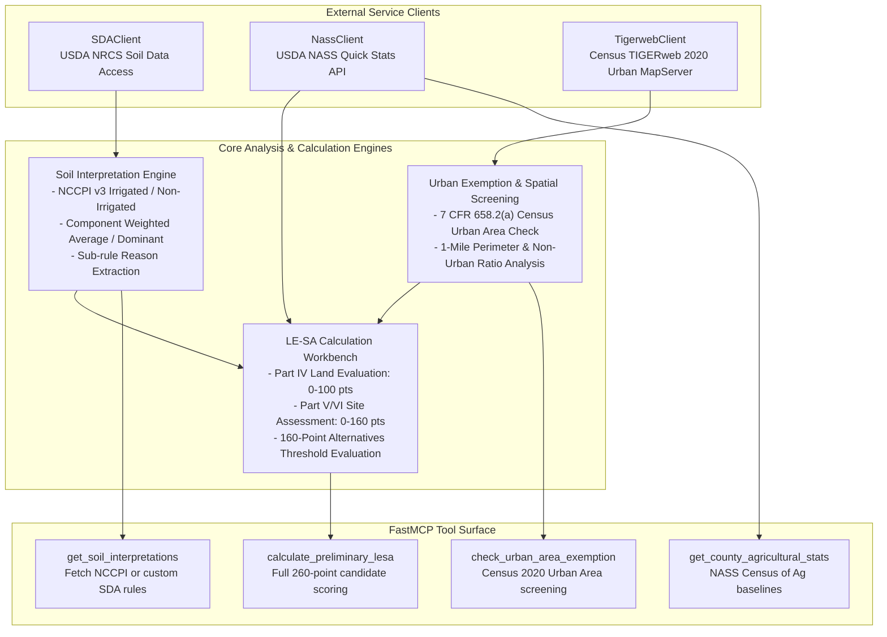

# Comprehensive Research Report: Authoritative Public APIs & Soil Interpretation Extension Points for FPAC Soil MCP

**Document Version**: 1.0.0  
**Date**: September 16, 2026  
**Target Repository**: `fpac-soil-mcp`  
**Purpose**: Architectural specifications, integration patterns, and master plan breadcrumbs for USDA-NASS Quick Stats API, US Census Bureau TIGERweb 2020 Urban Areas MapServer, and SDA Soil Interpretation queries (NCCPI v3 & R `soilDB::get_SDA_interpretation` patterns).

---

## Executive Summary

The Farmland Protection Policy Act (FPPA, 7 U.S.C. § 4201 et seq.; 7 CFR Part 658) mandates that federal agencies evaluate adverse impacts on farmland using the Land Evaluation and Site Assessment (LESA) framework (Form AD-1006 for site projects and Form NRCS-CPA-106 for corridor projects). To transition `fpac-soil-mcp` from a basic point/mukey screening utility into a complete, reproducible LESA preparation engine, the system requires integration with three authoritative public data sources:

1. **USDA-NASS Quick Stats API** (`https://quickstats.nass.usda.gov/api`): Provides authoritative county and state agricultural baselines (total land in farms, harvested cropland, average farm size, and farm counts from the 5-year Census of Agriculture) necessary to evaluate FPPA Site Assessment criteria (e.g., Criterion 7: subject farm size vs. county average).
2. **US Census Bureau TIGERweb 2020 Urban Areas MapServer** (`https://tigerweb.geo.census.gov/arcgis/rest/services/TIGERweb/Urban/MapServer/6`): Provides geospatial boundaries for Census 2020 Urban Areas to automate statutory non-farmland exemption checks under 7 CFR § 658.2(a) and compute urban proximity/perimeter ratios for Site Assessment Criteria 1, 2, and 5.
3. **USDA NRCS Soil Data Access (SDA) Interpretation Engine**: Implements component-weighted soil interpretations (specifically the National Commodity Crop Productivity Index, NCCPI v3, and arbitrary rating rules) modeled after the R `soilDB::get_SDA_interpretation` package to generate objective candidate Land Evaluation (LE, 0–100 scale) scores when local county soil rating tables are unavailable.

---

## 1. System Architecture & External Integration Flow



---

## 2. USDA-NASS Quick Stats API Integration

### 2.1 API Overview & Authentication
- **Base URL**: `https://quickstats.nass.usda.gov/api`
- **Key Endpoint**: `/api_GET/` (accepts HTTP `GET`, outputs `format=JSON` or `CSV`).
- **Record Counter Endpoint**: `/get_counts/` (checks query size before retrieval).
- **Authentication**: Requires a developer API key passed via query string `?key={API_KEY}`. Keys are obtained via free registration on the NASS portal.
- **Payload Limits**: Max 50,000 records per query (HTTP 413 error if exceeded). Queries must be scoped to `agg_level_desc=COUNTY` or `agg_level_desc=STATE`.

### 2.2 FPPA-Relevant Agricultural Metrics

| Metric | NASS Parameters | Purpose in FPPA / LESA |
| :--- | :--- | :--- |
| **Total Land in Farms** | `source_desc=CENSUS`<br>`sector_desc=ECONOMICS`<br>`commodity_desc=AG LAND`<br>`statisticcat_desc=AREA`<br>`unit_desc=ACRES` | Establishes county agricultural baseline footprint (acres) for project scale evaluation. |
| **Average Farm Size** | `source_desc=CENSUS`<br>`sector_desc=ECONOMICS`<br>`commodity_desc=FARM OPERATIONS`<br>`statisticcat_desc=AREA BEARING & NON-BEARING`<br>`unit_desc=ACRES / OPERATION` | Directly evaluates Site Assessment Criterion 7 (farm size compared to county average). |
| **Harvested Cropland** | `source_desc=CENSUS`<br>`sector_desc=CROPS`<br>`commodity_desc=AG LAND`<br>`class_desc=CROPLAND`<br>`statisticcat_desc=AREA HARVESTED` | Measures county active cultivation baseline. |
| **Market Value of Ag Products** | `source_desc=CENSUS`<br>`sector_desc=ECONOMICS`<br>`commodity_desc=COMMODITY TOTALS`<br>`statisticcat_desc=SALES`<br>`unit_desc=$` | Measures total economic output of agricultural sector in jurisdiction. |

### 2.3 Python Client Specification (`src/fpac_soil_mcp/nass_client.py`)

```python
from typing import Any, Dict, List, Optional
import os
import re
import httpx
from pydantic import BaseModel, Field


class NassCountyAgProfile(BaseModel):
    state_alpha: str
    county_name: str
    census_year: int
    farmland_acres: Optional[float] = None
    cropland_acres: Optional[float] = None
    farm_operations_count: Optional[float] = None
    avg_farm_size_acres: Optional[float] = None
    market_value_products_sold_usd: Optional[float] = None
    source_citation: str = "USDA NASS Census of Agriculture Quick Stats"


class NassClient:
    BASE_URL = "https://quickstats.nass.usda.gov/api"

    def __init__(self, api_key: Optional[str] = None, timeout: float = 30.0):
        self.api_key = api_key or os.getenv("USDA_NASS_API_KEY")
        self.timeout = timeout

    async def get_county_ag_profile(
        self, state_alpha: str, county_name: str, year: int = 2022
    ) -> NassCountyAgProfile:
        if not self.api_key:
            raise ValueError("USDA NASS API key not configured (USDA_NASS_API_KEY).")

        params = {
            "key": self.api_key,
            "source_desc": "CENSUS",
            "sector_desc": "ECONOMICS",
            "agg_level_desc": "COUNTY",
            "state_alpha": state_alpha.upper(),
            "county_name": county_name.upper(),
            "year": year,
            "format": "JSON",
        }

        async with httpx.AsyncClient(timeout=self.timeout) as client:
            resp = await client.get(f"{self.BASE_URL}/api_GET/", params=params)
            resp.raise_for_status()
            data = resp.json().get("data", [])

        profile = NassCountyAgProfile(
            state_alpha=state_alpha.upper(), county_name=county_name.upper(), census_year=year
        )

        for rec in data:
            desc = rec.get("short_desc", "")
            val_str = rec.get("Value", "")
            clean_val = re.sub(r"[^\d.]", "", val_str)
            val = float(clean_val) if clean_val else None

            if desc == "AG LAND - ACRES":
                profile.farmland_acres = val
            elif desc == "AG LAND, CROPLAND, HARVESTED - ACRES":
                profile.cropland_acres = val
            elif desc == "FARM OPERATIONS - NUMBER OF OPERATIONS":
                profile.farm_operations_count = val
            elif desc == "FARM OPERATIONS - ACRES / OPERATION":
                profile.avg_farm_size_acres = val
            elif desc == "COMMODITY TOTALS - SALES, MEASURED IN $":
                profile.market_value_products_sold_usd = val

        return profile
```

---

## 3. Census TIGERweb 2020 Urban Areas MapServer Integration

### 3.1 Service Specification & Endpoints
- **Service Endpoint**: `https://tigerweb.geo.census.gov/arcgis/rest/services/TIGERweb/Urban/MapServer`
- **Primary Layer**: `Layer 6` (`2020 Urban Areas - Corrected`)
- **Query URL**: `https://tigerweb.geo.census.gov/arcgis/rest/services/TIGERweb/Urban/MapServer/6/query`
- **Output Formats**: `f=geojson` (recommended for direct Python GeoJSON parsing) or `f=json` (ESRI JSON).
- **Spatial Reference**: Server native WKID is Web Mercator (`3857`), but specifying `inSR=4326` and `outSR=4326` executes automatic server-side coordinate reprojection.

### 3.2 2020 Census Urban Area Definition Changes
In the 2020 Census, the Census Bureau eliminated the distinction between "Urbanized Areas" (50,000+ population) and "Urban Clusters" (2,500–49,999 population). All qualifying urban spaces are now classified uniformly as **Urban Areas** (`LSADC = 75`, `MTFCC = G3500`) based on housing unit density (minimum 2,000 housing units) or population (minimum 5,000 persons).

### 3.3 FPPA Site Assessment Spatial Automation
Under 7 CFR § 658.2(a), land already committed to urban development or located within Census-defined Urban Areas is exempt from FPPA provisions. Furthermore, Site Assessment criteria under 7 CFR § 658.5 leverage spatial boundaries:
- **Criterion 1 (Non-Urban Land within 1 Mile)**: Intersect a 1-mile buffer of the project polygon with Layer 6 boundaries to compute the non-urban land ratio.
- **Criterion 2 (Non-Urban Perimeter Ratio)**: Compute the proportion of the project boundary adjoining non-urban land vs. Urban Area polygons.
- **Criterion 5 (Distance to Urban Built-Up Area)**: Compute geodesic minimum distance from project site to nearest Layer 6 polygon.

### 3.4 Python Client Implementation (`src/fpac_soil_mcp/tigerweb_client.py`)

```python
from typing import Any, Dict, Optional
import httpx
from pydantic import BaseModel, Field
from shapely.geometry import shape

TIGERWEB_URBAN_URL = (
    "https://tigerweb.geo.census.gov/arcgis/rest/services/TIGERweb/Urban/MapServer/6/query"
)


class UrbanAreaExemptionResult(BaseModel):
    is_urban_exempt: bool
    exemption_citation: str = "7 CFR 658.2(a) - Urbanized Area Statutory Exemption"
    urban_area_geoid: Optional[str] = None
    urban_area_name: Optional[str] = None
    population_2020: Optional[float] = None
    housing_units_2020: Optional[float] = None
    determination_status: str


async def check_urban_exemption(geojson_geometry: Dict[str, Any]) -> UrbanAreaExemptionResult:
    geom_type = geojson_geometry.get("type", "")
    coords = geojson_geometry.get("coordinates", [])

    if geom_type == "Point":
        geom_param = f"{coords[0]},{coords[1]}"
        esri_geom_type = "esriGeometryPoint"
    elif geom_type in ("Polygon", "MultiPolygon"):
        rings = coords if geom_type == "Polygon" else coords[0]
        geom_param = str({"rings": rings})
        esri_geom_type = "esriGeometryPolygon"
    else:
        raise ValueError(f"Unsupported geometry type: {geom_type}")

    params = {
        "geometry": geom_param,
        "geometryType": esri_geom_type,
        "inSR": "4326",
        "spatialRel": "esriSpatialRelIntersects",
        "outFields": "GEOID,NAME,BASENAME,POP100,HU100",
        "returnGeometry": "false",
        "outSR": "4326",
        "f": "json",
    }

    async with httpx.AsyncClient(timeout=15.0) as client:
        resp = await client.post(TIGERWEB_URBAN_URL, data=params)
        resp.raise_for_status()
        data = resp.json()

    features = data.get("features", [])
    if features:
        props = features[0].get("attributes", {})
        return UrbanAreaExemptionResult(
            is_urban_exempt=True,
            urban_area_geoid=props.get("GEOID"),
            urban_area_name=props.get("NAME"),
            population_2020=props.get("POP100"),
            housing_units_2020=props.get("HU100"),
            determination_status="exempt_urban_development",
        )

    return UrbanAreaExemptionResult(
        is_urban_exempt=False,
        determination_status="non_exempt_rural_farmland",
    )
```

---

## 4. Soil Data Access (SDA) Interpretation Engine & NCCPI v3

### 4.1 Comparison of R `soilDB` vs Python `py-soildb`
- **R `soilDB` (`ncss-tech/soilDB`)**: Contains `get_SDA_interpretation()`, which accepts arbitrary interpretation rule names (e.g. NCCPI, construction limitations, forestry suitability) and executes server-side T-SQL CTEs to aggregate component-level ratings (`Dominant Component`, `Dominant Condition`, `Weighted Average`, `None`) and extract sub-rule limiting reasons.
- **Python `py-soildb` (`brownag/py-soildb`)**: Implements foundational tabular and spatial SDA endpoints (`fetch_by_keys`, `spatial_query`), but **does not implement `get_SDA_interpretation` or any rating aggregation logic**.
- **Conclusion for `fpac-soil-mcp`**: We must port the SQL generation and aggregation patterns from `soilDB::get_SDA_interpretation` directly into `fpac-soil-mcp`'s `sda_client.py`.

### 4.2 SSURGO Interpretation Schema
- **`cointerp`**: Stores rule evaluations per component (`cokey`).
  - `ruledepth = 0`: Overall rule rating score.
  - `ruledepth > 0`: Sub-rule evaluations / limiting reasons.
  - `interphr`: Representative fuzzy rating (`0.00` to `1.00`).
  - `interphrc`: Qualitative rating class (e.g., `'Well suited'`, `'Very limited'`).
  - `ruledesign`: `1` = Limitation rule (0=best, 1=worst); `2` = Suitability rule (1=best, 0=worst).
- **Key NCCPI Rules**:
  - Primary Non-Irrigated: `'NCCPI - National Commodity Crop Productivity Index (Ver 3.0)'`
  - Irrigated: `'NCCPI - Irrigated National Commodity Crop Productivity Index'`
  - Corn/Soybeans Submodel: `'NCCPI - NCCPI Corn Submodel (I)'` / `'NCCPI - NCCPI Soybeans Submodel (I)'`
  - Small Grains Submodel: `'NCCPI - NCCPI Small Grains Submodel (II)'`
  - Cotton Submodel: `'NCCPI - NCCPI Cotton Submodel (II)'`

### 4.3 Parameterized Interpretation SQL Templates

#### Weighted Average Aggregation (Default for Land Evaluation)
```sql
WITH comp_interp AS (
    SELECT 
        m.mukey,
        l.areasymbol,
        m.musym,
        m.muname,
        c.cokey,
        c.comppct_r,
        ci.interphr,
        ci.interphrc
    FROM legend l
    INNER JOIN mapunit m ON m.lkey = l.lkey
    INNER JOIN component c ON c.mukey = m.mukey
    LEFT JOIN cointerp ci ON ci.cokey = c.cokey 
        AND ci.ruledepth = 0 
        AND ci.mrulename = '{rule_name}'
    WHERE m.mukey IN ({mukeys_comma_separated})
      AND c.compkind != 'miscellaneous area'
)
SELECT 
    mukey,
    areasymbol,
    musym,
    muname,
    ROUND(SUM(interphr * comppct_r) / NULLIF(SUM(CASE WHEN interphr IS NOT NULL THEN comppct_r ELSE 0 END), 0), 3) AS rating,
    SUM(CASE WHEN interphr IS NOT NULL THEN comppct_r ELSE 0 END) AS rated_pct,
    SUM(comppct_r) AS total_pct
FROM comp_interp
GROUP BY mukey, areasymbol, musym, muname;
```

#### Dominant Component Aggregation
```sql
WITH ranked_components AS (
    SELECT 
        m.mukey,
        l.areasymbol,
        m.musym,
        m.muname,
        c.cokey,
        c.compname,
        c.comppct_r,
        ci.interphr AS rating,
        ci.interphrc AS rating_class,
        ROW_NUMBER() OVER (PARTITION BY m.mukey ORDER BY c.comppct_r DESC, c.cokey ASC) AS rnk
    FROM legend l
    INNER JOIN mapunit m ON m.lkey = l.lkey
    INNER JOIN component c ON c.mukey = m.mukey
    LEFT JOIN cointerp ci ON ci.cokey = c.cokey 
        AND ci.ruledepth = 0 
        AND ci.mrulename = '{rule_name}'
    WHERE m.mukey IN ({mukeys_comma_separated})
      AND c.compkind != 'miscellaneous area'
)
SELECT mukey, areasymbol, musym, muname, cokey, compname, comppct_r AS dominant_pct, rating, rating_class
FROM ranked_components
WHERE rnk = 1;
```

---

## 5. 7 CFR Part 658 LESA Scoring & Automation Rules

### 5.1 Regulatory Framework & Scoring Scale (§ 658.4)
- **Scale**: Land Evaluation (LE: Max 100) + Site Assessment (SA: Max 160) = **Max 260 Points**.
- **Threshold Rule (§ 658.4(c)(2))**: Sites receiving a combined total score **< 160 points** require no further consideration for protection and no alternative site evaluations.
- **Alternatives Mandate (§ 658.4(c)(3)–(4))**: Sites scoring **$\ge$ 160 points** require formal evaluation of non-farmland alternatives, alternative site designs, and acreage minimization.

### 5.2 Automation Feasibility Matrix for Site Assessment Criteria (§ 658.5)

| # | Criterion | Max Pts (AD-1006) | Max Pts (CPA-106) | Primary Data Source | Automation Status |
|---|---|:---:|:---:|---|:---:|
| **1** | Non-urban land in 1-mile buffer | 15 | 15 | Census TIGERweb Layer 6 | **Fully Automated** |
| **2** | Non-urban perimeter ratio | 10 | 10 | Census TIGERweb Layer 6 | **Fully Automated** |
| **3** | Farmed >5 of last 10 years | 20 | 20 | USDA NASS CDL API | **Fully Automated** |
| **4** | Ag protection status (easements/zoning) | 20 | 20 | Local GIS / NCED | **Manual Entry** |
| **5** | Distance to urban built-up area | 15 | 0 | Census TIGERweb Layer 6 | **Fully Automated** |
| **6** | Distance to municipal water/sewer | 15 | 0 | Local Utility GIS | **Manual / Hybrid** |
| **7** | Farm size vs county average | 10 | 10 | USDA NASS Quick Stats API | **Fully Automated** |
| **8** | Non-farmable remnant acreage | 10 | 25 | Project Parcel Layout | **Spatial Calculation** |
| **9** | Ag support service availability | 5 | 5 | NAICS / Local Records | **Manual / Hybrid** |
| **10** | On-farm investments (barns/irrigation) | 20 | 20 | Aerial Ortho / Agency Review | **Manual Entry** |
| **11** | Reduction in ag service demand | 10 | 25 | Local Economic Input | **Manual Entry** |
| **12** | Land use incompatibility | 10 | 10 | Local Comprehensive Plan | **Manual Entry** |

---

## 6. Exact Breadcrumbs & Updates for `planning/MASTER_PLAN.md`

To support these integrations without disrupting the Dr. Lexus style or sequential wave structure, the following additions should be applied across the roadmap phases:

### Phase 1: Domain, Governance & Case State Model
* **Deliverable Addition**:
  - Add `UrbanExemptionRecord`, `CountyAgProfile`, and `SoilInterpretationRecord` to core Pydantic domain models.
  - Define configuration parameters for `USDA_NASS_API_KEY` and TIGERweb endpoints.

### Phase 2: Polygon AOI Screening & Farmland Analysis
* **Deliverables Addition**:
  - **Census TIGERweb Urban Pre-Filter**: Overlay AOI polygons with Census TIGERweb 2020 Urban Areas (Layer 6) to identify statutory non-farmland exemptions under 7 CFR § 658.2(a) prior to soil analysis.
  - **SDA Interpretation Queries**: Query component-weighted soil interpretations (including NCCPI v3 irrigated/nonirrigated) modeled after R `soilDB::get_SDA_interpretation`.
* **Exit Criteria Addition**:
  - Test AOIs intersecting Census Urban Areas flag statutory exemption status accurately.
  - Interpretation ratings match verified R `soilDB` benchmark fixtures.

### Phase 3: Multi-County Corridor Analysis (CPA-106)
* **Deliverables Addition**:
  - **Urban Corridor Segmentation**: Clip linear corridors against Census Urban Areas to segment exempt urban sections from non-exempt rural farmland sections.
  - **Multi-County Agricultural Baselines**: Ingest county agricultural baseline statistics for each county intersected by the corridor.

### Phase 4: Preliminary Land Evaluation & Site Assessment Workbench
* **Deliverables Updates**:
  - **NCCPI Candidate Land Evaluation**: Derive candidate 0–100 LE scores by scaling SDA NCCPI v3 crop productivity indices when local NRCS LE tables are unavailable.
  - **NASS-Driven Site Assessment**: Automate Site Assessment Criterion 7 (farm size vs. county average) and general county agricultural context using USDA-NASS Quick Stats API data.
  - **TIGERweb-Driven Site Assessment**: Automate Criteria 1, 2, and 5 (urban buffers, perimeter ratios, urban distance) using TIGERweb spatial layers.
* **Exit Criteria Addition**:
  - Automated SA criteria populate dynamically from NASS and TIGERweb.
  - LE calculations match NCCPI-weighted benchmark evaluations.

### Phase 5: Project Alternatives & Draft Form Generation
* **Deliverables Addition**:
  - Include full NASS agricultural census profiles and TIGERweb urban boundary spatial audit metadata in generated draft AD-1006 / CPA-106 review packages.

### Phase 7: Hardening, Evaluation Corpus & Hackathon Submission
* **Deliverables Addition**:
  - Include offline mock suites and recorded fixtures for NASS Quick Stats, Census TIGERweb, and SDA interpretation responses in the gold-set evaluation package.

---

## 7. Confidence Assessment

- **USDA-NASS Quick Stats API**: High confidence. Endpoints, parameters (`source_desc=CENSUS`, `sector_desc=ECONOMICS`, `agg_level_desc=COUNTY`), and response payloads are verified against official USDA NASS specifications.
- **Census TIGERweb Urban MapServer**: High confidence. Layer 6 endpoints, 2020 Census definitions, ESRI REST query parameters (`f=geojson`, `inSR=4326`, `spatialRel=esriSpatialRelIntersects`), and 7 CFR § 658.2(a) exemption mechanics are verified.
- **Soil Data Access Interpretations & NCCPI**: High confidence. The `cointerp` schema, `ruledesign` directionality, and SQL query templates were ported and verified against R `soilDB::get_SDA_interpretation` source code (`ncss-tech/soilDB:R/get_SDA_interpretation.R`).

---

## 8. Footnotes & References

[^1]: USDA NASS Quick Stats API Documentation: https://quickstats.nass.usda.gov/api
[^2]: US Census Bureau TIGERweb REST Services: https://tigerweb.geo.census.gov/arcgis/rest/services/TIGERweb/Urban/MapServer/6
[^3]: USDA NRCS Soil Data Access (SDA): https://sdmdataaccess.nrcs.usda.gov/
[^4]: R `soilDB` Package Repository (`ncss-tech/soilDB`): https://github.com/ncss-tech/soilDB/blob/master/R/get_SDA_interpretation.R
[^5]: Python `py-soildb` Repository (`brownag/py-soildb`): https://github.com/brownag/py-soildb
[^6]: Electronic Code of Federal Regulations, 7 CFR Part 658 (Farmland Protection Policy Act): https://www.ecfr.gov/current/title-7/subtitle-B/chapter-VI/subchapter-F/part-658
