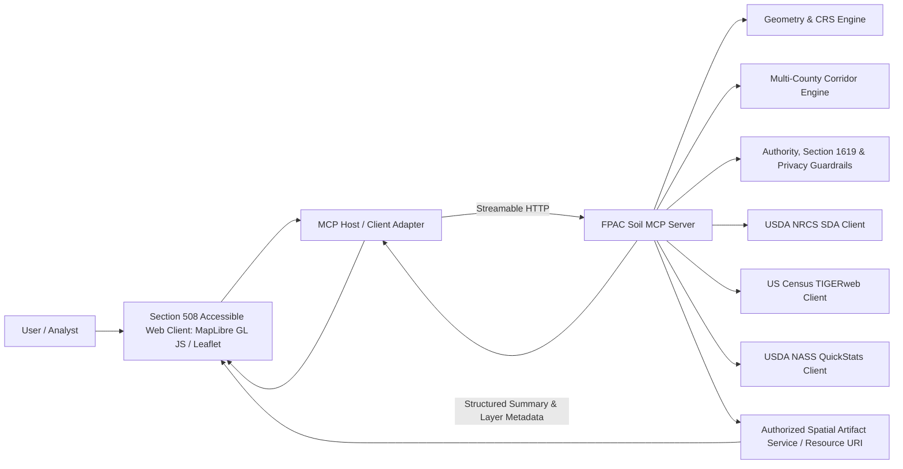

# Spatial Visualization and Client Experience Strategy

> **Status (2026-11-09):** the section 4 contract is implemented in part by [ADR 0017](../docs/decisions/0017-server-map-result-contract.md) (Accepted, [Plan 44](EXECUTION_PLAN_44.md)): an opt-in `map` block on the two analyze tools and `get_soil_polygons_by_geometry`, with additive `schema_version`, `data_mode` and `authority` fields. ADR 0017 maps each section 4 field to what the tools return; the full envelope restructure and offline testbeds remain open in `MASTER_PLAN.md` Phase 8.

## 1. Context and Purpose
This document specifies the architectural blueprint and delivery strategy for adding an interactive, open-source GIS visualization client and structured MCP response contract to the **FPAC Soil MCP Server**.

Building on the foundation completed in Phases 0–3 (geometry ingestion, geodesic/projected buffering, USDA Soil Data Access, Census TIGERweb urban screening, USDA NASS agricultural baselines, multi-county corridor partitioning, 7 CFR § 658.5(c) corridor scoring, Section 1619 privacy, and authority tagging), this strategy enables:
1. **Bi-directional user interaction**: Allowing users to sketch or upload AOI polygons and linear corridor alternatives on a map, inspect client-side geometry previews, and explicitly dispatch analysis requests to the MCP server.
2. **Structured, machine-readable spatial response contracts**: Enabling both text-only LLMs and map-enabled clients to consume analysis results, layer descriptors, and legends without parsing prose.
3. **Resilient hybrid demonstration architecture**: Seamless live query execution with explicit, non-silent fallback to verified local GeoPackage/DuckDB spatial fixtures (`demo_testbeds.gpkg`) for reliable hackathon and offline demonstrations.
4. **Accessible, non-presumptive visualization**: Presenting standardized demonstration symbology, tabular equivalents for all spatial layers, explicit data vintages, partial upstream failure states, and clear regulatory screening disclaimers.

---

## 2. Target Architecture

### 2.1 Prototype Architecture (Hackathon & Analyst Workbench)

> **Superseded for now (2026-10-24):** the Marimo prototype below is superseded by the agent-app map ([master plan Phase 8](MASTER_PLAN.md#phase-8-spatial-visualization--interactive-client-demo) and [Track A](MASTER_PLAN.md#track-a-agent-app); [Plan 37](EXECUTION_PLAN_37.md) D2). Sections 3-6 remain the contract the agent-app map follows.

```mermaid
flowchart TD
    subgraph UI ["Interactive Demo UI (Marimo + ipyleaflet)"]
        A[Interactive Map: Drawing Controls & Base Layers] -->|1. Draw AOI / Corridor Centerlines| B[Geometry Staging Buffer]
        C[Chat / Parameter Controls: Buffer Width, Alternative Names] -->|1b. Configure Parameters| B
        B -->|2. Explicit Click: 'Run Preliminary Screening'| D[Demo Client Orchestrator]
        M[Layer Switcher, Legend & Accessible Summary Table] -.-> A
    end

    subgraph Client ["MCP Client Adapter (stdio / Streamable HTTP)"]
        D -->|3. Invoke Tool: validate_aoi / screen_fppa_site / evaluate_corridor_alternatives| E[FastMCP Client Protocol Session]
    end

    subgraph Server ["FPAC Soil MCP Server (fpac_soil_mcp Core Engine)"]
        E --> F[Tool Router & Input Validation]
        F --> G[Geometry & Equal-Area CRS Engine (EPSG:6933)]
        G --> H{Execution Mode Router}
        
        H -->|Live Mode| I[SDAClient / TIGERwebClient / NASSClient]
        H -->|Explicit Fixture Mode| J[Local GeoPackage Snapshot: demo_testbeds.gpkg]
        
        I --> K[Corridor Partitioning, LE-SA & Reconciliation]
        J --> K
        K --> L[Structured JSON Envelope + Layer Descriptors + Bounded GeoJSON]
        L --> P[Authority & Privacy Redaction Engine]
    end

    P -->|4. Structured Result Envelope| E
    E -->|5a. Render Thematic Map Layers & Buffers| A
    E -->|5b. Populate Accessible Summary Table & Disclaimer| M
```

### 2.2 Production Architecture (Web Client & Enterprise Integration)



---

## 3. Division of Responsibilities

| Responsibility Area | MCP Server | Client (Notebook / Web App) |
| :--- | :--- | :--- |
| **Geometry Validation & CRS Transformation** | **Authoritative**: Validates topology, self-intersections, vertex limits, and transforms to EPSG:6933. | **Preview Only**: Displays preliminary drawing bounds and coordinates. |
| **Buffering & Acreage Calculations** | **Authoritative**: Computes projected equal-area buffers and reconciled acreages. | **Preview Only**: Client-side buffer previews are labeled as estimates. |
| **Multi-County Partitioning & Reconciliation** | **Authoritative**: Partitions segments and enforces exact sum reconciliation across counties. | **Display Only**: Renders segment breakdowns and highlights selected county segments. |
| **Regulatory Scoring (7 CFR § 658)** | **Authoritative**: Computes LE normalization and statutory CPA-106 corridor rules. | **Display Only**: Renders comparison matrices and objective metrics. |
| **Authority, Privacy & Redaction** | **Authoritative**: Enforces Section 1619 coordinate redaction and tags authority states. | **Display Only**: Visualizes explicit authority banners and audit metadata. |
| **Interaction & Map Controls** | *None* (Headless protocol service). | **Authoritative**: Geometry drawing tools, layer toggles, legends, and confirmation dialogues. |

---

## 4. Structured Visualization Response Contract

To allow text clients and map-capable clients to consume analysis results cleanly without parsing natural-language strings, all spatially-enabled tools return a structured response envelope adhering to the following schema:

```json
{
  "schema_version": "1.0",
  "analysis_id": "uuid-v4",
  "analysis_type": "corridor_comparison",
  "status": "completed",
  "data_mode": "live",
  "source_status": {
    "sda": "available",
    "tigerweb": "available",
    "nass": "available"
  },
  "authority": {
    "level": "machine_estimate",
    "label": "Preliminary Machine Estimate",
    "official_filing": false
  },
  "summary": {
    "alternatives_evaluated": 2,
    "lowest_modeled_impact_alternative": "alternative_b",
    "comparison_basis": "modeled farmland acreage and configured scoring rules"
  },
  "metrics": {
    "alternatives": [
      {
        "id": "alternative_a",
        "name": "Route A (Direct Cross-Country)",
        "direct_acres": 125.4,
        "indirect_acres": 22.1,
        "prime_farmland_acres": 112.8,
        "statewide_importance_acres": 14.2,
        "not_prime_acres": 20.5,
        "modeled_score": 184.2,
        "mandatory_alternatives_triggered": true
      },
      {
        "id": "alternative_b",
        "name": "Route B (Highway Co-location)",
        "direct_acres": 130.1,
        "indirect_acres": 15.0,
        "prime_farmland_acres": 18.4,
        "statewide_importance_acres": 12.0,
        "not_prime_acres": 114.7,
        "modeled_score": 112.5,
        "mandatory_alternatives_triggered": false
      }
    ]
  },
  "map": {
    "display_crs": "EPSG:4326",
    "bounds": [-93.75, 41.95, -93.45, 42.15],
    "layers": [
      {
        "id": "farmland_classes",
        "title": "Farmland Classification",
        "kind": "polygon",
        "delivery": "inline_geojson",
        "authority": "machine_estimate",
        "source": "USDA NRCS SDA",
        "data_vintage": "SSURGO 2024.1",
        "style_key": "farmland_class_code",
        "legend": [
          { "value": "prime", "label": "Prime Farmland", "color": "#2E7D32" },
          { "value": "statewide", "label": "Farmland of Statewide Importance", "color": "#F9A825" },
          { "value": "unique", "label": "Farmland of Unique Importance", "color": "#6A1B9A" },
          { "value": "local", "label": "Farmland of Local Importance", "color": "#0288D1" },
          { "value": "not_prime", "label": "Not Prime Farmland", "color": "#9E9E9E" },
          { "value": "unmapped", "label": "Unmapped / Water", "color": "#BDBDBD" }
        ],
        "feature_collection": {
          "type": "FeatureCollection",
          "features": []
        }
      }
    ]
  },
  "provenance": {
    "analysis_timestamp": "2026-09-28T09:00:00Z",
    "rule_version": "7-CFR-658.5-c-corridor-v1",
    "sources": [
      { "name": "USDA NRCS Soil Data Access", "endpoint": "https://sdmdataaccess.nrcs.usda.gov", "retrieved_at": "2026-09-28T09:00:00Z" },
      { "name": "US Census Bureau TIGERweb 2020", "layer": "Urban Areas (Layer 0)", "retrieved_at": "2026-09-28T09:00:00Z" }
    ],
    "calculation_crs": "EPSG:6933"
  },
  "privacy": {
    "coordinate_redaction": "none",
    "download_allowed": true
  },
  "warnings": [],
  "disclaimer": "PRELIMINARY SCREENING ESTIMATE ONLY. This tool does not issue binding agency rulings or replace official Form NRCS-CPA-106 / AD-1006 filings."
}
```

---

## 5. Demonstration Symbology & Accessibility Standard

Map visualizations implement clear multi-modal styling (color + pattern + textual code) to ensure Section 508 compliance and avoid relying solely on color:

| Classification | Color | Hex Code | Secondary Visual Cue | Description |
| :--- | :--- | :--- | :--- | :--- |
| **Prime Farmland** | Dark Green | `#2E7D32` | Label `[P]` / Solid fill | Prime agricultural soils under 7 CFR § 657.5. |
| **Statewide Importance** | Amber | `#F9A825` | Label `[S]` / Dense diagonal hatch | Soils of statewide agricultural significance. |
| **Unique Farmland** | Purple | `#6A1B9A` | Label `[U]` / Cross-hatch | Soils utilized for high-value specialty crops. |
| **Local Importance** | Light Blue | `#0288D1` | Label `[L]` / Dot stipple | Locally identified significant soils. |
| **Not Prime Farmland** | Muted Gray | `#9E9E9E` | Label `[NP]` / Transparent outline | Land not meeting farmland criteria. |
| **Urban Context** | Slate Blue | `#5C6BC0` | Dashed border / Semi-transparent | Census 2020 Urban Area boundaries. |
| **Alternative A Buffer** | Crimson | `#E53935` | Solid outline / Red buffer | Alternative route A footprint. |
| **Alternative B Buffer** | Cobalt | `#1E88E5` | Dashed outline / Blue buffer | Alternative route B footprint. |

---

## 6. Hybrid Data & Testbed Specifications

To guarantee dependable live demonstrations regardless of venue connectivity:
1. **Live-First Routing**: Queries live SDA, TIGERweb, and NASS endpoints with configurable timeouts and automatic retries.
2. **Explicit Fallback & Provenance**: When `data_mode = "fixture"`, responses carry clear provenance banners (`"data_mode": "fixture"`, `"fixture_id": "boone_ia_v1"`) so test data is never misrepresented as live authoritative data.
3. **Pre-packaged Testbeds**:
   - **Testbed 1 (Agricultural Core - Boone County, IA)**: Rich Mollisol associations (>85% Prime Farmland) intersecting the Ames urban fringe. Demonstrates parcel screening, urban exclusion checks, and CSR2 productivity integration.
   - **Testbed 2 (Infrastructure Corridor - Alternative Routing)**: Compares Route 1 (cutting across undisturbed prime cropland) with Route 2 (co-located along an interstate right-of-way). Demonstrates corridor buffering, county partitioning, and 7 CFR § 658.5(c) impact ranking.
